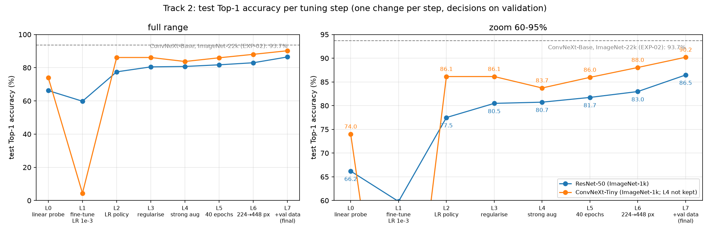

# CUB-200 Bird Species Classification: from scratch to 90 % with a tuning ladder

Fine-grained classification of **200 bird species** (Caltech-UCSD Birds 200, 4,829 training / 1,204 test images)
for COS30082 Applied Machine Learning, Assignment 1 (Swinburne University of Technology).

Instead of only fine-tuning a large pretrained model, the project improves CNNs **one justified change at a time**:

- **Track 1:** a CNN trained from scratch, from **4.9 %** to **58.6 %** test Top-1.
- **Track 2:** two ImageNet-1k CNNs, ResNet-50 and ConvNeXt-Tiny, climb the same transfer-learning ladder, from
  a linear probe to **86.5 %** and **90.2 %**.

Every decision is made on a held-out validation split; the test set is evaluated once at the end.

| | Link |
|---|---|
| Trained model (Hugging Face Hub) | https://huggingface.co/zwe-zwe/CUB-200 |
| Web demo | *(Streamlit Community Cloud link, to be added)* |
| Video walkthrough | *(YouTube link, to be added)* |

## Results

Test set (1,204 images), no test-time augmentation:

| Model | Pretraining | Params | Top-1 | Avg. per-class | Top-5 |
|---|---|---|---|---|---|
| VGG-style CNN with GAP head, from scratch (Track 1 best, S8) | none | 2.4 M | 58.64 % | 57.60 % | |
| ResNet-50, tuned (Track 2 final) | ImageNet-1k | 23.9 M | 86.46 % | 86.12 % | 96.76 % |
| **ConvNeXt-Tiny, tuned (Track 2 final, best model)** | ImageNet-1k | 28.0 M | **90.20 %** | **89.94 %** | **98.01 %** |
| *ConvNeXt-Base (reference ceiling, not tuned)* | *ImageNet-22k* | *87.8 M* | *93.69 %* | *93.55 %* | |

ConvNeXt-Tiny vs ResNet-50: McNemar's exact test p = 1.3 × 10⁻⁵ (75 vs 30 discordant test images).

### Track 2 ladder (test Top-1, %)

| Step | Change | ResNet-50 | ConvNeXt-Tiny |
|---|---|---|---|
| L0 | linear probe (frozen backbone) | 66.2 | 74.0 |
| L1 | full fine-tuning, single LR 1e-3 | 59.8 | 4.4 (catastrophic forgetting) |
| L2 | backbone LR 1e-4 / head 1e-3, warm-up + cosine | 77.5 | 86.1 |
| L3 | label smoothing 0.1, dropout 0.3, stochastic depth 0.1, weight decay 0.05 | 80.5 | 86.1 |
| L4 | strong augmentation (kept for ResNet, rejected for ConvNeXt on validation) | 80.7 | (83.7) |
| L5 | 40 epochs | 81.7 | 86.0 |
| L6 | progressive resizing 224 → 448 px | 83.0 | 88.0 |
| **L7** | **retrain on train + validation, test once** | **86.5** | **90.2** |
| L8 | architecture-specific (ResNet: SGD; ConvNeXt: layer-wise LR decay) | tie, not adopted | tie, not adopted |



The full story with every hyperparameter and the reason behind each step: **[TUNING_SUMMARY.md](experiments/TUNING_SUMMARY.md)**.
The raw evidence, one note per experiment: [experiments/](experiments/README.md).

## Repository structure

```
.
├── birdcls/                 Python package (all source code, commented)
│   ├── config.py            paths, global settings, experiment-config dataclasses, run naming
│   ├── data.py              annotations, species names, stratified split, augmentation presets, DataLoaders
│   ├── models.py            model builders (torchvision / timm / scratch), parameter groups, layer-decay levels
│   ├── scratch.py           CNNs trained from scratch (VGG-style variants, hand-written ResNet-18)
│   ├── augment.py           CutMix
│   ├── engine.py            training loop (phases, AMP, warm-up + cosine, early stopping), inference, TTA
│   ├── metrics.py           Top-1 accuracy, average per-class accuracy
│   ├── plots.py             report figures
│   ├── utils.py             seeding, device, logging, JSON
│   ├── train.py             CLI: train a model with one or more configs
│   ├── evaluate.py          CLI: evaluate runs on the test set, results table, error analysis
│   ├── export.py            CLI: export a run for the web apps (model.pt, optional ONNX)
│   └── report.py            CLI: generate run cards and comparison figures
├── configs/                 one YAML file per experiment configuration (scratch_*, tl_L0 ... tl_L8)
├── experiments/             experiment notes EXP-00 ... EXP-22, TUNING_SUMMARY.md, generated run cards
├── outputs/
│   ├── results.csv / .md    one row per run: train / val / test accuracy, gap, training time
│   ├── figures/             ladder and comparison figures
│   ├── error_analysis/      per-class accuracy, confusions, misclassified examples of the final models
│   └── runs/<model>__<config>/   config.yaml, history.json, train.log, curves.png (weights not in git)
├── streamlit_app/           Streamlit web app (deployed on Streamlit Community Cloud)
├── hf_space/                Gradio web app (local)
├── hf_static/               static in-browser app (ONNX Runtime Web), for a free Hugging Face Static Space
├── hf_model/                model card of the Hugging Face Hub repo
├── archive/                 original notebooks (first run)
├── requirements.txt / pyproject.toml / uv.lock
└── Progress.md              chronological experiment log
```

## Setup

**1. Python environment** (Python 3.12, a CUDA GPU for training; CPU is enough for the apps):

```bash
uv sync
```

or with pip:

```bash
pip install -r requirements.txt
```

**2. Dataset** (not included in this repo). Put the assignment files in the project root:

```
Train/        4,829 training images      (unzipped Train.zip)
Test/         1,204 test images          (unzipped Test.zip)
train.txt     "<image file> <label 0-199>" per line
test.txt
```

Species names are read from the file names (e.g. `Black_footed_Albatross_0004_2731401028.jpg`).

**3. Trained weights** (optional, to skip training): download the final ConvNeXt-Tiny from the Hub:

```bash
hf download zwe-zwe/CUB-200 model.pt --local-dir hf_space
```

## Usage

Run every command from the project root (prefix with `uv run` when using uv).

### Train

A model name plus one or more configs. Finished runs are skipped unless `--retrain`; `--smoke` runs a 1-minute
pipeline check; `--full-train` retrains on train + validation (no validation, final epoch kept).

Track 2, ConvNeXt-Tiny ladder and final model:

```bash
python -m birdcls.train --model convnext_tiny --config tl_L0_probe tl_L1_finetune tl_L2_discriminative tl_L3_regularise tl_L4_strongaug tl_L5_longer tl_L6_hires
```

```bash
python -m birdcls.train --model convnext_tiny --config tl_L6_hires --full-train
```

Track 2, ResNet-50 (strong augmentation kept from L4 on):

```bash
python -m birdcls.train --model resnet50.tv2_in1k --config tl_L0_probe tl_L1_finetune tl_L2_discriminative tl_L3_regularise tl_L4_strongaug tl_L5_longer_strongaug tl_L6_hires_strongaug
```

```bash
python -m birdcls.train --model resnet50.tv2_in1k --config tl_L6_hires_strongaug --full-train
```

Track 1 (from scratch), one model per step, for example the best recipe S6 and its full-train version S8:

```bash
python -m birdcls.train --model scratch_vgg_gap --config scratch_strongaug
```

```bash
python -m birdcls.train --model scratch_vgg_gap --config scratch_strongaug --full-train
```

| Step | Model | Config |
|---|---|---|
| S0 | `scratch_vgg` | `scratch_base` |
| S1 | `scratch_vgg_bn` | `scratch_base` |
| S2 | `scratch_vgg_bn` | `scratch_aug` |
| S3 | `scratch_vgg_gap` | `scratch_aug` |
| S4 / S5 / S6 | `scratch_vgg_gap` | `scratch_cosine` / `scratch_wd` / `scratch_strongaug` |
| S7 | `scratch_resnet18` | `scratch_strongaug` |
| S8 | `scratch_vgg_gap` | `scratch_strongaug --full-train` |

Training times on an RTX 4060 Laptop GPU (8 GB): ladder steps 3 to 17 minutes, final models about 20 minutes,
scratch runs up to 28 minutes.

### Evaluate

```bash
python -m birdcls.evaluate
```

This evaluates every finished run (with and without flip TTA) and writes `outputs/results.csv`. Use `--runs NAME ...`
to evaluate specific runs; rows of other runs are kept. For a detailed error analysis of one run
(written to `outputs/error_analysis/<run>/`):

```bash
python -m birdcls.evaluate --analyse convnext_tiny__tl_L6_hires__full
```

### Export and run the web apps

```bash
python -m birdcls.export --run convnext_tiny__tl_L6_hires__full --onnx
```

This writes `hf_space/model.pt` and `hf_static/model.onnx` and checks the ONNX model against PyTorch on the whole
test set.

Streamlit app (http://localhost:8501). It uses `hf_space/model.pt`, or downloads the model from the Hub:

```bash
cd streamlit_app && streamlit run app.py
```

Gradio app (http://127.0.0.1:7860):

```bash
cd hf_space && python app.py
```

Static in-browser app (http://localhost:8000):

```bash
python -m http.server 8000 --directory hf_static
```

### Run cards and figures

```bash
python -m birdcls.report
```

## Configuration options

Each `configs/*.yaml` is an `ExperimentConfig` (`birdcls/config.py`): one or more **phases**, each with
`img_size`, `batch_size`, `epochs`, `lr_backbone`, `lr_head` and `warmup_epochs`, plus:

| Option | Values | Meaning |
|---|---|---|
| `optimizer`, `momentum` | `adamw` / `sgd` | AdamW (decoupled weight decay) or SGD with momentum |
| `lr_schedule` | `cosine` / `constant` | per-phase linear warm-up then cosine decay, or constant |
| `augment` | `none` / `basic` / `strong` | augmentation preset (`birdcls/data.py`) |
| `label_smoothing`, `dropout`, `drop_path`, `weight_decay` | floats | regularisation |
| `cutmix_prob` | 0 to 1 | probability that a batch is CutMix-ed |
| `freeze_backbone` | bool | linear probe: train only the new head |
| `layer_decay` | (0, 1] | layer-wise LR decay (depth levels in `birdcls/models.py`); 1 = off |
| `patience` | int | early stopping on validation accuracy |

Models: `scratch_*` (from scratch), torchvision names (e.g. `convnext_tiny`) or timm names containing a dot
(e.g. `resnet50.tv2_in1k`, `convnext_base.fb_in22k`). Each model uses the input normalisation of its pretraining.

## Evaluation protocol

- `train.txt` is split into **80 % train / 20 % validation**, stratified by class, seed 42.
- Every choice (early stopping, checkpoint, keeping or reverting a ladder step, TTA on / off) is made on
  **validation** accuracy, with McNemar's exact test for small differences. The test set is never used for a decision.
- The final recipes are retrained on train + validation for the same number of epochs, and the test set is
  evaluated **once**.
- Runs are reproducible: re-running a configuration gave identical predictions.

## Notes

- **One GPU job at a time.** `train.py` refuses to start when less than 70 % of GPU memory is free (`--force`
  overrides), and a `train.lock` file stops two processes from training the same run.
- Batches that do not fit in GPU memory are split into micro-batches with gradient accumulation (`MAX_BATCH` in
  `birdcls/config.py`). This is only equivalent for LayerNorm / GroupNorm models, so accumulation is refused for
  BatchNorm models.
- Model weights are not stored in git (GitHub's 100 MB file limit). The final model is on the Hugging Face Hub;
  other runs can be retrained from their configs.

## Acknowledgements

Dataset: Caltech-UCSD Birds 200 (Welinder et al., 2010), as provided for the assignment. Pretrained weights:
torchvision (ConvNeXt-Tiny, Liu et al., 2022) and timm (ResNet-50 `tv2_in1k`, He et al., 2016).
