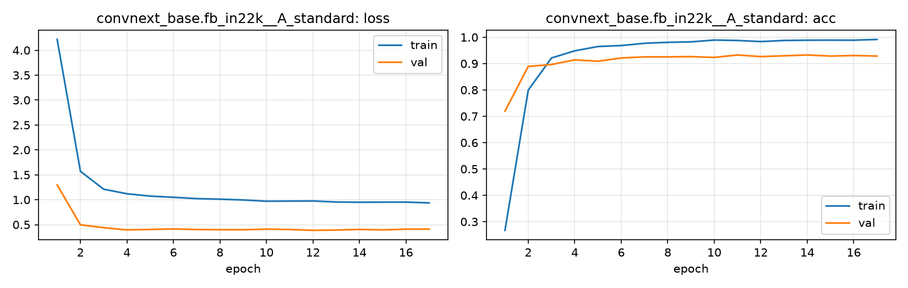

# Run card: `convnext_base.fb_in22k__A_standard`

_Generated by `python -m birdcls.report` from the files in `outputs/runs/convnext_base.fb_in22k__A_standard/`. Do not edit by hand._

## Summary

| Item | Value |
|---|---|
| Model | `convnext_base.fb_in22k` (87.77 M parameters) |
| Configuration | `A_standard`: Standard fine-tune, 224 px throughout, no CutMix |
| Finished | 2026-10-06 20:03 |
| Training time | 10.7 min, early stopping after 17/20 epochs |
| Best epoch (by val accuracy) | 11 at 224 px, val Top-1 0.9327 |
| Input normalisation | mean (0.485, 0.456, 0.406), std (0.229, 0.224, 0.225) |
| Command | `python -m birdcls.train --model convnext_base.fb_in22k --config A_standard` |

## Results (from `outputs/results.csv`)

| Variant | Train acc (clean) | Val Top-1 | Gap (train - val) | **Test Top-1** | **Test avg/class** |
|---|---|---|---|---|---|
| no TTA | 0.9992 | 0.9317 | 0.0675 | 0.9319 | 0.9296 |
| with TTA (flip averaging) | 0.9992 | 0.9337 | 0.0655 | 0.9302 | 0.9288 |

Train acc is measured on the training images with eval preprocessing (no augmentation).

## Configuration

Source: snapshot saved with the run (`config.yaml`).

| Setting | Value |
|---|---|
| `cutmix_prob` | 0.0 |
| `label_smoothing` | 0.1 |
| `weight_decay` | 0.05 |
| `dropout` | 0.3 |
| `drop_path` | 0.1 |
| `patience` | 6 |

| Phase | Image size | Batch | Epochs | LR backbone | LR head | Warm-up epochs |
|---|---|---|---|---|---|---|
| 1 | 224 | 32 | 20 | 0.0001 | 0.001 | 1 |

## Training curves

## Per-epoch log

| Epoch | Phase | Size | Train loss | Train acc | Val loss | Val acc | LR (backbone, end of epoch) |
|---|---|---|---|---|---|---|---|
| 1 | 1 | 224 | 4.216 | 0.267 | 1.297 | 0.7195 | 1.00e-04 |
| 2 | 1 | 224 | 1.571 | 0.799 | 0.497 | 0.8892 | 9.93e-05 |
| 3 | 1 | 224 | 1.212 | 0.921 | 0.440 | 0.8965 | 9.73e-05 |
| 4 | 1 | 224 | 1.120 | 0.948 | 0.394 | 0.9141 | 9.40e-05 |
| 5 | 1 | 224 | 1.073 | 0.965 | 0.404 | 0.9089 | 8.95e-05 |
| 6 | 1 | 224 | 1.049 | 0.968 | 0.414 | 0.9213 | 8.39e-05 |
| 7 | 1 | 224 | 1.023 | 0.977 | 0.403 | 0.9255 | 7.73e-05 |
| 8 | 1 | 224 | 1.011 | 0.981 | 0.398 | 0.9255 | 7.01e-05 |
| 9 | 1 | 224 | 0.995 | 0.983 | 0.397 | 0.9265 | 6.23e-05 |
| 10 | 1 | 224 | 0.970 | 0.989 | 0.410 | 0.9234 | 5.41e-05 |
| 11 **(best)** | 1 | 224 | 0.972 | 0.988 | 0.403 | 0.9327 | 4.59e-05 |
| 12 | 1 | 224 | 0.975 | 0.984 | 0.386 | 0.9265 | 3.77e-05 |
| 13 | 1 | 224 | 0.954 | 0.988 | 0.392 | 0.9296 | 2.99e-05 |
| 14 | 1 | 224 | 0.950 | 0.989 | 0.404 | 0.9327 | 2.27e-05 |
| 15 | 1 | 224 | 0.952 | 0.989 | 0.395 | 0.9286 | 1.61e-05 |
| 16 | 1 | 224 | 0.952 | 0.989 | 0.409 | 0.9306 | 1.05e-05 |
| 17 | 1 | 224 | 0.937 | 0.992 | 0.410 | 0.9286 | 6.03e-06 |

With CutMix, train loss/acc are computed on mixed images (soft accuracy), so they run lower than the clean train accuracy in the results table.

## Files

`outputs/runs/convnext_base.fb_in22k__A_standard/`: `best.pt` (best checkpoint), `history.json`, `train.log`, `curves.png`, `config.yaml`
