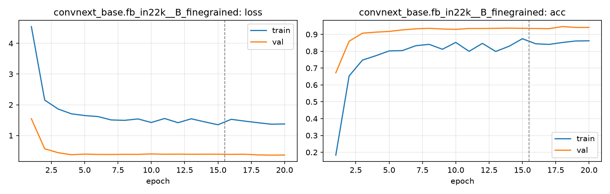

# Run card: `convnext_base.fb_in22k__B_finegrained`

_Generated by `python -m birdcls.report` from the files in `outputs/runs/convnext_base.fb_in22k__B_finegrained/`. Do not edit by hand._

## Summary

| Item | Value |
|---|---|
| Model | `convnext_base.fb_in22k` (87.77 M parameters) |
| Configuration | `B_finegrained`: Progressive resizing 224 -> 448 px + CutMix |
| Finished | 2026-10-06 20:27 |
| Training time | 19.6 min, completed all epochs |
| Best epoch (by val accuracy) | 18 at 448 px, val Top-1 0.9462 |
| Input normalisation | mean (0.485, 0.456, 0.406), std (0.229, 0.224, 0.225) |
| Command | `python -m birdcls.train --model convnext_base.fb_in22k --config B_finegrained` |

## Results (from `outputs/results.csv`)

| Variant | Train acc (clean) | Val Top-1 | Gap (train - val) | **Test Top-1** | **Test avg/class** |
|---|---|---|---|---|---|
| no TTA | 0.9990 | 0.9462 | 0.0528 | 0.9369 | 0.9355 |
| with TTA (flip averaging) | 0.9990 | 0.9441 | 0.0549 | 0.9360 | 0.9347 |

Train acc is measured on the training images with eval preprocessing (no augmentation).

## Configuration

Source: snapshot saved with the run (`config.yaml`).

| Setting | Value |
|---|---|
| `cutmix_prob` | 0.5 |
| `label_smoothing` | 0.1 |
| `weight_decay` | 0.05 |
| `dropout` | 0.3 |
| `drop_path` | 0.1 |
| `patience` | 6 |

| Phase | Image size | Batch | Epochs | LR backbone | LR head | Warm-up epochs |
|---|---|---|---|---|---|---|
| 1 | 224 | 32 | 15 | 0.0001 | 0.001 | 1 |
| 2 | 448 | 16 | 5 | 2e-05 | 0.0002 | 0 |

## Training curves

## Per-epoch log

| Epoch | Phase | Size | Train loss | Train acc | Val loss | Val acc | LR (backbone, end of epoch) |
|---|---|---|---|---|---|---|---|
| 1 | 1 | 224 | 4.547 | 0.183 | 1.546 | 0.6718 | 1.00e-04 |
| 2 | 1 | 224 | 2.154 | 0.653 | 0.568 | 0.8592 | 9.87e-05 |
| 3 | 1 | 224 | 1.864 | 0.747 | 0.441 | 0.9068 | 9.50e-05 |
| 4 | 1 | 224 | 1.706 | 0.773 | 0.374 | 0.9130 | 8.91e-05 |
| 5 | 1 | 224 | 1.650 | 0.802 | 0.394 | 0.9172 | 8.12e-05 |
| 6 | 1 | 224 | 1.616 | 0.804 | 0.383 | 0.9265 | 7.17e-05 |
| 7 | 1 | 224 | 1.506 | 0.833 | 0.382 | 0.9327 | 6.11e-05 |
| 8 | 1 | 224 | 1.494 | 0.841 | 0.387 | 0.9358 | 5.00e-05 |
| 9 | 1 | 224 | 1.540 | 0.811 | 0.386 | 0.9317 | 3.89e-05 |
| 10 | 1 | 224 | 1.424 | 0.852 | 0.400 | 0.9296 | 2.83e-05 |
| 11 | 1 | 224 | 1.554 | 0.799 | 0.390 | 0.9348 | 1.88e-05 |
| 12 | 1 | 224 | 1.417 | 0.846 | 0.393 | 0.9348 | 1.09e-05 |
| 13 | 1 | 224 | 1.544 | 0.798 | 0.389 | 0.9358 | 4.95e-06 |
| 14 | 1 | 224 | 1.444 | 0.829 | 0.391 | 0.9369 | 1.25e-06 |
| 15 | 1 | 224 | 1.350 | 0.874 | 0.391 | 0.9358 | 0.00e+00 |
| 16 | 2 | 448 | 1.527 | 0.844 | 0.387 | 0.9348 | 1.81e-05 |
| 17 | 2 | 448 | 1.469 | 0.840 | 0.390 | 0.9337 | 1.31e-05 |
| 18 **(best)** | 2 | 448 | 1.417 | 0.852 | 0.368 | 0.9462 | 6.91e-06 |
| 19 | 2 | 448 | 1.368 | 0.861 | 0.360 | 0.9410 | 1.91e-06 |
| 20 | 2 | 448 | 1.375 | 0.862 | 0.364 | 0.9410 | 0.00e+00 |

With CutMix, train loss/acc are computed on mixed images (soft accuracy), so they run lower than the clean train accuracy in the results table.

## Files

`outputs/runs/convnext_base.fb_in22k__B_finegrained/`: `best.pt` (best checkpoint), `history.json`, `train.log`, `curves.png`, `config.yaml`
