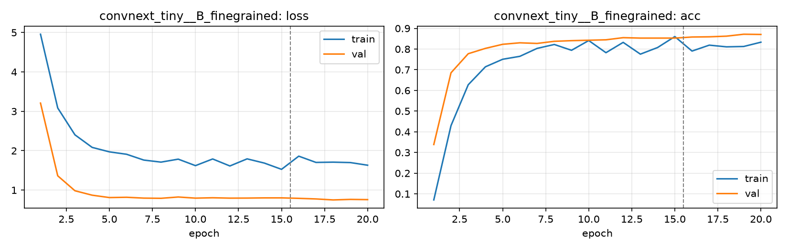

# Run card: `convnext_tiny__B_finegrained`

_Generated by `python -m birdcls.report` from the files in `outputs/runs/convnext_tiny__B_finegrained/`. Do not edit by hand._

## Summary

| Item | Value |
|---|---|
| Model | `convnext_tiny` (27.97 M parameters) |
| Configuration | `B_finegrained`: Progressive resizing 224 -> 448 px + CutMix |
| Finished | 2026-10-06 19:50 (file date of the migration; trained earlier the same day in the notebook) |
| Training time | 10.2 min, completed all epochs |
| Best epoch (by val accuracy) | 19 at 448 px, val Top-1 0.8716 |
| Input normalisation | mean (0.485, 0.456, 0.406), std (0.229, 0.224, 0.225) |
| Command | original notebook, `archive/notebook_convnext_tiny_run.ipynb` (same training logic as `birdcls`) |

## Results (from `outputs/results.csv`)

| Variant | Train acc (clean) | Val Top-1 | Gap (train - val) | **Test Top-1** | **Test avg/class** |
|---|---|---|---|---|---|
| no TTA | 0.9984 | 0.8716 | 0.1268 | 0.8663 | 0.8639 |
| with TTA (flip averaging) | 0.9984 | 0.8644 | 0.1341 | 0.8704 | 0.8686 |

Train acc is measured on the training images with eval preprocessing (no augmentation).

## Configuration

Source: no snapshot (trained with the original notebook); values from `configs/B_finegrained.yaml`, which matches the notebook settings.

| Setting | Value |
|---|---|
| `cutmix_prob` | 0.5 |
| `label_smoothing` | 0.1 |
| `weight_decay` | 0.05 |
| `dropout` | 0.3 |
| `drop_path` | 0.1 |
| `patience` | 6 |
| `optimizer` | adamw |
| `momentum` | 0.9 |
| `lr_schedule` | cosine |
| `augment` | basic |
| `freeze_backbone` | False |
| `layer_decay` | 1.0 |

| Phase | Image size | Batch | Epochs | LR backbone | LR head | Warm-up epochs |
|---|---|---|---|---|---|---|
| 1 | 224 | 32 | 15 | 0.0001 | 0.001 | 1 |
| 2 | 448 | 16 | 5 | 2e-05 | 0.0002 | 0 |

## Training curves

## Per-epoch log

| Epoch | Phase | Size | Train loss | Train acc | Val loss | Val acc | LR (backbone, end of epoch) |
|---|---|---|---|---|---|---|---|
| 1 | 1 | 224 | 4.957 | 0.071 | 3.209 | 0.3385 | n/a |
| 2 | 1 | 224 | 3.084 | 0.430 | 1.363 | 0.6853 | n/a |
| 3 | 1 | 224 | 2.403 | 0.627 | 0.983 | 0.7774 | n/a |
| 4 | 1 | 224 | 2.084 | 0.714 | 0.871 | 0.8033 | n/a |
| 5 | 1 | 224 | 1.971 | 0.751 | 0.811 | 0.8230 | n/a |
| 6 | 1 | 224 | 1.910 | 0.765 | 0.818 | 0.8302 | n/a |
| 7 | 1 | 224 | 1.762 | 0.803 | 0.797 | 0.8271 | n/a |
| 8 | 1 | 224 | 1.710 | 0.822 | 0.792 | 0.8375 | n/a |
| 9 | 1 | 224 | 1.786 | 0.794 | 0.825 | 0.8406 | n/a |
| 10 | 1 | 224 | 1.621 | 0.841 | 0.796 | 0.8427 | n/a |
| 11 | 1 | 224 | 1.790 | 0.782 | 0.805 | 0.8447 | n/a |
| 12 | 1 | 224 | 1.613 | 0.832 | 0.796 | 0.8551 | n/a |
| 13 | 1 | 224 | 1.793 | 0.775 | 0.797 | 0.8530 | n/a |
| 14 | 1 | 224 | 1.686 | 0.807 | 0.802 | 0.8530 | n/a |
| 15 | 1 | 224 | 1.527 | 0.860 | 0.803 | 0.8530 | n/a |
| 16 | 2 | 448 | 1.862 | 0.790 | 0.791 | 0.8582 | n/a |
| 17 | 2 | 448 | 1.703 | 0.819 | 0.776 | 0.8592 | n/a |
| 18 | 2 | 448 | 1.709 | 0.811 | 0.751 | 0.8623 | n/a |
| 19 **(best)** | 2 | 448 | 1.699 | 0.812 | 0.764 | 0.8716 | n/a |
| 20 | 2 | 448 | 1.632 | 0.833 | 0.758 | 0.8706 | n/a |

With CutMix, train loss/acc are computed on mixed images (soft accuracy), so they run lower than the clean train accuracy in the results table.

## Files

`outputs/runs/convnext_tiny__B_finegrained/`: `best.pt` (best checkpoint), `history.json`, `train.log`, `curves.png`
