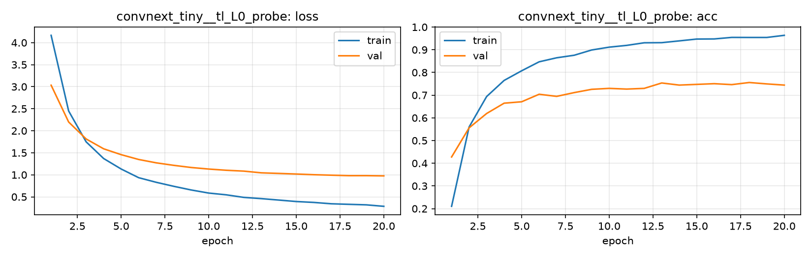

# Run card: `convnext_tiny__tl_L0_probe`

_Generated by `python -m birdcls.report` from the files in `outputs/runs/convnext_tiny__tl_L0_probe/`. Do not edit by hand._

## Summary

| Item | Value |
|---|---|
| Model | `convnext_tiny` (27.97 M parameters) |
| Configuration | `tl_L0_probe`: L0 linear probe: frozen pretrained backbone, train only a new linear head (AdamW 1e-3 constant, 20 epochs) |
| Finished | 2026-10-17 13:05 |
| Training time | 2.7 min, completed all epochs |
| Best epoch (by val accuracy) | 18 at 224 px, val Top-1 0.7557 |
| Input normalisation | mean (0.485, 0.456, 0.406), std (0.229, 0.224, 0.225) |
| Command | `python -m birdcls.train --model convnext_tiny --config tl_L0_probe` |

## Results (from `outputs/results.csv`)

| Variant | Train acc (clean) | Val Top-1 | Gap (train - val) | **Test Top-1** | **Test avg/class** |
|---|---|---|---|---|---|
| no TTA | 0.9871 | 0.7557 | 0.2314 | 0.7400 | 0.7357 |
| with TTA (flip averaging) | 0.9871 | 0.7567 | 0.2303 | 0.7450 | 0.7409 |

Train acc is measured on the training images with eval preprocessing (no augmentation).

## Configuration

Source: snapshot saved with the run (`config.yaml`).

| Setting | Value |
|---|---|
| `full_train` | False |
| `cutmix_prob` | 0.0 |
| `label_smoothing` | 0.0 |
| `weight_decay` | 0.01 |
| `dropout` | 0.0 |
| `drop_path` | 0.0 |
| `patience` | 6 |
| `optimizer` | adamw |
| `momentum` | 0.9 |
| `lr_schedule` | constant |
| `augment` | basic |
| `freeze_backbone` | True |

| Phase | Image size | Batch | Epochs | LR backbone | LR head | Warm-up epochs |
|---|---|---|---|---|---|---|
| 1 | 224 | 32 | 20 | 0.001 | 0.001 | 0 |

## Training curves

## Per-epoch log

| Epoch | Phase | Size | Train loss | Train acc | Val loss | Val acc | LR (backbone, end of epoch) |
|---|---|---|---|---|---|---|---|
| 1 | 1 | 224 | 4.166 | 0.210 | 3.034 | 0.4275 | 1.00e-03 |
| 2 | 1 | 224 | 2.449 | 0.560 | 2.199 | 0.5559 | 1.00e-03 |
| 3 | 1 | 224 | 1.748 | 0.694 | 1.814 | 0.6190 | 1.00e-03 |
| 4 | 1 | 224 | 1.370 | 0.765 | 1.590 | 0.6646 | 1.00e-03 |
| 5 | 1 | 224 | 1.131 | 0.807 | 1.457 | 0.6708 | 1.00e-03 |
| 6 | 1 | 224 | 0.934 | 0.847 | 1.348 | 0.7039 | 1.00e-03 |
| 7 | 1 | 224 | 0.830 | 0.865 | 1.272 | 0.6946 | 1.00e-03 |
| 8 | 1 | 224 | 0.739 | 0.876 | 1.215 | 0.7112 | 1.00e-03 |
| 9 | 1 | 224 | 0.655 | 0.899 | 1.166 | 0.7257 | 1.00e-03 |
| 10 | 1 | 224 | 0.586 | 0.911 | 1.131 | 0.7298 | 1.00e-03 |
| 11 | 1 | 224 | 0.546 | 0.919 | 1.103 | 0.7267 | 1.00e-03 |
| 12 | 1 | 224 | 0.487 | 0.931 | 1.084 | 0.7298 | 1.00e-03 |
| 13 | 1 | 224 | 0.459 | 0.931 | 1.045 | 0.7536 | 1.00e-03 |
| 14 | 1 | 224 | 0.427 | 0.939 | 1.031 | 0.7443 | 1.00e-03 |
| 15 | 1 | 224 | 0.393 | 0.947 | 1.018 | 0.7474 | 1.00e-03 |
| 16 | 1 | 224 | 0.373 | 0.948 | 1.002 | 0.7505 | 1.00e-03 |
| 17 | 1 | 224 | 0.342 | 0.954 | 0.991 | 0.7464 | 1.00e-03 |
| 18 **(best)** | 1 | 224 | 0.330 | 0.954 | 0.980 | 0.7557 | 1.00e-03 |
| 19 | 1 | 224 | 0.318 | 0.954 | 0.981 | 0.7495 | 1.00e-03 |
| 20 | 1 | 224 | 0.284 | 0.964 | 0.975 | 0.7443 | 1.00e-03 |

With CutMix, train loss/acc are computed on mixed images (soft accuracy), so they run lower than the clean train accuracy in the results table.

## Files

`outputs/runs/convnext_tiny__tl_L0_probe/`: `best.pt` (best checkpoint), `history.json`, `train.log`, `curves.png`, `config.yaml`
