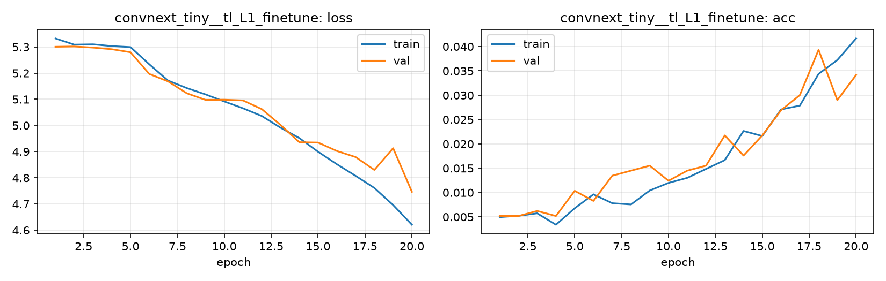

# Run card: `convnext_tiny__tl_L1_finetune`

_Generated by `python -m birdcls.report` from the files in `outputs/runs/convnext_tiny__tl_L1_finetune/`. Do not edit by hand._

## Summary

| Item | Value |
|---|---|
| Model | `convnext_tiny` (27.97 M parameters) |
| Configuration | `tl_L1_finetune`: L1 full fine-tuning: unfreeze the backbone, same single LR as L0 (AdamW 1e-3 constant for all layers, 20 epochs) |
| Finished | 2026-10-17 13:18 |
| Training time | 4.9 min, completed all epochs |
| Best epoch (by val accuracy) | 18 at 224 px, val Top-1 0.0393 |
| Input normalisation | mean (0.485, 0.456, 0.406), std (0.229, 0.224, 0.225) |
| Command | `python -m birdcls.train --model convnext_tiny --config tl_L1_finetune` |

## Results (from `outputs/results.csv`)

| Variant | Train acc (clean) | Val Top-1 | Gap (train - val) | **Test Top-1** | **Test avg/class** |
|---|---|---|---|---|---|
| no TTA | 0.0593 | 0.0393 | 0.0199 | 0.0440 | 0.0397 |
| with TTA (flip averaging) | 0.0593 | 0.0383 | 0.0210 | 0.0449 | 0.0405 |

Train acc is measured on the training images with eval preprocessing (no augmentation).

## Configuration

Source: snapshot saved with the run (`config.yaml`).

| Setting | Value |
|---|---|
| `full_train` | False |
| `cutmix_prob` | 0.0 |
| `label_smoothing` | 0.0 |
| `weight_decay` | 0.01 |
| `dropout` | 0.0 |
| `drop_path` | 0.0 |
| `patience` | 6 |
| `optimizer` | adamw |
| `momentum` | 0.9 |
| `lr_schedule` | constant |
| `augment` | basic |
| `freeze_backbone` | False |

| Phase | Image size | Batch | Epochs | LR backbone | LR head | Warm-up epochs |
|---|---|---|---|---|---|---|
| 1 | 224 | 32 | 20 | 0.001 | 0.001 | 0 |

## Training curves

## Per-epoch log

| Epoch | Phase | Size | Train loss | Train acc | Val loss | Val acc | LR (backbone, end of epoch) |
|---|---|---|---|---|---|---|---|
| 1 | 1 | 224 | 5.332 | 0.005 | 5.301 | 0.0052 | 1.00e-03 |
| 2 | 1 | 224 | 5.309 | 0.005 | 5.302 | 0.0052 | 1.00e-03 |
| 3 | 1 | 224 | 5.310 | 0.006 | 5.297 | 0.0062 | 1.00e-03 |
| 4 | 1 | 224 | 5.303 | 0.003 | 5.291 | 0.0052 | 1.00e-03 |
| 5 | 1 | 224 | 5.299 | 0.007 | 5.280 | 0.0104 | 1.00e-03 |
| 6 | 1 | 224 | 5.234 | 0.010 | 5.197 | 0.0083 | 1.00e-03 |
| 7 | 1 | 224 | 5.171 | 0.008 | 5.168 | 0.0135 | 1.00e-03 |
| 8 | 1 | 224 | 5.143 | 0.008 | 5.123 | 0.0145 | 1.00e-03 |
| 9 | 1 | 224 | 5.119 | 0.010 | 5.098 | 0.0155 | 1.00e-03 |
| 10 | 1 | 224 | 5.092 | 0.012 | 5.098 | 0.0124 | 1.00e-03 |
| 11 | 1 | 224 | 5.066 | 0.013 | 5.096 | 0.0145 | 1.00e-03 |
| 12 | 1 | 224 | 5.036 | 0.015 | 5.062 | 0.0155 | 1.00e-03 |
| 13 | 1 | 224 | 4.991 | 0.017 | 5.002 | 0.0217 | 1.00e-03 |
| 14 | 1 | 224 | 4.952 | 0.023 | 4.936 | 0.0176 | 1.00e-03 |
| 15 | 1 | 224 | 4.900 | 0.022 | 4.935 | 0.0217 | 1.00e-03 |
| 16 | 1 | 224 | 4.852 | 0.027 | 4.903 | 0.0269 | 1.00e-03 |
| 17 | 1 | 224 | 4.807 | 0.028 | 4.879 | 0.0300 | 1.00e-03 |
| 18 **(best)** | 1 | 224 | 4.761 | 0.034 | 4.830 | 0.0393 | 1.00e-03 |
| 19 | 1 | 224 | 4.696 | 0.037 | 4.913 | 0.0290 | 1.00e-03 |
| 20 | 1 | 224 | 4.621 | 0.042 | 4.747 | 0.0342 | 1.00e-03 |

With CutMix, train loss/acc are computed on mixed images (soft accuracy), so they run lower than the clean train accuracy in the results table.

## Files

`outputs/runs/convnext_tiny__tl_L1_finetune/`: `best.pt` (best checkpoint), `history.json`, `train.log`, `curves.png`, `config.yaml`
