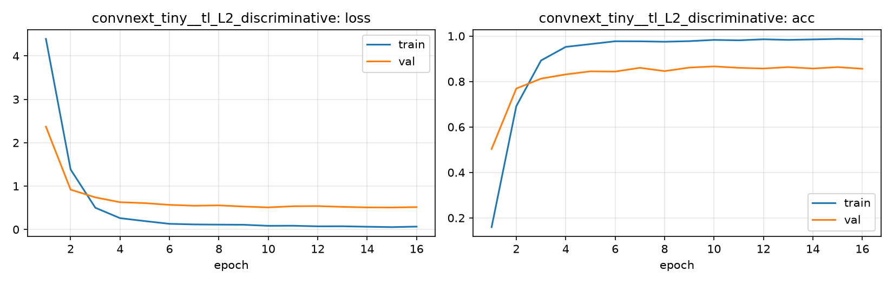

# Run card: `convnext_tiny__tl_L2_discriminative`

_Generated by `python -m birdcls.report` from the files in `outputs/runs/convnext_tiny__tl_L2_discriminative/`. Do not edit by hand._

## Summary

| Item | Value |
|---|---|
| Model | `convnext_tiny` (27.97 M parameters) |
| Configuration | `tl_L2_discriminative`: L2 LR policy: backbone 1e-4 / head 1e-3 + 1-epoch warm-up + cosine (AdamW, 20 epochs) |
| Finished | 2026-10-17 13:30 |
| Training time | 3.9 min, early stopping after 16/20 epochs |
| Best epoch (by val accuracy) | 10 at 224 px, val Top-1 0.8665 |
| Input normalisation | mean (0.485, 0.456, 0.406), std (0.229, 0.224, 0.225) |
| Command | `python -m birdcls.train --model convnext_tiny --config tl_L2_discriminative` |

## Results (from `outputs/results.csv`)

| Variant | Train acc (clean) | Val Top-1 | Gap (train - val) | **Test Top-1** | **Test avg/class** |
|---|---|---|---|---|---|
| no TTA | 0.9987 | 0.8665 | 0.1322 | 0.8613 | 0.8587 |
| with TTA (flip averaging) | 0.9987 | 0.8654 | 0.1333 | 0.8580 | 0.8554 |

Train acc is measured on the training images with eval preprocessing (no augmentation).

## Configuration

Source: snapshot saved with the run (`config.yaml`).

| Setting | Value |
|---|---|
| `full_train` | False |
| `cutmix_prob` | 0.0 |
| `label_smoothing` | 0.0 |
| `weight_decay` | 0.01 |
| `dropout` | 0.0 |
| `drop_path` | 0.0 |
| `patience` | 6 |
| `optimizer` | adamw |
| `momentum` | 0.9 |
| `lr_schedule` | cosine |
| `augment` | basic |
| `freeze_backbone` | False |

| Phase | Image size | Batch | Epochs | LR backbone | LR head | Warm-up epochs |
|---|---|---|---|---|---|---|
| 1 | 224 | 32 | 20 | 0.0001 | 0.001 | 1 |

## Training curves

## Per-epoch log

| Epoch | Phase | Size | Train loss | Train acc | Val loss | Val acc | LR (backbone, end of epoch) |
|---|---|---|---|---|---|---|---|
| 1 | 1 | 224 | 4.393 | 0.159 | 2.370 | 0.5031 | 1.00e-04 |
| 2 | 1 | 224 | 1.382 | 0.692 | 0.918 | 0.7692 | 9.93e-05 |
| 3 | 1 | 224 | 0.500 | 0.892 | 0.739 | 0.8126 | 9.73e-05 |
| 4 | 1 | 224 | 0.260 | 0.952 | 0.628 | 0.8313 | 9.40e-05 |
| 5 | 1 | 224 | 0.193 | 0.965 | 0.607 | 0.8447 | 8.95e-05 |
| 6 | 1 | 224 | 0.129 | 0.977 | 0.567 | 0.8437 | 8.39e-05 |
| 7 | 1 | 224 | 0.115 | 0.977 | 0.547 | 0.8602 | 7.73e-05 |
| 8 | 1 | 224 | 0.111 | 0.975 | 0.555 | 0.8458 | 7.01e-05 |
| 9 | 1 | 224 | 0.108 | 0.978 | 0.528 | 0.8613 | 6.23e-05 |
| 10 **(best)** | 1 | 224 | 0.084 | 0.983 | 0.508 | 0.8665 | 5.41e-05 |
| 11 | 1 | 224 | 0.086 | 0.981 | 0.535 | 0.8602 | 4.59e-05 |
| 12 | 1 | 224 | 0.072 | 0.986 | 0.538 | 0.8571 | 3.77e-05 |
| 13 | 1 | 224 | 0.073 | 0.983 | 0.521 | 0.8634 | 2.99e-05 |
| 14 | 1 | 224 | 0.062 | 0.985 | 0.508 | 0.8571 | 2.27e-05 |
| 15 | 1 | 224 | 0.053 | 0.988 | 0.506 | 0.8634 | 1.61e-05 |
| 16 | 1 | 224 | 0.065 | 0.986 | 0.514 | 0.8561 | 1.05e-05 |

With CutMix, train loss/acc are computed on mixed images (soft accuracy), so they run lower than the clean train accuracy in the results table.

## Files

`outputs/runs/convnext_tiny__tl_L2_discriminative/`: `best.pt` (best checkpoint), `history.json`, `train.log`, `curves.png`, `config.yaml`
