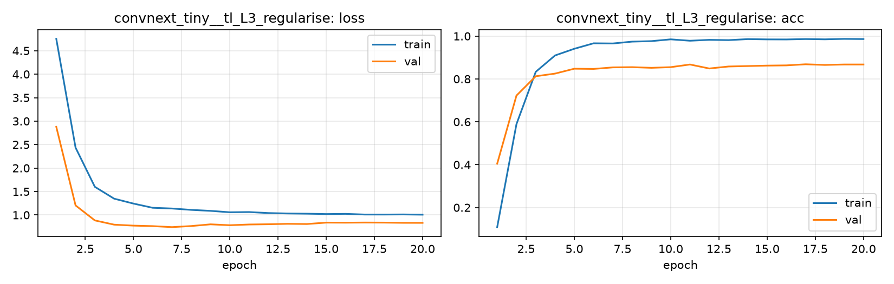

# Run card: `convnext_tiny__tl_L3_regularise`

_Generated by `python -m birdcls.report` from the files in `outputs/runs/convnext_tiny__tl_L3_regularise/`. Do not edit by hand._

## Summary

| Item | Value |
|---|---|
| Model | `convnext_tiny` (27.97 M parameters) |
| Configuration | `tl_L3_regularise`: L3 regularisation: L2 + label smoothing 0.1, dropout 0.3, stochastic depth 0.1, weight decay 0.05 |
| Finished | 2026-10-17 13:44 |
| Training time | 5.0 min, completed all epochs |
| Best epoch (by val accuracy) | 17 at 224 px, val Top-1 0.8685 |
| Input normalisation | mean (0.485, 0.456, 0.406), std (0.229, 0.224, 0.225) |
| Command | `python -m birdcls.train --model convnext_tiny --config tl_L3_regularise` |

## Results (from `outputs/results.csv`)

| Variant | Train acc (clean) | Val Top-1 | Gap (train - val) | **Test Top-1** | **Test avg/class** |
|---|---|---|---|---|---|
| no TTA | 0.9990 | 0.8685 | 0.1304 | 0.8613 | 0.8571 |
| with TTA (flip averaging) | 0.9990 | 0.8665 | 0.1325 | 0.8688 | 0.8668 |

Train acc is measured on the training images with eval preprocessing (no augmentation).

## Configuration

Source: snapshot saved with the run (`config.yaml`).

| Setting | Value |
|---|---|
| `full_train` | False |
| `cutmix_prob` | 0.0 |
| `label_smoothing` | 0.1 |
| `weight_decay` | 0.05 |
| `dropout` | 0.3 |
| `drop_path` | 0.1 |
| `patience` | 6 |
| `optimizer` | adamw |
| `momentum` | 0.9 |
| `lr_schedule` | cosine |
| `augment` | basic |
| `freeze_backbone` | False |

| Phase | Image size | Batch | Epochs | LR backbone | LR head | Warm-up epochs |
|---|---|---|---|---|---|---|
| 1 | 224 | 32 | 20 | 0.0001 | 0.001 | 1 |

## Training curves

## Per-epoch log

| Epoch | Phase | Size | Train loss | Train acc | Val loss | Val acc | LR (backbone, end of epoch) |
|---|---|---|---|---|---|---|---|
| 1 | 1 | 224 | 4.753 | 0.109 | 2.878 | 0.4048 | 1.00e-04 |
| 2 | 1 | 224 | 2.435 | 0.589 | 1.204 | 0.7226 | 9.93e-05 |
| 3 | 1 | 224 | 1.600 | 0.833 | 0.884 | 0.8126 | 9.73e-05 |
| 4 | 1 | 224 | 1.348 | 0.910 | 0.794 | 0.8251 | 9.40e-05 |
| 5 | 1 | 224 | 1.243 | 0.941 | 0.773 | 0.8478 | 8.95e-05 |
| 6 | 1 | 224 | 1.153 | 0.966 | 0.762 | 0.8468 | 8.39e-05 |
| 7 | 1 | 224 | 1.138 | 0.966 | 0.741 | 0.8540 | 7.73e-05 |
| 8 | 1 | 224 | 1.109 | 0.974 | 0.764 | 0.8551 | 7.01e-05 |
| 9 | 1 | 224 | 1.088 | 0.977 | 0.801 | 0.8520 | 6.23e-05 |
| 10 | 1 | 224 | 1.058 | 0.985 | 0.782 | 0.8551 | 5.41e-05 |
| 11 | 1 | 224 | 1.063 | 0.978 | 0.797 | 0.8675 | 4.59e-05 |
| 12 | 1 | 224 | 1.041 | 0.983 | 0.803 | 0.8489 | 3.77e-05 |
| 13 | 1 | 224 | 1.032 | 0.981 | 0.812 | 0.8582 | 2.99e-05 |
| 14 | 1 | 224 | 1.028 | 0.986 | 0.807 | 0.8602 | 2.27e-05 |
| 15 | 1 | 224 | 1.020 | 0.985 | 0.837 | 0.8623 | 1.61e-05 |
| 16 | 1 | 224 | 1.024 | 0.984 | 0.836 | 0.8634 | 1.05e-05 |
| 17 **(best)** | 1 | 224 | 1.010 | 0.986 | 0.839 | 0.8685 | 6.03e-06 |
| 18 | 1 | 224 | 1.009 | 0.985 | 0.837 | 0.8654 | 2.71e-06 |
| 19 | 1 | 224 | 1.011 | 0.987 | 0.833 | 0.8675 | 6.82e-07 |
| 20 | 1 | 224 | 1.007 | 0.986 | 0.832 | 0.8675 | 0.00e+00 |

With CutMix, train loss/acc are computed on mixed images (soft accuracy), so they run lower than the clean train accuracy in the results table.

## Files

`outputs/runs/convnext_tiny__tl_L3_regularise/`: `best.pt` (best checkpoint), `history.json`, `train.log`, `curves.png`, `config.yaml`
