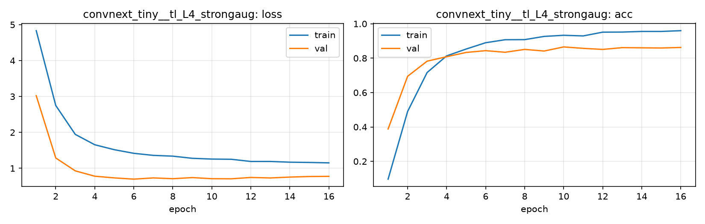

# Run card: `convnext_tiny__tl_L4_strongaug`

_Generated by `python -m birdcls.report` from the files in `outputs/runs/convnext_tiny__tl_L4_strongaug/`. Do not edit by hand._

## Summary

| Item | Value |
|---|---|
| Model | `convnext_tiny` (27.97 M parameters) |
| Configuration | `tl_L4_strongaug`: L4 strong augmentation: L3 + crop 25-100%, TrivialAugmentWide, flip, random erasing |
| Finished | 2026-10-17 13:55 |
| Training time | 4.0 min, early stopping after 16/20 epochs |
| Best epoch (by val accuracy) | 10 at 224 px, val Top-1 0.8654 |
| Input normalisation | mean (0.485, 0.456, 0.406), std (0.229, 0.224, 0.225) |
| Command | `python -m birdcls.train --model convnext_tiny --config tl_L4_strongaug` |

## Results (from `outputs/results.csv`)

| Variant | Train acc (clean) | Val Top-1 | Gap (train - val) | **Test Top-1** | **Test avg/class** |
|---|---|---|---|---|---|
| no TTA | 0.9987 | 0.8654 | 0.1333 | 0.8372 | 0.8343 |
| with TTA (flip averaging) | 0.9987 | 0.8696 | 0.1291 | 0.8430 | 0.8422 |

Train acc is measured on the training images with eval preprocessing (no augmentation).

## Configuration

Source: snapshot saved with the run (`config.yaml`).

| Setting | Value |
|---|---|
| `full_train` | False |
| `cutmix_prob` | 0.0 |
| `label_smoothing` | 0.1 |
| `weight_decay` | 0.05 |
| `dropout` | 0.3 |
| `drop_path` | 0.1 |
| `patience` | 6 |
| `optimizer` | adamw |
| `momentum` | 0.9 |
| `lr_schedule` | cosine |
| `augment` | strong |
| `freeze_backbone` | False |

| Phase | Image size | Batch | Epochs | LR backbone | LR head | Warm-up epochs |
|---|---|---|---|---|---|---|
| 1 | 224 | 32 | 20 | 0.0001 | 0.001 | 1 |

## Training curves

## Per-epoch log

| Epoch | Phase | Size | Train loss | Train acc | Val loss | Val acc | LR (backbone, end of epoch) |
|---|---|---|---|---|---|---|---|
| 1 | 1 | 224 | 4.833 | 0.097 | 3.021 | 0.3882 | 1.00e-04 |
| 2 | 1 | 224 | 2.749 | 0.490 | 1.288 | 0.6946 | 9.93e-05 |
| 3 | 1 | 224 | 1.945 | 0.717 | 0.929 | 0.7826 | 9.73e-05 |
| 4 | 1 | 224 | 1.656 | 0.813 | 0.780 | 0.8085 | 9.40e-05 |
| 5 | 1 | 224 | 1.519 | 0.853 | 0.733 | 0.8333 | 8.95e-05 |
| 6 | 1 | 224 | 1.418 | 0.890 | 0.698 | 0.8437 | 8.39e-05 |
| 7 | 1 | 224 | 1.360 | 0.907 | 0.733 | 0.8344 | 7.73e-05 |
| 8 | 1 | 224 | 1.338 | 0.908 | 0.711 | 0.8509 | 7.01e-05 |
| 9 | 1 | 224 | 1.279 | 0.927 | 0.742 | 0.8416 | 6.23e-05 |
| 10 **(best)** | 1 | 224 | 1.257 | 0.933 | 0.711 | 0.8654 | 5.41e-05 |
| 11 | 1 | 224 | 1.251 | 0.929 | 0.708 | 0.8571 | 4.59e-05 |
| 12 | 1 | 224 | 1.191 | 0.951 | 0.745 | 0.8509 | 3.77e-05 |
| 13 | 1 | 224 | 1.191 | 0.952 | 0.732 | 0.8613 | 2.99e-05 |
| 14 | 1 | 224 | 1.170 | 0.955 | 0.756 | 0.8602 | 2.27e-05 |
| 15 | 1 | 224 | 1.163 | 0.955 | 0.771 | 0.8592 | 1.61e-05 |
| 16 | 1 | 224 | 1.151 | 0.960 | 0.776 | 0.8623 | 1.05e-05 |

With CutMix, train loss/acc are computed on mixed images (soft accuracy), so they run lower than the clean train accuracy in the results table.

## Files

`outputs/runs/convnext_tiny__tl_L4_strongaug/`: `best.pt` (best checkpoint), `history.json`, `train.log`, `curves.png`, `config.yaml`
