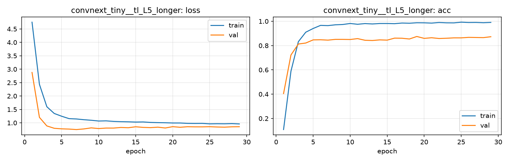

# Run card: `convnext_tiny__tl_L5_longer`

_Generated by `python -m birdcls.report` from the files in `outputs/runs/convnext_tiny__tl_L5_longer/`. Do not edit by hand._

## Summary

| Item | Value |
|---|---|
| Model | `convnext_tiny` (27.97 M parameters) |
| Configuration | `tl_L5_longer`: L5 longer training for ConvNeXt-Tiny: L3 (basic aug) with 40 epochs, patience 10 |
| Finished | 2026-10-17 14:14 |
| Training time | 7.3 min, early stopping after 29/40 epochs |
| Best epoch (by val accuracy) | 19 at 224 px, val Top-1 0.8747 |
| Input normalisation | mean (0.485, 0.456, 0.406), std (0.229, 0.224, 0.225) |
| Command | `python -m birdcls.train --model convnext_tiny --config tl_L5_longer` |

## Results (from `outputs/results.csv`)

| Variant | Train acc (clean) | Val Top-1 | Gap (train - val) | **Test Top-1** | **Test avg/class** |
|---|---|---|---|---|---|
| no TTA | 0.9987 | 0.8747 | 0.1240 | 0.8596 | 0.8568 |
| with TTA (flip averaging) | 0.9987 | 0.8778 | 0.1209 | 0.8696 | 0.8688 |

Train acc is measured on the training images with eval preprocessing (no augmentation).

## Configuration

Source: snapshot saved with the run (`config.yaml`).

| Setting | Value |
|---|---|
| `full_train` | False |
| `cutmix_prob` | 0.0 |
| `label_smoothing` | 0.1 |
| `weight_decay` | 0.05 |
| `dropout` | 0.3 |
| `drop_path` | 0.1 |
| `patience` | 10 |
| `optimizer` | adamw |
| `momentum` | 0.9 |
| `lr_schedule` | cosine |
| `augment` | basic |
| `freeze_backbone` | False |

| Phase | Image size | Batch | Epochs | LR backbone | LR head | Warm-up epochs |
|---|---|---|---|---|---|---|
| 1 | 224 | 32 | 40 | 0.0001 | 0.001 | 1 |

## Training curves

## Per-epoch log

| Epoch | Phase | Size | Train loss | Train acc | Val loss | Val acc | LR (backbone, end of epoch) |
|---|---|---|---|---|---|---|---|
| 1 | 1 | 224 | 4.753 | 0.109 | 2.878 | 0.4048 | 1.00e-04 |
| 2 | 1 | 224 | 2.435 | 0.589 | 1.204 | 0.7226 | 9.98e-05 |
| 3 | 1 | 224 | 1.601 | 0.832 | 0.885 | 0.8126 | 9.94e-05 |
| 4 | 1 | 224 | 1.349 | 0.910 | 0.797 | 0.8209 | 9.85e-05 |
| 5 | 1 | 224 | 1.246 | 0.941 | 0.776 | 0.8468 | 9.74e-05 |
| 6 | 1 | 224 | 1.157 | 0.966 | 0.767 | 0.8478 | 9.60e-05 |
| 7 | 1 | 224 | 1.144 | 0.964 | 0.750 | 0.8447 | 9.43e-05 |
| 8 | 1 | 224 | 1.117 | 0.971 | 0.773 | 0.8509 | 9.23e-05 |
| 9 | 1 | 224 | 1.096 | 0.973 | 0.812 | 0.8509 | 9.00e-05 |
| 10 | 1 | 224 | 1.067 | 0.982 | 0.786 | 0.8499 | 8.74e-05 |
| 11 | 1 | 224 | 1.073 | 0.975 | 0.805 | 0.8571 | 8.46e-05 |
| 12 | 1 | 224 | 1.054 | 0.981 | 0.804 | 0.8437 | 8.16e-05 |
| 13 | 1 | 224 | 1.043 | 0.978 | 0.827 | 0.8416 | 7.84e-05 |
| 14 | 1 | 224 | 1.038 | 0.982 | 0.818 | 0.8468 | 7.50e-05 |
| 15 | 1 | 224 | 1.029 | 0.982 | 0.853 | 0.8447 | 7.14e-05 |
| 16 | 1 | 224 | 1.033 | 0.980 | 0.831 | 0.8613 | 6.77e-05 |
| 17 | 1 | 224 | 1.016 | 0.985 | 0.821 | 0.8602 | 6.39e-05 |
| 18 | 1 | 224 | 1.008 | 0.984 | 0.838 | 0.8540 | 6.00e-05 |
| 19 **(best)** | 1 | 224 | 1.003 | 0.988 | 0.808 | 0.8747 | 5.60e-05 |
| 20 | 1 | 224 | 0.994 | 0.987 | 0.857 | 0.8592 | 5.20e-05 |
| 21 | 1 | 224 | 0.994 | 0.985 | 0.835 | 0.8644 | 4.80e-05 |
| 22 | 1 | 224 | 0.980 | 0.990 | 0.855 | 0.8582 | 4.40e-05 |
| 23 | 1 | 224 | 0.977 | 0.987 | 0.850 | 0.8602 | 4.00e-05 |
| 24 | 1 | 224 | 0.979 | 0.987 | 0.850 | 0.8634 | 3.61e-05 |
| 25 | 1 | 224 | 0.962 | 0.992 | 0.856 | 0.8634 | 3.23e-05 |
| 26 | 1 | 224 | 0.967 | 0.990 | 0.845 | 0.8675 | 2.86e-05 |
| 27 | 1 | 224 | 0.964 | 0.990 | 0.838 | 0.8665 | 2.50e-05 |
| 28 | 1 | 224 | 0.971 | 0.988 | 0.852 | 0.8654 | 2.16e-05 |
| 29 | 1 | 224 | 0.959 | 0.991 | 0.855 | 0.8727 | 1.84e-05 |

With CutMix, train loss/acc are computed on mixed images (soft accuracy), so they run lower than the clean train accuracy in the results table.

## Files

`outputs/runs/convnext_tiny__tl_L5_longer/`: `best.pt` (best checkpoint), `history.json`, `train.log`, `curves.png`, `config.yaml`
