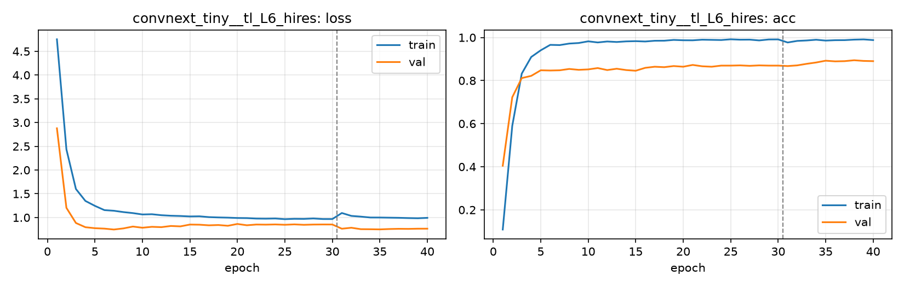

# Run card: `convnext_tiny__tl_L6_hires`

_Generated by `python -m birdcls.report` from the files in `outputs/runs/convnext_tiny__tl_L6_hires/`. Do not edit by hand._

## Summary

| Item | Value |
|---|---|
| Model | `convnext_tiny` (27.97 M parameters) |
| Configuration | `tl_L6_hires`: L6 resolution for ConvNeXt-Tiny: L5 (basic aug) with 30 epochs at 224 px + 10 epochs at 448 px |
| Finished | 2026-10-17 14:50 |
| Training time | 16.9 min, completed all epochs |
| Best epoch (by val accuracy) | 38 at 448 px, val Top-1 0.8944 |
| Input normalisation | mean (0.485, 0.456, 0.406), std (0.229, 0.224, 0.225) |
| Command | `python -m birdcls.train --model convnext_tiny --config tl_L6_hires` |

## Results (from `outputs/results.csv`)

| Variant | Train acc (clean) | Val Top-1 | Gap (train - val) | **Test Top-1** | **Test avg/class** |
|---|---|---|---|---|---|
| no TTA | 0.9987 | 0.8944 | 0.1043 | 0.8804 | 0.8757 |
| with TTA (flip averaging) | 0.9987 | 0.8944 | 0.1043 | 0.8846 | 0.8799 |

Train acc is measured on the training images with eval preprocessing (no augmentation).

## Configuration

Source: snapshot saved with the run (`config.yaml`).

| Setting | Value |
|---|---|
| `full_train` | False |
| `cutmix_prob` | 0.0 |
| `label_smoothing` | 0.1 |
| `weight_decay` | 0.05 |
| `dropout` | 0.3 |
| `drop_path` | 0.1 |
| `patience` | 10 |
| `optimizer` | adamw |
| `momentum` | 0.9 |
| `lr_schedule` | cosine |
| `augment` | basic |
| `freeze_backbone` | False |

| Phase | Image size | Batch | Epochs | LR backbone | LR head | Warm-up epochs |
|---|---|---|---|---|---|---|
| 1 | 224 | 32 | 30 | 0.0001 | 0.001 | 1 |
| 2 | 448 | 16 | 10 | 2e-05 | 0.0002 | 0 |

## Training curves

## Per-epoch log

| Epoch | Phase | Size | Train loss | Train acc | Val loss | Val acc | LR (backbone, end of epoch) |
|---|---|---|---|---|---|---|---|
| 1 | 1 | 224 | 4.753 | 0.109 | 2.878 | 0.4048 | 1.00e-04 |
| 2 | 1 | 224 | 2.435 | 0.590 | 1.204 | 0.7226 | 9.97e-05 |
| 3 | 1 | 224 | 1.601 | 0.832 | 0.885 | 0.8116 | 9.88e-05 |
| 4 | 1 | 224 | 1.349 | 0.910 | 0.796 | 0.8219 | 9.74e-05 |
| 5 | 1 | 224 | 1.245 | 0.941 | 0.775 | 0.8478 | 9.54e-05 |
| 6 | 1 | 224 | 1.156 | 0.966 | 0.766 | 0.8468 | 9.28e-05 |
| 7 | 1 | 224 | 1.142 | 0.965 | 0.747 | 0.8478 | 8.98e-05 |
| 8 | 1 | 224 | 1.114 | 0.972 | 0.771 | 0.8540 | 8.63e-05 |
| 9 | 1 | 224 | 1.093 | 0.974 | 0.810 | 0.8499 | 8.24e-05 |
| 10 | 1 | 224 | 1.064 | 0.982 | 0.785 | 0.8520 | 7.81e-05 |
| 11 | 1 | 224 | 1.069 | 0.977 | 0.804 | 0.8582 | 7.34e-05 |
| 12 | 1 | 224 | 1.049 | 0.982 | 0.797 | 0.8489 | 6.85e-05 |
| 13 | 1 | 224 | 1.038 | 0.979 | 0.822 | 0.8551 | 6.34e-05 |
| 14 | 1 | 224 | 1.032 | 0.982 | 0.813 | 0.8489 | 5.81e-05 |
| 15 | 1 | 224 | 1.023 | 0.983 | 0.852 | 0.8458 | 5.27e-05 |
| 16 | 1 | 224 | 1.026 | 0.982 | 0.849 | 0.8592 | 4.73e-05 |
| 17 | 1 | 224 | 1.008 | 0.985 | 0.836 | 0.8644 | 4.19e-05 |
| 18 | 1 | 224 | 1.002 | 0.985 | 0.842 | 0.8623 | 3.66e-05 |
| 19 | 1 | 224 | 0.997 | 0.989 | 0.826 | 0.8675 | 3.15e-05 |
| 20 | 1 | 224 | 0.990 | 0.987 | 0.864 | 0.8644 | 2.66e-05 |
| 21 | 1 | 224 | 0.988 | 0.987 | 0.837 | 0.8727 | 2.19e-05 |
| 22 | 1 | 224 | 0.978 | 0.990 | 0.852 | 0.8665 | 1.76e-05 |
| 23 | 1 | 224 | 0.976 | 0.989 | 0.850 | 0.8644 | 1.37e-05 |
| 24 | 1 | 224 | 0.980 | 0.988 | 0.854 | 0.8696 | 1.02e-05 |
| 25 | 1 | 224 | 0.965 | 0.992 | 0.847 | 0.8696 | 7.16e-06 |
| 26 | 1 | 224 | 0.973 | 0.990 | 0.855 | 0.8706 | 4.62e-06 |
| 27 | 1 | 224 | 0.971 | 0.990 | 0.846 | 0.8685 | 2.62e-06 |
| 28 | 1 | 224 | 0.980 | 0.986 | 0.852 | 0.8706 | 1.17e-06 |
| 29 | 1 | 224 | 0.968 | 0.991 | 0.854 | 0.8696 | 2.93e-07 |
| 30 | 1 | 224 | 0.968 | 0.991 | 0.853 | 0.8696 | 0.00e+00 |
| 31 | 2 | 448 | 1.095 | 0.977 | 0.764 | 0.8675 | 1.95e-05 |
| 32 | 2 | 448 | 1.034 | 0.984 | 0.785 | 0.8706 | 1.81e-05 |
| 33 | 2 | 448 | 1.019 | 0.986 | 0.755 | 0.8778 | 1.59e-05 |
| 34 | 2 | 448 | 1.000 | 0.990 | 0.753 | 0.8841 | 1.31e-05 |
| 35 | 2 | 448 | 1.000 | 0.986 | 0.750 | 0.8923 | 1.00e-05 |
| 36 | 2 | 448 | 0.997 | 0.988 | 0.758 | 0.8892 | 6.91e-06 |
| 37 | 2 | 448 | 0.994 | 0.988 | 0.762 | 0.8903 | 4.12e-06 |
| 38 **(best)** | 2 | 448 | 0.988 | 0.990 | 0.760 | 0.8944 | 1.91e-06 |
| 39 | 2 | 448 | 0.984 | 0.991 | 0.765 | 0.8913 | 4.89e-07 |
| 40 | 2 | 448 | 0.993 | 0.988 | 0.765 | 0.8903 | 0.00e+00 |

With CutMix, train loss/acc are computed on mixed images (soft accuracy), so they run lower than the clean train accuracy in the results table.

## Files

`outputs/runs/convnext_tiny__tl_L6_hires/`: `best.pt` (best checkpoint), `history.json`, `train.log`, `curves.png`, `config.yaml`
