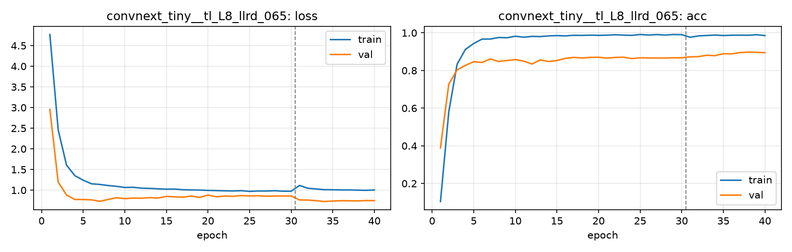

# Run card: `convnext_tiny__tl_L8_llrd_065`

_Generated by `python -m birdcls.report` from the files in `outputs/runs/convnext_tiny__tl_L8_llrd_065/`. Do not edit by hand._

## Summary

| Item | Value |
|---|---|
| Model | `convnext_tiny` (27.97 M parameters) |
| Configuration | `tl_L8_llrd_065`: L8 ConvNeXt-Tiny: L6 with layer-wise LR decay 0.65 (stem 0.18x ... top stage 1x backbone LR) |
| Finished | 2026-10-19 20:04 |
| Training time | 17.1 min, completed all epochs |
| Best epoch (by val accuracy) | 38 at 448 px, val Top-1 0.8975 |
| Input normalisation | mean (0.485, 0.456, 0.406), std (0.229, 0.224, 0.225) |
| Command | `python -m birdcls.train --model convnext_tiny --config tl_L8_llrd_065` |

## Results (from `outputs/results.csv`)

| Variant | Train acc (clean) | Val Top-1 | Gap (train - val) | **Test Top-1** | **Test avg/class** |
|---|---|---|---|---|---|
| no TTA | 0.9984 | 0.8975 | 0.1009 | 0.8779 | 0.8729 |
| with TTA (flip averaging) | 0.9984 | 0.8923 | 0.1061 | 0.8779 | 0.8729 |

Train acc is measured on the training images with eval preprocessing (no augmentation).

## Configuration

Source: snapshot saved with the run (`config.yaml`).

| Setting | Value |
|---|---|
| `full_train` | False |
| `cutmix_prob` | 0.0 |
| `label_smoothing` | 0.1 |
| `weight_decay` | 0.05 |
| `dropout` | 0.3 |
| `drop_path` | 0.1 |
| `patience` | 10 |
| `optimizer` | adamw |
| `momentum` | 0.9 |
| `lr_schedule` | cosine |
| `augment` | basic |
| `freeze_backbone` | False |
| `layer_decay` | 0.65 |

| Phase | Image size | Batch | Epochs | LR backbone | LR head | Warm-up epochs |
|---|---|---|---|---|---|---|
| 1 | 224 | 32 | 30 | 0.0001 | 0.001 | 1 |
| 2 | 448 | 16 | 10 | 2e-05 | 0.0002 | 0 |

## Training curves

## Per-epoch log

| Epoch | Phase | Size | Train loss | Train acc | Val loss | Val acc | LR (backbone, end of epoch) |
|---|---|---|---|---|---|---|---|
| 1 | 1 | 224 | 4.769 | 0.104 | 2.958 | 0.3892 | 1.00e-04 |
| 2 | 1 | 224 | 2.460 | 0.580 | 1.195 | 0.7277 | 9.97e-05 |
| 3 | 1 | 224 | 1.608 | 0.834 | 0.883 | 0.8033 | 9.88e-05 |
| 4 | 1 | 224 | 1.351 | 0.912 | 0.774 | 0.8271 | 9.74e-05 |
| 5 | 1 | 224 | 1.242 | 0.943 | 0.773 | 0.8468 | 9.54e-05 |
| 6 | 1 | 224 | 1.155 | 0.967 | 0.767 | 0.8427 | 9.28e-05 |
| 7 | 1 | 224 | 1.139 | 0.967 | 0.729 | 0.8613 | 8.98e-05 |
| 8 | 1 | 224 | 1.113 | 0.975 | 0.775 | 0.8478 | 8.63e-05 |
| 9 | 1 | 224 | 1.093 | 0.974 | 0.816 | 0.8530 | 8.24e-05 |
| 10 | 1 | 224 | 1.065 | 0.982 | 0.796 | 0.8582 | 7.81e-05 |
| 11 | 1 | 224 | 1.069 | 0.977 | 0.809 | 0.8499 | 7.34e-05 |
| 12 | 1 | 224 | 1.049 | 0.981 | 0.806 | 0.8344 | 6.85e-05 |
| 13 | 1 | 224 | 1.043 | 0.980 | 0.819 | 0.8561 | 6.34e-05 |
| 14 | 1 | 224 | 1.032 | 0.984 | 0.809 | 0.8478 | 5.81e-05 |
| 15 | 1 | 224 | 1.024 | 0.985 | 0.849 | 0.8530 | 5.27e-05 |
| 16 | 1 | 224 | 1.027 | 0.984 | 0.838 | 0.8644 | 4.73e-05 |
| 17 | 1 | 224 | 1.010 | 0.987 | 0.831 | 0.8696 | 4.19e-05 |
| 18 | 1 | 224 | 1.006 | 0.986 | 0.857 | 0.8665 | 3.66e-05 |
| 19 | 1 | 224 | 1.002 | 0.988 | 0.824 | 0.8696 | 3.15e-05 |
| 20 | 1 | 224 | 0.995 | 0.987 | 0.881 | 0.8706 | 2.66e-05 |
| 21 | 1 | 224 | 0.990 | 0.988 | 0.840 | 0.8654 | 2.19e-05 |
| 22 | 1 | 224 | 0.985 | 0.990 | 0.857 | 0.8696 | 1.76e-05 |
| 23 | 1 | 224 | 0.980 | 0.988 | 0.851 | 0.8706 | 1.37e-05 |
| 24 | 1 | 224 | 0.987 | 0.987 | 0.869 | 0.8634 | 1.02e-05 |
| 25 | 1 | 224 | 0.970 | 0.991 | 0.860 | 0.8675 | 7.16e-06 |
| 26 | 1 | 224 | 0.979 | 0.988 | 0.864 | 0.8665 | 4.62e-06 |
| 27 | 1 | 224 | 0.978 | 0.991 | 0.854 | 0.8665 | 2.62e-06 |
| 28 | 1 | 224 | 0.987 | 0.988 | 0.858 | 0.8665 | 1.17e-06 |
| 29 | 1 | 224 | 0.975 | 0.991 | 0.860 | 0.8675 | 2.93e-07 |
| 30 | 1 | 224 | 0.974 | 0.990 | 0.860 | 0.8675 | 0.00e+00 |
| 31 | 2 | 448 | 1.114 | 0.977 | 0.763 | 0.8727 | 1.95e-05 |
| 32 | 2 | 448 | 1.046 | 0.984 | 0.760 | 0.8737 | 1.81e-05 |
| 33 | 2 | 448 | 1.029 | 0.986 | 0.745 | 0.8810 | 1.59e-05 |
| 34 | 2 | 448 | 1.012 | 0.988 | 0.725 | 0.8789 | 1.31e-05 |
| 35 | 2 | 448 | 1.010 | 0.986 | 0.738 | 0.8892 | 1.00e-05 |
| 36 | 2 | 448 | 1.005 | 0.988 | 0.745 | 0.8882 | 6.91e-06 |
| 37 | 2 | 448 | 1.005 | 0.988 | 0.742 | 0.8954 | 4.12e-06 |
| 38 **(best)** | 2 | 448 | 1.000 | 0.987 | 0.739 | 0.8975 | 1.91e-06 |
| 39 | 2 | 448 | 0.996 | 0.990 | 0.748 | 0.8965 | 4.89e-07 |
| 40 | 2 | 448 | 1.004 | 0.986 | 0.746 | 0.8944 | 0.00e+00 |

With CutMix, train loss/acc are computed on mixed images (soft accuracy), so they run lower than the clean train accuracy in the results table.

## Files

`outputs/runs/convnext_tiny__tl_L8_llrd_065/`: `best.pt` (best checkpoint), `history.json`, `train.log`, `curves.png`, `config.yaml`
