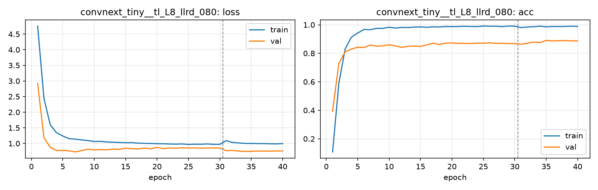

# Run card: `convnext_tiny__tl_L8_llrd_080`

_Generated by `python -m birdcls.report` from the files in `outputs/runs/convnext_tiny__tl_L8_llrd_080/`. Do not edit by hand._

## Summary

| Item | Value |
|---|---|
| Model | `convnext_tiny` (27.97 M parameters) |
| Configuration | `tl_L8_llrd_080`: L8 ConvNeXt-Tiny: L6 with layer-wise LR decay 0.8 (stem 0.41x ... top stage 1x backbone LR) |
| Finished | 2026-10-19 19:47 |
| Training time | 17.1 min, completed all epochs |
| Best epoch (by val accuracy) | 35 at 448 px, val Top-1 0.8903 |
| Input normalisation | mean (0.485, 0.456, 0.406), std (0.229, 0.224, 0.225) |
| Command | `python -m birdcls.train --model convnext_tiny --config tl_L8_llrd_080` |

## Results (from `outputs/results.csv`)

| Variant | Train acc (clean) | Val Top-1 | Gap (train - val) | **Test Top-1** | **Test avg/class** |
|---|---|---|---|---|---|
| no TTA | 0.9984 | 0.8903 | 0.1082 | 0.8704 | 0.8644 |
| with TTA (flip averaging) | 0.9984 | 0.8934 | 0.1051 | 0.8796 | 0.8743 |

Train acc is measured on the training images with eval preprocessing (no augmentation).

## Configuration

Source: snapshot saved with the run (`config.yaml`).

| Setting | Value |
|---|---|
| `full_train` | False |
| `cutmix_prob` | 0.0 |
| `label_smoothing` | 0.1 |
| `weight_decay` | 0.05 |
| `dropout` | 0.3 |
| `drop_path` | 0.1 |
| `patience` | 10 |
| `optimizer` | adamw |
| `momentum` | 0.9 |
| `lr_schedule` | cosine |
| `augment` | basic |
| `freeze_backbone` | False |
| `layer_decay` | 0.8 |

| Phase | Image size | Batch | Epochs | LR backbone | LR head | Warm-up epochs |
|---|---|---|---|---|---|---|
| 1 | 224 | 32 | 30 | 0.0001 | 0.001 | 1 |
| 2 | 448 | 16 | 10 | 2e-05 | 0.0002 | 0 |

## Training curves

## Per-epoch log

| Epoch | Phase | Size | Train loss | Train acc | Val loss | Val acc | LR (backbone, end of epoch) |
|---|---|---|---|---|---|---|---|
| 1 | 1 | 224 | 4.758 | 0.108 | 2.918 | 0.3934 | 1.00e-04 |
| 2 | 1 | 224 | 2.442 | 0.589 | 1.185 | 0.7288 | 9.97e-05 |
| 3 | 1 | 224 | 1.600 | 0.830 | 0.876 | 0.8106 | 9.88e-05 |
| 4 | 1 | 224 | 1.343 | 0.913 | 0.775 | 0.8292 | 9.74e-05 |
| 5 | 1 | 224 | 1.239 | 0.942 | 0.773 | 0.8427 | 9.54e-05 |
| 6 | 1 | 224 | 1.153 | 0.967 | 0.762 | 0.8406 | 9.28e-05 |
| 7 | 1 | 224 | 1.139 | 0.966 | 0.728 | 0.8582 | 8.98e-05 |
| 8 | 1 | 224 | 1.112 | 0.975 | 0.773 | 0.8499 | 8.63e-05 |
| 9 | 1 | 224 | 1.092 | 0.975 | 0.818 | 0.8520 | 8.24e-05 |
| 10 | 1 | 224 | 1.063 | 0.983 | 0.792 | 0.8602 | 7.81e-05 |
| 11 | 1 | 224 | 1.068 | 0.977 | 0.803 | 0.8520 | 7.34e-05 |
| 12 | 1 | 224 | 1.048 | 0.982 | 0.796 | 0.8416 | 6.85e-05 |
| 13 | 1 | 224 | 1.040 | 0.980 | 0.819 | 0.8489 | 6.34e-05 |
| 14 | 1 | 224 | 1.032 | 0.984 | 0.809 | 0.8509 | 5.81e-05 |
| 15 | 1 | 224 | 1.023 | 0.985 | 0.849 | 0.8478 | 5.27e-05 |
| 16 | 1 | 224 | 1.025 | 0.983 | 0.834 | 0.8592 | 4.73e-05 |
| 17 | 1 | 224 | 1.010 | 0.986 | 0.824 | 0.8706 | 4.19e-05 |
| 18 | 1 | 224 | 1.003 | 0.984 | 0.850 | 0.8623 | 3.66e-05 |
| 19 | 1 | 224 | 0.999 | 0.988 | 0.827 | 0.8716 | 3.15e-05 |
| 20 | 1 | 224 | 0.992 | 0.987 | 0.874 | 0.8727 | 2.66e-05 |
| 21 | 1 | 224 | 0.988 | 0.988 | 0.834 | 0.8696 | 2.19e-05 |
| 22 | 1 | 224 | 0.982 | 0.990 | 0.856 | 0.8696 | 1.76e-05 |
| 23 | 1 | 224 | 0.978 | 0.988 | 0.848 | 0.8685 | 1.37e-05 |
| 24 | 1 | 224 | 0.984 | 0.988 | 0.861 | 0.8716 | 1.02e-05 |
| 25 | 1 | 224 | 0.967 | 0.991 | 0.854 | 0.8706 | 7.16e-06 |
| 26 | 1 | 224 | 0.976 | 0.990 | 0.857 | 0.8737 | 4.62e-06 |
| 27 | 1 | 224 | 0.974 | 0.990 | 0.849 | 0.8696 | 2.62e-06 |
| 28 | 1 | 224 | 0.984 | 0.988 | 0.853 | 0.8706 | 1.17e-06 |
| 29 | 1 | 224 | 0.971 | 0.991 | 0.855 | 0.8685 | 2.93e-07 |
| 30 | 1 | 224 | 0.971 | 0.991 | 0.855 | 0.8685 | 0.00e+00 |
| 31 | 2 | 448 | 1.089 | 0.981 | 0.767 | 0.8634 | 1.95e-05 |
| 32 | 2 | 448 | 1.032 | 0.984 | 0.777 | 0.8706 | 1.81e-05 |
| 33 | 2 | 448 | 1.016 | 0.986 | 0.758 | 0.8789 | 1.59e-05 |
| 34 | 2 | 448 | 1.001 | 0.991 | 0.743 | 0.8758 | 1.31e-05 |
| 35 **(best)** | 2 | 448 | 1.000 | 0.986 | 0.748 | 0.8903 | 1.00e-05 |
| 36 | 2 | 448 | 0.995 | 0.988 | 0.758 | 0.8872 | 6.91e-06 |
| 37 | 2 | 448 | 0.994 | 0.988 | 0.756 | 0.8882 | 4.12e-06 |
| 38 | 2 | 448 | 0.989 | 0.988 | 0.753 | 0.8892 | 1.91e-06 |
| 39 | 2 | 448 | 0.985 | 0.990 | 0.762 | 0.8872 | 4.89e-07 |
| 40 | 2 | 448 | 0.994 | 0.989 | 0.760 | 0.8872 | 0.00e+00 |

With CutMix, train loss/acc are computed on mixed images (soft accuracy), so they run lower than the clean train accuracy in the results table.

## Files

`outputs/runs/convnext_tiny__tl_L8_llrd_080/`: `best.pt` (best checkpoint), `history.json`, `train.log`, `curves.png`, `config.yaml`
