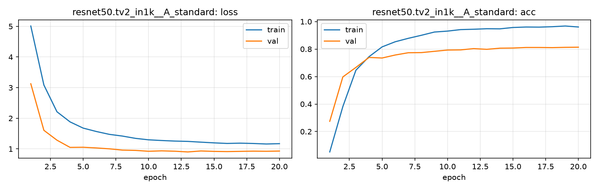

# Run card: `resnet50.tv2_in1k__A_standard`

_Generated by `python -m birdcls.report` from the files in `outputs/runs/resnet50.tv2_in1k__A_standard/`. Do not edit by hand._

## Summary

| Item | Value |
|---|---|
| Model | `resnet50.tv2_in1k` (23.92 M parameters) |
| Configuration | `A_standard`: Standard fine-tune, 224 px throughout, no CutMix |
| Finished | 2026-10-06 21:28 |
| Training time | 4.8 min, completed all epochs |
| Best epoch (by val accuracy) | 20 at 224 px, val Top-1 0.8137 |
| Input normalisation | mean (0.485, 0.456, 0.406), std (0.229, 0.224, 0.225) |
| Command | `python -m birdcls.train --model resnet50.tv2_in1k --config A_standard` |

## Results (from `outputs/results.csv`)

| Variant | Train acc (clean) | Val Top-1 | Gap (train - val) | **Test Top-1** | **Test avg/class** |
|---|---|---|---|---|---|
| no TTA | 0.9990 | 0.8137 | 0.1853 | 0.8048 | 0.7987 |
| with TTA (flip averaging) | 0.9990 | 0.8230 | 0.1760 | 0.8164 | 0.8122 |

Train acc is measured on the training images with eval preprocessing (no augmentation).

## Configuration

Source: snapshot saved with the run (`config.yaml`).

| Setting | Value |
|---|---|
| `cutmix_prob` | 0.0 |
| `label_smoothing` | 0.1 |
| `weight_decay` | 0.05 |
| `dropout` | 0.3 |
| `drop_path` | 0.1 |
| `patience` | 6 |

| Phase | Image size | Batch | Epochs | LR backbone | LR head | Warm-up epochs |
|---|---|---|---|---|---|---|
| 1 | 224 | 32 | 20 | 0.0001 | 0.001 | 1 |

## Training curves

## Per-epoch log

| Epoch | Phase | Size | Train loss | Train acc | Val loss | Val acc | LR (backbone, end of epoch) |
|---|---|---|---|---|---|---|---|
| 1 | 1 | 224 | 5.011 | 0.052 | 3.127 | 0.2743 | 1.00e-04 |
| 2 | 1 | 224 | 3.086 | 0.382 | 1.607 | 0.5973 | 9.93e-05 |
| 3 | 1 | 224 | 2.212 | 0.646 | 1.285 | 0.6667 | 9.73e-05 |
| 4 | 1 | 224 | 1.882 | 0.745 | 1.050 | 0.7391 | 9.40e-05 |
| 5 | 1 | 224 | 1.679 | 0.816 | 1.054 | 0.7350 | 8.95e-05 |
| 6 | 1 | 224 | 1.569 | 0.853 | 1.032 | 0.7567 | 8.39e-05 |
| 7 | 1 | 224 | 1.475 | 0.878 | 1.003 | 0.7733 | 7.73e-05 |
| 8 | 1 | 224 | 1.419 | 0.900 | 0.961 | 0.7743 | 7.01e-05 |
| 9 | 1 | 224 | 1.344 | 0.924 | 0.952 | 0.7836 | 6.23e-05 |
| 10 | 1 | 224 | 1.297 | 0.931 | 0.923 | 0.7930 | 5.41e-05 |
| 11 | 1 | 224 | 1.274 | 0.942 | 0.937 | 0.7940 | 4.59e-05 |
| 12 | 1 | 224 | 1.256 | 0.944 | 0.925 | 0.8033 | 3.77e-05 |
| 13 | 1 | 224 | 1.245 | 0.948 | 0.901 | 0.7981 | 2.99e-05 |
| 14 | 1 | 224 | 1.220 | 0.947 | 0.933 | 0.8064 | 2.27e-05 |
| 15 | 1 | 224 | 1.197 | 0.957 | 0.919 | 0.8075 | 1.61e-05 |
| 16 | 1 | 224 | 1.179 | 0.960 | 0.913 | 0.8116 | 1.05e-05 |
| 17 | 1 | 224 | 1.188 | 0.960 | 0.920 | 0.8116 | 6.03e-06 |
| 18 | 1 | 224 | 1.177 | 0.963 | 0.927 | 0.8106 | 2.71e-06 |
| 19 | 1 | 224 | 1.160 | 0.968 | 0.923 | 0.8126 | 6.82e-07 |
| 20 **(best)** | 1 | 224 | 1.171 | 0.961 | 0.930 | 0.8137 | 0.00e+00 |

With CutMix, train loss/acc are computed on mixed images (soft accuracy), so they run lower than the clean train accuracy in the results table.

## Files

`outputs/runs/resnet50.tv2_in1k__A_standard/`: `best.pt` (best checkpoint), `history.json`, `train.log`, `curves.png`, `config.yaml`
