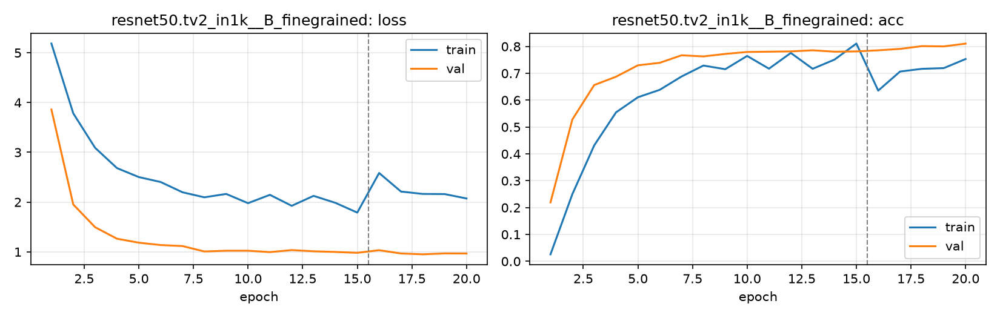

# Run card: `resnet50.tv2_in1k__B_finegrained`

_Generated by `python -m birdcls.report` from the files in `outputs/runs/resnet50.tv2_in1k__B_finegrained/`. Do not edit by hand._

## Summary

| Item | Value |
|---|---|
| Model | `resnet50.tv2_in1k` (23.92 M parameters) |
| Configuration | `B_finegrained`: Progressive resizing 224 -> 448 px + CutMix |
| Finished | 2026-10-06 21:36 |
| Training time | 8.0 min, completed all epochs |
| Best epoch (by val accuracy) | 20 at 448 px, val Top-1 0.8106 |
| Input normalisation | mean (0.485, 0.456, 0.406), std (0.229, 0.224, 0.225) |
| Command | `python -m birdcls.train --model resnet50.tv2_in1k --config B_finegrained` |

## Results (from `outputs/results.csv`)

| Variant | Train acc (clean) | Val Top-1 | Gap (train - val) | **Test Top-1** | **Test avg/class** |
|---|---|---|---|---|---|
| no TTA | 0.9915 | 0.8106 | 0.1809 | 0.7990 | 0.7924 |
| with TTA (flip averaging) | 0.9915 | 0.8085 | 0.1830 | 0.8040 | 0.7976 |

Train acc is measured on the training images with eval preprocessing (no augmentation).

## Configuration

Source: snapshot saved with the run (`config.yaml`).

| Setting | Value |
|---|---|
| `cutmix_prob` | 0.5 |
| `label_smoothing` | 0.1 |
| `weight_decay` | 0.05 |
| `dropout` | 0.3 |
| `drop_path` | 0.1 |
| `patience` | 6 |

| Phase | Image size | Batch | Epochs | LR backbone | LR head | Warm-up epochs |
|---|---|---|---|---|---|---|
| 1 | 224 | 32 | 15 | 0.0001 | 0.001 | 1 |
| 2 | 448 | 16 | 5 | 2e-05 | 0.0002 | 0 |

## Training curves

## Per-epoch log

| Epoch | Phase | Size | Train loss | Train acc | Val loss | Val acc | LR (backbone, end of epoch) |
|---|---|---|---|---|---|---|---|
| 1 | 1 | 224 | 5.186 | 0.026 | 3.860 | 0.2195 | 1.00e-04 |
| 2 | 1 | 224 | 3.783 | 0.250 | 1.953 | 0.5280 | 9.87e-05 |
| 3 | 1 | 224 | 3.090 | 0.432 | 1.495 | 0.6563 | 9.50e-05 |
| 4 | 1 | 224 | 2.683 | 0.555 | 1.264 | 0.6874 | 8.91e-05 |
| 5 | 1 | 224 | 2.503 | 0.611 | 1.184 | 0.7298 | 8.12e-05 |
| 6 | 1 | 224 | 2.403 | 0.639 | 1.137 | 0.7391 | 7.17e-05 |
| 7 | 1 | 224 | 2.197 | 0.688 | 1.117 | 0.7671 | 6.11e-05 |
| 8 | 1 | 224 | 2.096 | 0.729 | 1.008 | 0.7629 | 5.00e-05 |
| 9 | 1 | 224 | 2.164 | 0.715 | 1.023 | 0.7723 | 3.89e-05 |
| 10 | 1 | 224 | 1.978 | 0.765 | 1.023 | 0.7795 | 2.83e-05 |
| 11 | 1 | 224 | 2.146 | 0.717 | 0.995 | 0.7805 | 1.88e-05 |
| 12 | 1 | 224 | 1.925 | 0.776 | 1.036 | 0.7816 | 1.09e-05 |
| 13 | 1 | 224 | 2.125 | 0.717 | 1.011 | 0.7857 | 4.95e-06 |
| 14 | 1 | 224 | 1.985 | 0.751 | 0.998 | 0.7805 | 1.25e-06 |
| 15 | 1 | 224 | 1.789 | 0.811 | 0.981 | 0.7816 | 0.00e+00 |
| 16 | 2 | 448 | 2.585 | 0.636 | 1.033 | 0.7857 | 1.81e-05 |
| 17 | 2 | 448 | 2.212 | 0.707 | 0.967 | 0.7909 | 1.31e-05 |
| 18 | 2 | 448 | 2.164 | 0.717 | 0.951 | 0.8012 | 6.91e-06 |
| 19 | 2 | 448 | 2.161 | 0.719 | 0.968 | 0.8002 | 1.91e-06 |
| 20 **(best)** | 2 | 448 | 2.073 | 0.753 | 0.967 | 0.8106 | 0.00e+00 |

With CutMix, train loss/acc are computed on mixed images (soft accuracy), so they run lower than the clean train accuracy in the results table.

## Files

`outputs/runs/resnet50.tv2_in1k__B_finegrained/`: `best.pt` (best checkpoint), `history.json`, `train.log`, `curves.png`, `config.yaml`
