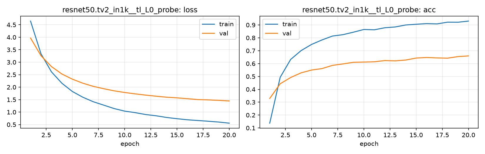

# Run card: `resnet50.tv2_in1k__tl_L0_probe`

_Generated by `python -m birdcls.report` from the files in `outputs/runs/resnet50.tv2_in1k__tl_L0_probe/`. Do not edit by hand._

## Summary

| Item | Value |
|---|---|
| Model | `resnet50.tv2_in1k` (23.92 M parameters) |
| Configuration | `tl_L0_probe`: L0 linear probe: frozen pretrained backbone, train only a new linear head (AdamW 1e-3 constant, 20 epochs) |
| Finished | 2026-10-17 13:02 |
| Training time | 2.7 min, completed all epochs |
| Best epoch (by val accuracy) | 20 at 224 px, val Top-1 0.6594 |
| Input normalisation | mean (0.485, 0.456, 0.406), std (0.229, 0.224, 0.225) |
| Command | `python -m birdcls.train --model resnet50.tv2_in1k --config tl_L0_probe` |

## Results (from `outputs/results.csv`)

| Variant | Train acc (clean) | Val Top-1 | Gap (train - val) | **Test Top-1** | **Test avg/class** |
|---|---|---|---|---|---|
| no TTA | 0.9542 | 0.6594 | 0.2948 | 0.6620 | 0.6543 |
| with TTA (flip averaging) | 0.9542 | 0.6843 | 0.2699 | 0.6711 | 0.6622 |

Train acc is measured on the training images with eval preprocessing (no augmentation).

## Configuration

Source: snapshot saved with the run (`config.yaml`).

| Setting | Value |
|---|---|
| `full_train` | False |
| `cutmix_prob` | 0.0 |
| `label_smoothing` | 0.0 |
| `weight_decay` | 0.01 |
| `dropout` | 0.0 |
| `drop_path` | 0.0 |
| `patience` | 6 |
| `optimizer` | adamw |
| `momentum` | 0.9 |
| `lr_schedule` | constant |
| `augment` | basic |
| `freeze_backbone` | True |

| Phase | Image size | Batch | Epochs | LR backbone | LR head | Warm-up epochs |
|---|---|---|---|---|---|---|
| 1 | 224 | 32 | 20 | 0.001 | 0.001 | 0 |

## Training curves

## Per-epoch log

| Epoch | Phase | Size | Train loss | Train acc | Val loss | Val acc | LR (backbone, end of epoch) |
|---|---|---|---|---|---|---|---|
| 1 | 1 | 224 | 4.647 | 0.137 | 3.967 | 0.3292 | 1.00e-03 |
| 2 | 1 | 224 | 3.335 | 0.493 | 3.259 | 0.4431 | 1.00e-03 |
| 3 | 1 | 224 | 2.612 | 0.632 | 2.824 | 0.4917 | 1.00e-03 |
| 4 | 1 | 224 | 2.155 | 0.701 | 2.526 | 0.5280 | 1.00e-03 |
| 5 | 1 | 224 | 1.826 | 0.749 | 2.320 | 0.5497 | 1.00e-03 |
| 6 | 1 | 224 | 1.596 | 0.784 | 2.158 | 0.5611 | 1.00e-03 |
| 7 | 1 | 224 | 1.415 | 0.814 | 2.031 | 0.5859 | 1.00e-03 |
| 8 | 1 | 224 | 1.278 | 0.824 | 1.937 | 0.5973 | 1.00e-03 |
| 9 | 1 | 224 | 1.141 | 0.844 | 1.852 | 0.6097 | 1.00e-03 |
| 10 | 1 | 224 | 1.039 | 0.865 | 1.786 | 0.6118 | 1.00e-03 |
| 11 | 1 | 224 | 0.979 | 0.862 | 1.731 | 0.6139 | 1.00e-03 |
| 12 | 1 | 224 | 0.902 | 0.878 | 1.681 | 0.6232 | 1.00e-03 |
| 13 | 1 | 224 | 0.853 | 0.884 | 1.637 | 0.6211 | 1.00e-03 |
| 14 | 1 | 224 | 0.786 | 0.900 | 1.597 | 0.6273 | 1.00e-03 |
| 15 | 1 | 224 | 0.735 | 0.905 | 1.571 | 0.6429 | 1.00e-03 |
| 16 | 1 | 224 | 0.692 | 0.910 | 1.537 | 0.6470 | 1.00e-03 |
| 17 | 1 | 224 | 0.663 | 0.908 | 1.502 | 0.6439 | 1.00e-03 |
| 18 | 1 | 224 | 0.633 | 0.922 | 1.489 | 0.6418 | 1.00e-03 |
| 19 | 1 | 224 | 0.601 | 0.921 | 1.469 | 0.6542 | 1.00e-03 |
| 20 **(best)** | 1 | 224 | 0.557 | 0.930 | 1.446 | 0.6594 | 1.00e-03 |

With CutMix, train loss/acc are computed on mixed images (soft accuracy), so they run lower than the clean train accuracy in the results table.

## Files

`outputs/runs/resnet50.tv2_in1k__tl_L0_probe/`: `best.pt` (best checkpoint), `history.json`, `train.log`, `curves.png`, `config.yaml`
