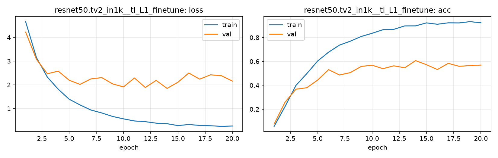

# Run card: `resnet50.tv2_in1k__tl_L1_finetune`

_Generated by `python -m birdcls.report` from the files in `outputs/runs/resnet50.tv2_in1k__tl_L1_finetune/`. Do not edit by hand._

## Summary

| Item | Value |
|---|---|
| Model | `resnet50.tv2_in1k` (23.92 M parameters) |
| Configuration | `tl_L1_finetune`: L1 full fine-tuning: unfreeze the backbone, same single LR as L0 (AdamW 1e-3 constant for all layers, 20 epochs) |
| Finished | 2026-10-17 13:13 |
| Training time | 4.6 min, completed all epochs |
| Best epoch (by val accuracy) | 14 at 224 px, val Top-1 0.6066 |
| Input normalisation | mean (0.485, 0.456, 0.406), std (0.229, 0.224, 0.225) |
| Command | `python -m birdcls.train --model resnet50.tv2_in1k --config tl_L1_finetune` |

## Results (from `outputs/results.csv`)

| Variant | Train acc (clean) | Val Top-1 | Gap (train - val) | **Test Top-1** | **Test avg/class** |
|---|---|---|---|---|---|
| no TTA | 0.9715 | 0.6066 | 0.3649 | 0.5980 | 0.5885 |
| with TTA (flip averaging) | 0.9715 | 0.6159 | 0.3556 | 0.6163 | 0.6081 |

Train acc is measured on the training images with eval preprocessing (no augmentation).

## Configuration

Source: snapshot saved with the run (`config.yaml`).

| Setting | Value |
|---|---|
| `full_train` | False |
| `cutmix_prob` | 0.0 |
| `label_smoothing` | 0.0 |
| `weight_decay` | 0.01 |
| `dropout` | 0.0 |
| `drop_path` | 0.0 |
| `patience` | 6 |
| `optimizer` | adamw |
| `momentum` | 0.9 |
| `lr_schedule` | constant |
| `augment` | basic |
| `freeze_backbone` | False |

| Phase | Image size | Batch | Epochs | LR backbone | LR head | Warm-up epochs |
|---|---|---|---|---|---|---|
| 1 | 224 | 32 | 20 | 0.001 | 0.001 | 0 |

## Training curves

## Per-epoch log

| Epoch | Phase | Size | Train loss | Train acc | Val loss | Val acc | LR (backbone, end of epoch) |
|---|---|---|---|---|---|---|---|
| 1 | 1 | 224 | 4.663 | 0.057 | 4.225 | 0.0766 | 1.00e-03 |
| 2 | 1 | 224 | 3.145 | 0.222 | 3.070 | 0.2588 | 1.00e-03 |
| 3 | 1 | 224 | 2.324 | 0.399 | 2.467 | 0.3675 | 1.00e-03 |
| 4 | 1 | 224 | 1.814 | 0.498 | 2.578 | 0.3799 | 1.00e-03 |
| 5 | 1 | 224 | 1.394 | 0.604 | 2.195 | 0.4441 | 1.00e-03 |
| 6 | 1 | 224 | 1.153 | 0.677 | 2.018 | 0.5311 | 1.00e-03 |
| 7 | 1 | 224 | 0.938 | 0.736 | 2.249 | 0.4865 | 1.00e-03 |
| 8 | 1 | 224 | 0.814 | 0.769 | 2.304 | 0.5062 | 1.00e-03 |
| 9 | 1 | 224 | 0.666 | 0.808 | 2.038 | 0.5580 | 1.00e-03 |
| 10 | 1 | 224 | 0.565 | 0.835 | 1.913 | 0.5683 | 1.00e-03 |
| 11 | 1 | 224 | 0.477 | 0.865 | 2.288 | 0.5393 | 1.00e-03 |
| 12 | 1 | 224 | 0.447 | 0.868 | 1.888 | 0.5631 | 1.00e-03 |
| 13 | 1 | 224 | 0.384 | 0.897 | 2.186 | 0.5466 | 1.00e-03 |
| 14 **(best)** | 1 | 224 | 0.362 | 0.897 | 1.849 | 0.6066 | 1.00e-03 |
| 15 | 1 | 224 | 0.281 | 0.922 | 2.110 | 0.5725 | 1.00e-03 |
| 16 | 1 | 224 | 0.327 | 0.911 | 2.498 | 0.5321 | 1.00e-03 |
| 17 | 1 | 224 | 0.288 | 0.923 | 2.239 | 0.5839 | 1.00e-03 |
| 18 | 1 | 224 | 0.274 | 0.922 | 2.423 | 0.5590 | 1.00e-03 |
| 19 | 1 | 224 | 0.249 | 0.933 | 2.383 | 0.5652 | 1.00e-03 |
| 20 | 1 | 224 | 0.263 | 0.923 | 2.159 | 0.5694 | 1.00e-03 |

With CutMix, train loss/acc are computed on mixed images (soft accuracy), so they run lower than the clean train accuracy in the results table.

## Files

`outputs/runs/resnet50.tv2_in1k__tl_L1_finetune/`: `best.pt` (best checkpoint), `history.json`, `train.log`, `curves.png`, `config.yaml`
