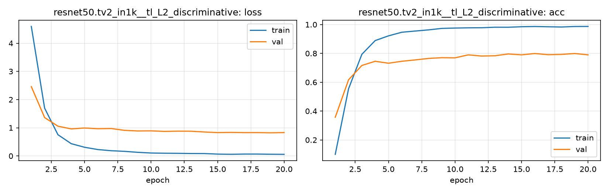

# Run card: `resnet50.tv2_in1k__tl_L2_discriminative`

_Generated by `python -m birdcls.report` from the files in `outputs/runs/resnet50.tv2_in1k__tl_L2_discriminative/`. Do not edit by hand._

## Summary

| Item | Value |
|---|---|
| Model | `resnet50.tv2_in1k` (23.92 M parameters) |
| Configuration | `tl_L2_discriminative`: L2 LR policy: backbone 1e-4 / head 1e-3 + 1-epoch warm-up + cosine (AdamW, 20 epochs) |
| Finished | 2026-10-17 13:26 |
| Training time | 4.5 min, completed all epochs |
| Best epoch (by val accuracy) | 16 at 224 px, val Top-1 0.7992 |
| Input normalisation | mean (0.485, 0.456, 0.406), std (0.229, 0.224, 0.225) |
| Command | `python -m birdcls.train --model resnet50.tv2_in1k --config tl_L2_discriminative` |

## Results (from `outputs/results.csv`)

| Variant | Train acc (clean) | Val Top-1 | Gap (train - val) | **Test Top-1** | **Test avg/class** |
|---|---|---|---|---|---|
| no TTA | 0.9984 | 0.8002 | 0.1982 | 0.7749 | 0.7664 |
| with TTA (flip averaging) | 0.9984 | 0.7981 | 0.2003 | 0.7857 | 0.7784 |

Train acc is measured on the training images with eval preprocessing (no augmentation).

## Configuration

Source: snapshot saved with the run (`config.yaml`).

| Setting | Value |
|---|---|
| `full_train` | False |
| `cutmix_prob` | 0.0 |
| `label_smoothing` | 0.0 |
| `weight_decay` | 0.01 |
| `dropout` | 0.0 |
| `drop_path` | 0.0 |
| `patience` | 6 |
| `optimizer` | adamw |
| `momentum` | 0.9 |
| `lr_schedule` | cosine |
| `augment` | basic |
| `freeze_backbone` | False |

| Phase | Image size | Batch | Epochs | LR backbone | LR head | Warm-up epochs |
|---|---|---|---|---|---|---|
| 1 | 224 | 32 | 20 | 0.0001 | 0.001 | 1 |

## Training curves

## Per-epoch log

| Epoch | Phase | Size | Train loss | Train acc | Val loss | Val acc | LR (backbone, end of epoch) |
|---|---|---|---|---|---|---|---|
| 1 | 1 | 224 | 4.595 | 0.100 | 2.459 | 0.3571 | 1.00e-04 |
| 2 | 1 | 224 | 1.696 | 0.555 | 1.362 | 0.6170 | 9.93e-05 |
| 3 | 1 | 224 | 0.754 | 0.794 | 1.056 | 0.7164 | 9.73e-05 |
| 4 | 1 | 224 | 0.436 | 0.889 | 0.959 | 0.7453 | 9.40e-05 |
| 5 | 1 | 224 | 0.309 | 0.922 | 0.991 | 0.7319 | 8.95e-05 |
| 6 | 1 | 224 | 0.227 | 0.947 | 0.965 | 0.7453 | 8.39e-05 |
| 7 | 1 | 224 | 0.186 | 0.955 | 0.973 | 0.7547 | 7.73e-05 |
| 8 | 1 | 224 | 0.163 | 0.963 | 0.908 | 0.7650 | 7.01e-05 |
| 9 | 1 | 224 | 0.129 | 0.973 | 0.887 | 0.7702 | 6.23e-05 |
| 10 | 1 | 224 | 0.105 | 0.976 | 0.891 | 0.7692 | 5.41e-05 |
| 11 | 1 | 224 | 0.096 | 0.977 | 0.871 | 0.7899 | 4.59e-05 |
| 12 | 1 | 224 | 0.093 | 0.978 | 0.879 | 0.7816 | 3.77e-05 |
| 13 | 1 | 224 | 0.087 | 0.982 | 0.877 | 0.7836 | 2.99e-05 |
| 14 | 1 | 224 | 0.085 | 0.981 | 0.850 | 0.7961 | 2.27e-05 |
| 15 | 1 | 224 | 0.066 | 0.985 | 0.828 | 0.7899 | 1.61e-05 |
| 16 **(best)** | 1 | 224 | 0.059 | 0.986 | 0.835 | 0.7992 | 1.05e-05 |
| 17 | 1 | 224 | 0.067 | 0.985 | 0.827 | 0.7909 | 6.03e-06 |
| 18 | 1 | 224 | 0.067 | 0.983 | 0.828 | 0.7930 | 2.71e-06 |
| 19 | 1 | 224 | 0.061 | 0.986 | 0.822 | 0.7992 | 6.82e-07 |
| 20 | 1 | 224 | 0.057 | 0.987 | 0.829 | 0.7899 | 0.00e+00 |

With CutMix, train loss/acc are computed on mixed images (soft accuracy), so they run lower than the clean train accuracy in the results table.

## Files

`outputs/runs/resnet50.tv2_in1k__tl_L2_discriminative/`: `best.pt` (best checkpoint), `history.json`, `train.log`, `curves.png`, `config.yaml`
