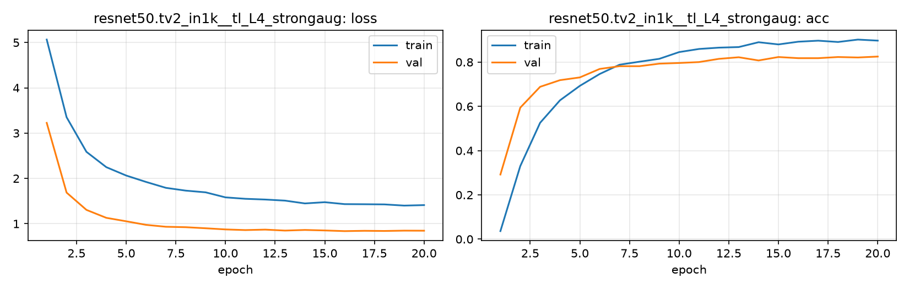

# Run card: `resnet50.tv2_in1k__tl_L4_strongaug`

_Generated by `python -m birdcls.report` from the files in `outputs/runs/resnet50.tv2_in1k__tl_L4_strongaug/`. Do not edit by hand._

## Summary

| Item | Value |
|---|---|
| Model | `resnet50.tv2_in1k` (23.92 M parameters) |
| Configuration | `tl_L4_strongaug`: L4 strong augmentation: L3 + crop 25-100%, TrivialAugmentWide, flip, random erasing |
| Finished | 2026-10-17 13:51 |
| Training time | 4.7 min, completed all epochs |
| Best epoch (by val accuracy) | 20 at 224 px, val Top-1 0.8251 |
| Input normalisation | mean (0.485, 0.456, 0.406), std (0.229, 0.224, 0.225) |
| Command | `python -m birdcls.train --model resnet50.tv2_in1k --config tl_L4_strongaug` |

## Results (from `outputs/results.csv`)

| Variant | Train acc (clean) | Val Top-1 | Gap (train - val) | **Test Top-1** | **Test avg/class** |
|---|---|---|---|---|---|
| no TTA | 0.9990 | 0.8251 | 0.1739 | 0.8073 | 0.8017 |
| with TTA (flip averaging) | 0.9990 | 0.8333 | 0.1656 | 0.8223 | 0.8171 |

Train acc is measured on the training images with eval preprocessing (no augmentation).

## Configuration

Source: snapshot saved with the run (`config.yaml`).

| Setting | Value |
|---|---|
| `full_train` | False |
| `cutmix_prob` | 0.0 |
| `label_smoothing` | 0.1 |
| `weight_decay` | 0.05 |
| `dropout` | 0.3 |
| `drop_path` | 0.1 |
| `patience` | 6 |
| `optimizer` | adamw |
| `momentum` | 0.9 |
| `lr_schedule` | cosine |
| `augment` | strong |
| `freeze_backbone` | False |

| Phase | Image size | Batch | Epochs | LR backbone | LR head | Warm-up epochs |
|---|---|---|---|---|---|---|
| 1 | 224 | 32 | 20 | 0.0001 | 0.001 | 1 |

## Training curves

## Per-epoch log

| Epoch | Phase | Size | Train loss | Train acc | Val loss | Val acc | LR (backbone, end of epoch) |
|---|---|---|---|---|---|---|---|
| 1 | 1 | 224 | 5.065 | 0.036 | 3.226 | 0.2919 | 1.00e-04 |
| 2 | 1 | 224 | 3.351 | 0.330 | 1.687 | 0.5942 | 9.93e-05 |
| 3 | 1 | 224 | 2.587 | 0.526 | 1.305 | 0.6884 | 9.73e-05 |
| 4 | 1 | 224 | 2.249 | 0.627 | 1.130 | 0.7184 | 9.40e-05 |
| 5 | 1 | 224 | 2.064 | 0.693 | 1.054 | 0.7308 | 8.95e-05 |
| 6 | 1 | 224 | 1.923 | 0.746 | 0.975 | 0.7692 | 8.39e-05 |
| 7 | 1 | 224 | 1.792 | 0.788 | 0.933 | 0.7816 | 7.73e-05 |
| 8 | 1 | 224 | 1.731 | 0.802 | 0.924 | 0.7816 | 7.01e-05 |
| 9 | 1 | 224 | 1.693 | 0.815 | 0.900 | 0.7930 | 6.23e-05 |
| 10 | 1 | 224 | 1.582 | 0.845 | 0.874 | 0.7961 | 5.41e-05 |
| 11 | 1 | 224 | 1.550 | 0.859 | 0.860 | 0.8002 | 4.59e-05 |
| 12 | 1 | 224 | 1.534 | 0.865 | 0.870 | 0.8147 | 3.77e-05 |
| 13 | 1 | 224 | 1.510 | 0.868 | 0.849 | 0.8219 | 2.99e-05 |
| 14 | 1 | 224 | 1.448 | 0.890 | 0.863 | 0.8075 | 2.27e-05 |
| 15 | 1 | 224 | 1.475 | 0.880 | 0.852 | 0.8230 | 1.61e-05 |
| 16 | 1 | 224 | 1.433 | 0.892 | 0.837 | 0.8178 | 1.05e-05 |
| 17 | 1 | 224 | 1.430 | 0.897 | 0.844 | 0.8178 | 6.03e-06 |
| 18 | 1 | 224 | 1.427 | 0.891 | 0.840 | 0.8230 | 2.71e-06 |
| 19 | 1 | 224 | 1.400 | 0.902 | 0.848 | 0.8209 | 6.82e-07 |
| 20 **(best)** | 1 | 224 | 1.411 | 0.897 | 0.846 | 0.8251 | 0.00e+00 |

With CutMix, train loss/acc are computed on mixed images (soft accuracy), so they run lower than the clean train accuracy in the results table.

## Files

`outputs/runs/resnet50.tv2_in1k__tl_L4_strongaug/`: `best.pt` (best checkpoint), `history.json`, `train.log`, `curves.png`, `config.yaml`
