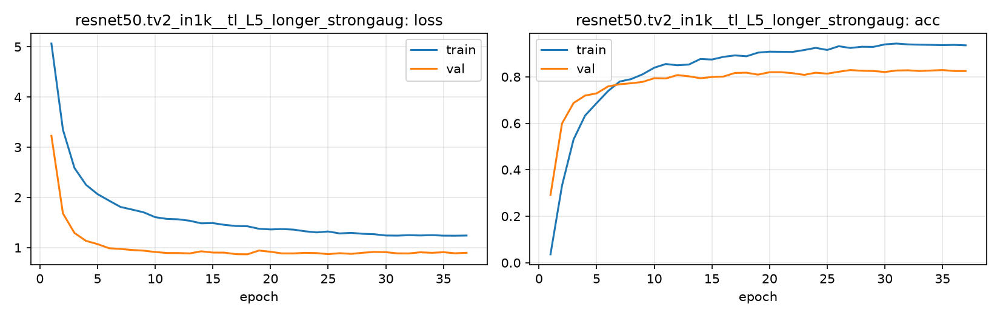

# Run card: `resnet50.tv2_in1k__tl_L5_longer_strongaug`

_Generated by `python -m birdcls.report` from the files in `outputs/runs/resnet50.tv2_in1k__tl_L5_longer_strongaug/`. Do not edit by hand._

## Summary

| Item | Value |
|---|---|
| Model | `resnet50.tv2_in1k` (23.92 M parameters) |
| Configuration | `tl_L5_longer_strongaug`: L5 longer training for ResNet-50: L4 (strong aug) with 40 epochs, patience 10 |
| Finished | 2026-10-17 14:06 |
| Training time | 8.6 min, early stopping after 37/40 epochs |
| Best epoch (by val accuracy) | 27 at 224 px, val Top-1 0.8292 |
| Input normalisation | mean (0.485, 0.456, 0.406), std (0.229, 0.224, 0.225) |
| Command | `python -m birdcls.train --model resnet50.tv2_in1k --config tl_L5_longer_strongaug` |

## Results (from `outputs/results.csv`)

| Variant | Train acc (clean) | Val Top-1 | Gap (train - val) | **Test Top-1** | **Test avg/class** |
|---|---|---|---|---|---|
| no TTA | 0.9997 | 0.8292 | 0.1705 | 0.8173 | 0.8129 |
| with TTA (flip averaging) | 0.9997 | 0.8251 | 0.1747 | 0.8264 | 0.8234 |

Train acc is measured on the training images with eval preprocessing (no augmentation).

## Configuration

Source: snapshot saved with the run (`config.yaml`).

| Setting | Value |
|---|---|
| `full_train` | False |
| `cutmix_prob` | 0.0 |
| `label_smoothing` | 0.1 |
| `weight_decay` | 0.05 |
| `dropout` | 0.3 |
| `drop_path` | 0.1 |
| `patience` | 10 |
| `optimizer` | adamw |
| `momentum` | 0.9 |
| `lr_schedule` | cosine |
| `augment` | strong |
| `freeze_backbone` | False |

| Phase | Image size | Batch | Epochs | LR backbone | LR head | Warm-up epochs |
|---|---|---|---|---|---|---|
| 1 | 224 | 32 | 40 | 0.0001 | 0.001 | 1 |

## Training curves

## Per-epoch log

| Epoch | Phase | Size | Train loss | Train acc | Val loss | Val acc | LR (backbone, end of epoch) |
|---|---|---|---|---|---|---|---|
| 1 | 1 | 224 | 5.065 | 0.036 | 3.226 | 0.2919 | 1.00e-04 |
| 2 | 1 | 224 | 3.349 | 0.332 | 1.681 | 0.5994 | 9.98e-05 |
| 3 | 1 | 224 | 2.586 | 0.530 | 1.291 | 0.6874 | 9.94e-05 |
| 4 | 1 | 224 | 2.251 | 0.633 | 1.134 | 0.7195 | 9.85e-05 |
| 5 | 1 | 224 | 2.066 | 0.687 | 1.070 | 0.7288 | 9.74e-05 |
| 6 | 1 | 224 | 1.936 | 0.739 | 0.988 | 0.7588 | 9.60e-05 |
| 7 | 1 | 224 | 1.809 | 0.780 | 0.973 | 0.7681 | 9.43e-05 |
| 8 | 1 | 224 | 1.758 | 0.790 | 0.953 | 0.7723 | 9.23e-05 |
| 9 | 1 | 224 | 1.703 | 0.811 | 0.939 | 0.7785 | 9.00e-05 |
| 10 | 1 | 224 | 1.606 | 0.839 | 0.913 | 0.7940 | 8.74e-05 |
| 11 | 1 | 224 | 1.572 | 0.855 | 0.893 | 0.7930 | 8.46e-05 |
| 12 | 1 | 224 | 1.564 | 0.850 | 0.892 | 0.8075 | 8.16e-05 |
| 13 | 1 | 224 | 1.535 | 0.853 | 0.884 | 0.8023 | 7.84e-05 |
| 14 | 1 | 224 | 1.483 | 0.877 | 0.927 | 0.7940 | 7.50e-05 |
| 15 | 1 | 224 | 1.488 | 0.874 | 0.901 | 0.7992 | 7.14e-05 |
| 16 | 1 | 224 | 1.453 | 0.886 | 0.900 | 0.8012 | 6.77e-05 |
| 17 | 1 | 224 | 1.430 | 0.892 | 0.869 | 0.8168 | 6.39e-05 |
| 18 | 1 | 224 | 1.425 | 0.889 | 0.867 | 0.8178 | 6.00e-05 |
| 19 | 1 | 224 | 1.375 | 0.904 | 0.942 | 0.8095 | 5.60e-05 |
| 20 | 1 | 224 | 1.362 | 0.908 | 0.917 | 0.8199 | 5.20e-05 |
| 21 | 1 | 224 | 1.369 | 0.908 | 0.884 | 0.8199 | 4.80e-05 |
| 22 | 1 | 224 | 1.358 | 0.907 | 0.884 | 0.8157 | 4.40e-05 |
| 23 | 1 | 224 | 1.325 | 0.915 | 0.896 | 0.8085 | 4.00e-05 |
| 24 | 1 | 224 | 1.303 | 0.925 | 0.891 | 0.8178 | 3.61e-05 |
| 25 | 1 | 224 | 1.321 | 0.916 | 0.870 | 0.8137 | 3.23e-05 |
| 26 | 1 | 224 | 1.283 | 0.932 | 0.889 | 0.8219 | 2.86e-05 |
| 27 **(best)** | 1 | 224 | 1.294 | 0.924 | 0.875 | 0.8292 | 2.50e-05 |
| 28 | 1 | 224 | 1.275 | 0.929 | 0.897 | 0.8261 | 2.16e-05 |
| 29 | 1 | 224 | 1.267 | 0.929 | 0.914 | 0.8251 | 1.84e-05 |
| 30 | 1 | 224 | 1.241 | 0.940 | 0.909 | 0.8209 | 1.54e-05 |
| 31 | 1 | 224 | 1.239 | 0.943 | 0.886 | 0.8271 | 1.26e-05 |
| 32 | 1 | 224 | 1.248 | 0.940 | 0.884 | 0.8282 | 1.00e-05 |
| 33 | 1 | 224 | 1.242 | 0.938 | 0.907 | 0.8251 | 7.74e-06 |
| 34 | 1 | 224 | 1.248 | 0.938 | 0.896 | 0.8271 | 5.73e-06 |
| 35 | 1 | 224 | 1.238 | 0.936 | 0.908 | 0.8292 | 4.00e-06 |
| 36 | 1 | 224 | 1.237 | 0.938 | 0.887 | 0.8251 | 2.57e-06 |
| 37 | 1 | 224 | 1.240 | 0.936 | 0.897 | 0.8251 | 1.45e-06 |

With CutMix, train loss/acc are computed on mixed images (soft accuracy), so they run lower than the clean train accuracy in the results table.

## Files

`outputs/runs/resnet50.tv2_in1k__tl_L5_longer_strongaug/`: `best.pt` (best checkpoint), `history.json`, `train.log`, `curves.png`, `config.yaml`
