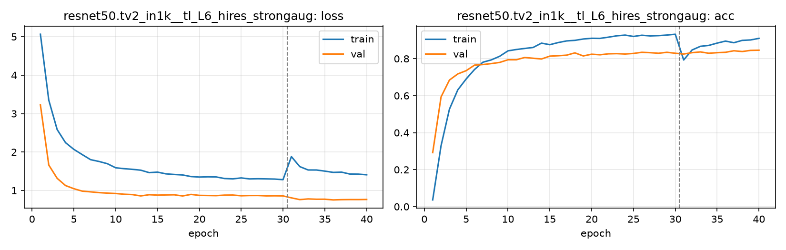

# Run card: `resnet50.tv2_in1k__tl_L6_hires_strongaug`

_Generated by `python -m birdcls.report` from the files in `outputs/runs/resnet50.tv2_in1k__tl_L6_hires_strongaug/`. Do not edit by hand._

## Summary

| Item | Value |
|---|---|
| Model | `resnet50.tv2_in1k` (23.92 M parameters) |
| Configuration | `tl_L6_hires_strongaug`: L6 resolution for ResNet-50: L5 (strong aug) with 30 epochs at 224 px + 10 epochs at 448 px |
| Finished | 2026-10-17 14:33 |
| Training time | 15.7 min, completed all epochs |
| Best epoch (by val accuracy) | 40 at 448 px, val Top-1 0.8458 |
| Input normalisation | mean (0.485, 0.456, 0.406), std (0.229, 0.224, 0.225) |
| Command | `python -m birdcls.train --model resnet50.tv2_in1k --config tl_L6_hires_strongaug` |

## Results (from `outputs/results.csv`)

| Variant | Train acc (clean) | Val Top-1 | Gap (train - val) | **Test Top-1** | **Test avg/class** |
|---|---|---|---|---|---|
| no TTA | 0.9995 | 0.8458 | 0.1537 | 0.8297 | 0.8240 |
| with TTA (flip averaging) | 0.9995 | 0.8458 | 0.1537 | 0.8331 | 0.8278 |

Train acc is measured on the training images with eval preprocessing (no augmentation).

## Configuration

Source: snapshot saved with the run (`config.yaml`).

| Setting | Value |
|---|---|
| `full_train` | False |
| `cutmix_prob` | 0.0 |
| `label_smoothing` | 0.1 |
| `weight_decay` | 0.05 |
| `dropout` | 0.3 |
| `drop_path` | 0.1 |
| `patience` | 10 |
| `optimizer` | adamw |
| `momentum` | 0.9 |
| `lr_schedule` | cosine |
| `augment` | strong |
| `freeze_backbone` | False |

| Phase | Image size | Batch | Epochs | LR backbone | LR head | Warm-up epochs |
|---|---|---|---|---|---|---|
| 1 | 224 | 32 | 30 | 0.0001 | 0.001 | 1 |
| 2 | 448 | 16 | 10 | 2e-05 | 0.0002 | 0 |

## Training curves

## Per-epoch log

| Epoch | Phase | Size | Train loss | Train acc | Val loss | Val acc | LR (backbone, end of epoch) |
|---|---|---|---|---|---|---|---|
| 1 | 1 | 224 | 5.065 | 0.036 | 3.226 | 0.2919 | 1.00e-04 |
| 2 | 1 | 224 | 3.350 | 0.329 | 1.663 | 0.5932 | 9.97e-05 |
| 3 | 1 | 224 | 2.586 | 0.527 | 1.317 | 0.6843 | 9.88e-05 |
| 4 | 1 | 224 | 2.245 | 0.631 | 1.130 | 0.7174 | 9.74e-05 |
| 5 | 1 | 224 | 2.070 | 0.690 | 1.047 | 0.7350 | 9.54e-05 |
| 6 | 1 | 224 | 1.934 | 0.741 | 0.984 | 0.7650 | 9.28e-05 |
| 7 | 1 | 224 | 1.802 | 0.781 | 0.965 | 0.7681 | 8.98e-05 |
| 8 | 1 | 224 | 1.756 | 0.793 | 0.945 | 0.7733 | 8.63e-05 |
| 9 | 1 | 224 | 1.697 | 0.813 | 0.932 | 0.7795 | 8.24e-05 |
| 10 | 1 | 224 | 1.591 | 0.842 | 0.922 | 0.7940 | 7.81e-05 |
| 11 | 1 | 224 | 1.568 | 0.849 | 0.904 | 0.7940 | 7.34e-05 |
| 12 | 1 | 224 | 1.551 | 0.855 | 0.894 | 0.8064 | 6.85e-05 |
| 13 | 1 | 224 | 1.529 | 0.860 | 0.859 | 0.8023 | 6.34e-05 |
| 14 | 1 | 224 | 1.465 | 0.884 | 0.891 | 0.7981 | 5.81e-05 |
| 15 | 1 | 224 | 1.478 | 0.876 | 0.880 | 0.8137 | 5.27e-05 |
| 16 | 1 | 224 | 1.434 | 0.887 | 0.885 | 0.8157 | 4.73e-05 |
| 17 | 1 | 224 | 1.417 | 0.896 | 0.889 | 0.8188 | 4.19e-05 |
| 18 | 1 | 224 | 1.404 | 0.899 | 0.858 | 0.8313 | 3.66e-05 |
| 19 | 1 | 224 | 1.363 | 0.906 | 0.898 | 0.8147 | 3.15e-05 |
| 20 | 1 | 224 | 1.350 | 0.910 | 0.873 | 0.8240 | 2.66e-05 |
| 21 | 1 | 224 | 1.356 | 0.910 | 0.870 | 0.8209 | 2.19e-05 |
| 22 | 1 | 224 | 1.353 | 0.916 | 0.866 | 0.8261 | 1.76e-05 |
| 23 | 1 | 224 | 1.312 | 0.923 | 0.880 | 0.8271 | 1.37e-05 |
| 24 | 1 | 224 | 1.303 | 0.927 | 0.882 | 0.8251 | 1.02e-05 |
| 25 | 1 | 224 | 1.328 | 0.920 | 0.863 | 0.8282 | 7.16e-06 |
| 26 | 1 | 224 | 1.301 | 0.927 | 0.869 | 0.8344 | 4.62e-06 |
| 27 | 1 | 224 | 1.306 | 0.923 | 0.870 | 0.8323 | 2.62e-06 |
| 28 | 1 | 224 | 1.302 | 0.924 | 0.860 | 0.8292 | 1.17e-06 |
| 29 | 1 | 224 | 1.298 | 0.928 | 0.862 | 0.8344 | 2.93e-07 |
| 30 | 1 | 224 | 1.282 | 0.932 | 0.860 | 0.8292 | 0.00e+00 |
| 31 | 2 | 448 | 1.882 | 0.793 | 0.809 | 0.8251 | 1.95e-05 |
| 32 | 2 | 448 | 1.622 | 0.847 | 0.763 | 0.8323 | 1.81e-05 |
| 33 | 2 | 448 | 1.534 | 0.867 | 0.781 | 0.8364 | 1.59e-05 |
| 34 | 2 | 448 | 1.533 | 0.872 | 0.773 | 0.8292 | 1.31e-05 |
| 35 | 2 | 448 | 1.504 | 0.884 | 0.774 | 0.8323 | 1.00e-05 |
| 36 | 2 | 448 | 1.471 | 0.895 | 0.755 | 0.8344 | 6.91e-06 |
| 37 | 2 | 448 | 1.478 | 0.886 | 0.762 | 0.8427 | 4.12e-06 |
| 38 | 2 | 448 | 1.428 | 0.899 | 0.765 | 0.8385 | 1.91e-06 |
| 39 | 2 | 448 | 1.426 | 0.901 | 0.764 | 0.8447 | 4.89e-07 |
| 40 **(best)** | 2 | 448 | 1.409 | 0.910 | 0.767 | 0.8458 | 0.00e+00 |

With CutMix, train loss/acc are computed on mixed images (soft accuracy), so they run lower than the clean train accuracy in the results table.

## Files

`outputs/runs/resnet50.tv2_in1k__tl_L6_hires_strongaug/`: `best.pt` (best checkpoint), `history.json`, `train.log`, `curves.png`, `config.yaml`
