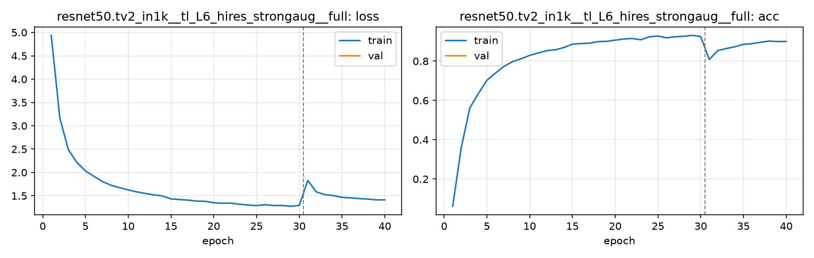

# Run card: `resnet50.tv2_in1k__tl_L6_hires_strongaug__full`

_Generated by `python -m birdcls.report` from the files in `outputs/runs/resnet50.tv2_in1k__tl_L6_hires_strongaug__full/`. Do not edit by hand._

## Summary

| Item | Value |
|---|---|
| Model | `resnet50.tv2_in1k` (23.92 M parameters) |
| Configuration | `tl_L6_hires_strongaug`: L6 resolution for ResNet-50: L5 (strong aug) with 30 epochs at 224 px + 10 epochs at 448 px |
| Finished | 2026-10-17 15:11 |
| Training time | 18.0 min, completed all epochs |
| Checkpoint | **final epoch 40** (full-train: trained on train + val, no validation, no early stopping) |
| Input normalisation | mean (0.485, 0.456, 0.406), std (0.229, 0.224, 0.225) |
| Command | `python -m birdcls.train --model resnet50.tv2_in1k --config tl_L6_hires_strongaug` |

## Results (from `outputs/results.csv`)

| Variant | Train acc (clean) | Val Top-1 | Gap (train - val) | **Test Top-1** | **Test avg/class** |
|---|---|---|---|---|---|
| no TTA | 0.9992 | nan | nan | 0.8646 | 0.8612 |
| with TTA (flip averaging) | 0.9992 | nan | nan | 0.8663 | 0.8631 |

Train acc is measured on the training images with eval preprocessing (no augmentation).

## Configuration

Source: snapshot saved with the run (`config.yaml`).

| Setting | Value |
|---|---|
| `full_train` | True |
| `cutmix_prob` | 0.0 |
| `label_smoothing` | 0.1 |
| `weight_decay` | 0.05 |
| `dropout` | 0.3 |
| `drop_path` | 0.1 |
| `patience` | 10 |
| `optimizer` | adamw |
| `momentum` | 0.9 |
| `lr_schedule` | cosine |
| `augment` | strong |
| `freeze_backbone` | False |

| Phase | Image size | Batch | Epochs | LR backbone | LR head | Warm-up epochs |
|---|---|---|---|---|---|---|
| 1 | 224 | 32 | 30 | 0.0001 | 0.001 | 1 |
| 2 | 448 | 16 | 10 | 2e-05 | 0.0002 | 0 |

## Training curves

## Per-epoch log

| Epoch | Phase | Size | Train loss | Train acc | Val loss | Val acc | LR (backbone, end of epoch) |
|---|---|---|---|---|---|---|---|
| 1 | 1 | 224 | 4.939 | 0.061 | nan | nan | 1.00e-04 |
| 2 | 1 | 224 | 3.168 | 0.360 | nan | nan | 9.97e-05 |
| 3 | 1 | 224 | 2.488 | 0.561 | nan | nan | 9.88e-05 |
| 4 | 1 | 224 | 2.214 | 0.635 | nan | nan | 9.74e-05 |
| 5 | 1 | 224 | 2.034 | 0.702 | nan | nan | 9.54e-05 |
| 6 | 1 | 224 | 1.915 | 0.739 | nan | nan | 9.28e-05 |
| 7 | 1 | 224 | 1.803 | 0.774 | nan | nan | 8.98e-05 |
| 8 | 1 | 224 | 1.725 | 0.797 | nan | nan | 8.63e-05 |
| 9 | 1 | 224 | 1.674 | 0.812 | nan | nan | 8.24e-05 |
| 10 | 1 | 224 | 1.625 | 0.829 | nan | nan | 7.81e-05 |
| 11 | 1 | 224 | 1.583 | 0.841 | nan | nan | 7.34e-05 |
| 12 | 1 | 224 | 1.549 | 0.853 | nan | nan | 6.85e-05 |
| 13 | 1 | 224 | 1.519 | 0.858 | nan | nan | 6.34e-05 |
| 14 | 1 | 224 | 1.496 | 0.869 | nan | nan | 5.81e-05 |
| 15 | 1 | 224 | 1.433 | 0.887 | nan | nan | 5.27e-05 |
| 16 | 1 | 224 | 1.418 | 0.889 | nan | nan | 4.73e-05 |
| 17 | 1 | 224 | 1.406 | 0.891 | nan | nan | 4.19e-05 |
| 18 | 1 | 224 | 1.385 | 0.899 | nan | nan | 3.66e-05 |
| 19 | 1 | 224 | 1.381 | 0.901 | nan | nan | 3.15e-05 |
| 20 | 1 | 224 | 1.349 | 0.907 | nan | nan | 2.66e-05 |
| 21 | 1 | 224 | 1.340 | 0.912 | nan | nan | 2.19e-05 |
| 22 | 1 | 224 | 1.341 | 0.915 | nan | nan | 1.76e-05 |
| 23 | 1 | 224 | 1.319 | 0.909 | nan | nan | 1.37e-05 |
| 24 | 1 | 224 | 1.301 | 0.924 | nan | nan | 1.02e-05 |
| 25 | 1 | 224 | 1.289 | 0.928 | nan | nan | 7.16e-06 |
| 26 | 1 | 224 | 1.308 | 0.919 | nan | nan | 4.62e-06 |
| 27 | 1 | 224 | 1.290 | 0.924 | nan | nan | 2.62e-06 |
| 28 | 1 | 224 | 1.292 | 0.926 | nan | nan | 1.17e-06 |
| 29 | 1 | 224 | 1.273 | 0.931 | nan | nan | 2.93e-07 |
| 30 | 1 | 224 | 1.294 | 0.925 | nan | nan | 0.00e+00 |
| 31 | 2 | 448 | 1.827 | 0.808 | nan | nan | 1.95e-05 |
| 32 | 2 | 448 | 1.582 | 0.854 | nan | nan | 1.81e-05 |
| 33 | 2 | 448 | 1.523 | 0.864 | nan | nan | 1.59e-05 |
| 34 | 2 | 448 | 1.504 | 0.873 | nan | nan | 1.31e-05 |
| 35 | 2 | 448 | 1.467 | 0.885 | nan | nan | 1.00e-05 |
| 36 | 2 | 448 | 1.455 | 0.889 | nan | nan | 6.91e-06 |
| 37 | 2 | 448 | 1.440 | 0.896 | nan | nan | 4.12e-06 |
| 38 | 2 | 448 | 1.428 | 0.902 | nan | nan | 1.91e-06 |
| 39 | 2 | 448 | 1.412 | 0.900 | nan | nan | 4.89e-07 |
| 40 **(best)** | 2 | 448 | 1.411 | 0.900 | nan | nan | 0.00e+00 |

With CutMix, train loss/acc are computed on mixed images (soft accuracy), so they run lower than the clean train accuracy in the results table.

## Files

`outputs/runs/resnet50.tv2_in1k__tl_L6_hires_strongaug__full/`: `best.pt` (best checkpoint), `history.json`, `train.log`, `curves.png`, `config.yaml`
