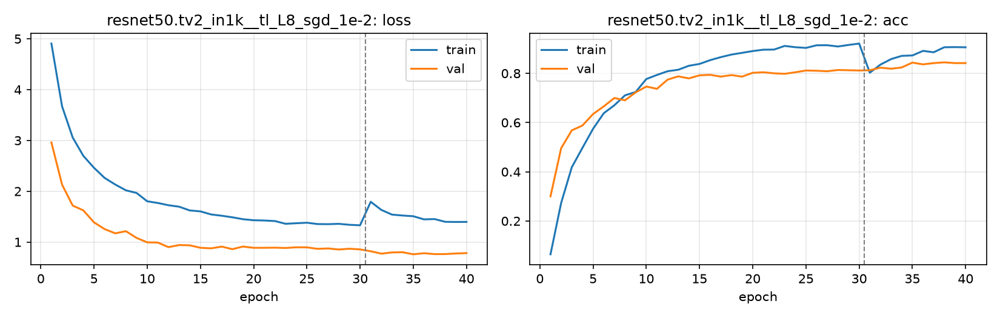

# Run card: `resnet50.tv2_in1k__tl_L8_sgd_1e-2`

_Generated by `python -m birdcls.report` from the files in `outputs/runs/resnet50.tv2_in1k__tl_L8_sgd_1e-2/`. Do not edit by hand._

## Summary

| Item | Value |
|---|---|
| Model | `resnet50.tv2_in1k` (23.92 M parameters) |
| Configuration | `tl_L8_sgd_1e-2`: L8 ResNet-50: L6 with SGD momentum 0.9, wd 1e-4, backbone LR 0.01 / head 0.1 |
| Finished | 2026-10-19 18:54 |
| Training time | 15.2 min, completed all epochs |
| Best epoch (by val accuracy) | 38 at 448 px, val Top-1 0.8447 |
| Input normalisation | mean (0.485, 0.456, 0.406), std (0.229, 0.224, 0.225) |
| Command | `python -m birdcls.train --model resnet50.tv2_in1k --config tl_L8_sgd_1e-2` |

## Results (from `outputs/results.csv`)

| Variant | Train acc (clean) | Val Top-1 | Gap (train - val) | **Test Top-1** | **Test avg/class** |
|---|---|---|---|---|---|
| no TTA | 0.9992 | 0.8447 | 0.1545 | 0.8272 | 0.8224 |
| with TTA (flip averaging) | 0.9992 | 0.8437 | 0.1555 | 0.8314 | 0.8266 |

Train acc is measured on the training images with eval preprocessing (no augmentation).

## Configuration

Source: snapshot saved with the run (`config.yaml`).

| Setting | Value |
|---|---|
| `full_train` | False |
| `cutmix_prob` | 0.0 |
| `label_smoothing` | 0.1 |
| `weight_decay` | 0.0001 |
| `dropout` | 0.3 |
| `drop_path` | 0.1 |
| `patience` | 10 |
| `optimizer` | sgd |
| `momentum` | 0.9 |
| `lr_schedule` | cosine |
| `augment` | strong |
| `freeze_backbone` | False |
| `layer_decay` | 1.0 |

| Phase | Image size | Batch | Epochs | LR backbone | LR head | Warm-up epochs |
|---|---|---|---|---|---|---|
| 1 | 224 | 32 | 30 | 0.01 | 0.1 | 1 |
| 2 | 448 | 16 | 10 | 0.002 | 0.02 | 0 |

## Training curves

## Per-epoch log

| Epoch | Phase | Size | Train loss | Train acc | Val loss | Val acc | LR (backbone, end of epoch) |
|---|---|---|---|---|---|---|---|
| 1 | 1 | 224 | 4.907 | 0.065 | 2.960 | 0.3002 | 1.00e-02 |
| 2 | 1 | 224 | 3.672 | 0.273 | 2.130 | 0.4959 | 9.97e-03 |
| 3 | 1 | 224 | 3.057 | 0.418 | 1.717 | 0.5683 | 9.88e-03 |
| 4 | 1 | 224 | 2.696 | 0.497 | 1.623 | 0.5880 | 9.74e-03 |
| 5 | 1 | 224 | 2.461 | 0.575 | 1.387 | 0.6346 | 9.54e-03 |
| 6 | 1 | 224 | 2.262 | 0.638 | 1.254 | 0.6656 | 9.28e-03 |
| 7 | 1 | 224 | 2.131 | 0.670 | 1.171 | 0.6998 | 8.98e-03 |
| 8 | 1 | 224 | 2.018 | 0.711 | 1.214 | 0.6905 | 8.63e-03 |
| 9 | 1 | 224 | 1.966 | 0.724 | 1.081 | 0.7226 | 8.24e-03 |
| 10 | 1 | 224 | 1.802 | 0.777 | 0.994 | 0.7464 | 7.81e-03 |
| 11 | 1 | 224 | 1.768 | 0.793 | 0.990 | 0.7371 | 7.34e-03 |
| 12 | 1 | 224 | 1.724 | 0.809 | 0.900 | 0.7743 | 6.85e-03 |
| 13 | 1 | 224 | 1.695 | 0.815 | 0.941 | 0.7878 | 6.34e-03 |
| 14 | 1 | 224 | 1.622 | 0.831 | 0.935 | 0.7795 | 5.81e-03 |
| 15 | 1 | 224 | 1.603 | 0.838 | 0.887 | 0.7919 | 5.27e-03 |
| 16 | 1 | 224 | 1.543 | 0.854 | 0.876 | 0.7940 | 4.73e-03 |
| 17 | 1 | 224 | 1.518 | 0.866 | 0.910 | 0.7867 | 4.19e-03 |
| 18 | 1 | 224 | 1.487 | 0.876 | 0.860 | 0.7930 | 3.66e-03 |
| 19 | 1 | 224 | 1.449 | 0.883 | 0.911 | 0.7867 | 3.15e-03 |
| 20 | 1 | 224 | 1.429 | 0.891 | 0.886 | 0.8023 | 2.66e-03 |
| 21 | 1 | 224 | 1.424 | 0.896 | 0.887 | 0.8043 | 2.19e-03 |
| 22 | 1 | 224 | 1.413 | 0.897 | 0.889 | 0.8002 | 1.76e-03 |
| 23 | 1 | 224 | 1.359 | 0.911 | 0.883 | 0.7981 | 1.37e-03 |
| 24 | 1 | 224 | 1.370 | 0.906 | 0.896 | 0.8043 | 1.02e-03 |
| 25 | 1 | 224 | 1.380 | 0.903 | 0.895 | 0.8116 | 7.16e-04 |
| 26 | 1 | 224 | 1.354 | 0.914 | 0.866 | 0.8106 | 4.62e-04 |
| 27 | 1 | 224 | 1.351 | 0.914 | 0.874 | 0.8085 | 2.62e-04 |
| 28 | 1 | 224 | 1.358 | 0.909 | 0.853 | 0.8137 | 1.17e-04 |
| 29 | 1 | 224 | 1.339 | 0.915 | 0.869 | 0.8126 | 2.93e-05 |
| 30 | 1 | 224 | 1.329 | 0.921 | 0.855 | 0.8116 | 0.00e+00 |
| 31 | 2 | 448 | 1.792 | 0.803 | 0.819 | 0.8126 | 1.95e-03 |
| 32 | 2 | 448 | 1.632 | 0.836 | 0.771 | 0.8230 | 1.81e-03 |
| 33 | 2 | 448 | 1.540 | 0.858 | 0.795 | 0.8188 | 1.59e-03 |
| 34 | 2 | 448 | 1.522 | 0.871 | 0.800 | 0.8240 | 1.31e-03 |
| 35 | 2 | 448 | 1.508 | 0.873 | 0.758 | 0.8437 | 1.00e-03 |
| 36 | 2 | 448 | 1.446 | 0.891 | 0.780 | 0.8364 | 6.91e-04 |
| 37 | 2 | 448 | 1.452 | 0.886 | 0.762 | 0.8416 | 4.12e-04 |
| 38 **(best)** | 2 | 448 | 1.398 | 0.906 | 0.763 | 0.8447 | 1.91e-04 |
| 39 | 2 | 448 | 1.395 | 0.907 | 0.774 | 0.8416 | 4.89e-05 |
| 40 | 2 | 448 | 1.396 | 0.906 | 0.782 | 0.8416 | 0.00e+00 |

With CutMix, train loss/acc are computed on mixed images (soft accuracy), so they run lower than the clean train accuracy in the results table.

## Files

`outputs/runs/resnet50.tv2_in1k__tl_L8_sgd_1e-2/`: `best.pt` (best checkpoint), `history.json`, `train.log`, `curves.png`, `config.yaml`
