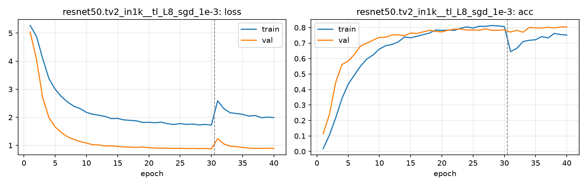

# Run card: `resnet50.tv2_in1k__tl_L8_sgd_1e-3`

_Generated by `python -m birdcls.report` from the files in `outputs/runs/resnet50.tv2_in1k__tl_L8_sgd_1e-3/`. Do not edit by hand._

## Summary

| Item | Value |
|---|---|
| Model | `resnet50.tv2_in1k` (23.92 M parameters) |
| Configuration | `tl_L8_sgd_1e-3`: L8 ResNet-50: L6 with SGD momentum 0.9, wd 1e-4, backbone LR 0.001 / head 0.01 |
| Finished | 2026-10-19 18:24 |
| Training time | 15.4 min, completed all epochs |
| Best epoch (by val accuracy) | 39 at 448 px, val Top-1 0.8043 |
| Input normalisation | mean (0.485, 0.456, 0.406), std (0.229, 0.224, 0.225) |
| Command | `python -m birdcls.train --model resnet50.tv2_in1k --config tl_L8_sgd_1e-3` |

## Results (from `outputs/results.csv`)

| Variant | Train acc (clean) | Val Top-1 | Gap (train - val) | **Test Top-1** | **Test avg/class** |
|---|---|---|---|---|---|
| no TTA | 0.9821 | 0.8043 | 0.1778 | 0.7890 | 0.7802 |
| with TTA (flip averaging) | 0.9821 | 0.8168 | 0.1654 | 0.7857 | 0.7756 |

Train acc is measured on the training images with eval preprocessing (no augmentation).

## Configuration

Source: snapshot saved with the run (`config.yaml`).

| Setting | Value |
|---|---|
| `full_train` | False |
| `cutmix_prob` | 0.0 |
| `label_smoothing` | 0.1 |
| `weight_decay` | 0.0001 |
| `dropout` | 0.3 |
| `drop_path` | 0.1 |
| `patience` | 10 |
| `optimizer` | sgd |
| `momentum` | 0.9 |
| `lr_schedule` | cosine |
| `augment` | strong |
| `freeze_backbone` | False |
| `layer_decay` | 1.0 |

| Phase | Image size | Batch | Epochs | LR backbone | LR head | Warm-up epochs |
|---|---|---|---|---|---|---|
| 1 | 224 | 32 | 30 | 0.001 | 0.01 | 1 |
| 2 | 448 | 16 | 10 | 0.0002 | 0.002 | 0 |

## Training curves

## Per-epoch log

| Epoch | Phase | Size | Train loss | Train acc | Val loss | Val acc | LR (backbone, end of epoch) |
|---|---|---|---|---|---|---|---|
| 1 | 1 | 224 | 5.272 | 0.017 | 5.042 | 0.1139 | 1.00e-03 |
| 2 | 1 | 224 | 4.886 | 0.105 | 4.077 | 0.2381 | 9.97e-04 |
| 3 | 1 | 224 | 4.095 | 0.216 | 2.702 | 0.4451 | 9.88e-04 |
| 4 | 1 | 224 | 3.379 | 0.341 | 1.990 | 0.5611 | 9.74e-04 |
| 5 | 1 | 224 | 3.001 | 0.434 | 1.657 | 0.5839 | 9.54e-04 |
| 6 | 1 | 224 | 2.736 | 0.494 | 1.455 | 0.6263 | 9.28e-04 |
| 7 | 1 | 224 | 2.541 | 0.552 | 1.305 | 0.6812 | 8.98e-04 |
| 8 | 1 | 224 | 2.394 | 0.597 | 1.209 | 0.6998 | 8.63e-04 |
| 9 | 1 | 224 | 2.309 | 0.623 | 1.135 | 0.7195 | 8.24e-04 |
| 10 | 1 | 224 | 2.177 | 0.661 | 1.084 | 0.7371 | 7.81e-04 |
| 11 | 1 | 224 | 2.109 | 0.683 | 1.025 | 0.7381 | 7.34e-04 |
| 12 | 1 | 224 | 2.075 | 0.691 | 1.016 | 0.7526 | 6.85e-04 |
| 13 | 1 | 224 | 2.031 | 0.707 | 0.978 | 0.7536 | 6.34e-04 |
| 14 | 1 | 224 | 1.953 | 0.739 | 0.982 | 0.7474 | 5.81e-04 |
| 15 | 1 | 224 | 1.961 | 0.734 | 0.963 | 0.7650 | 5.27e-04 |
| 16 | 1 | 224 | 1.908 | 0.743 | 0.948 | 0.7619 | 4.73e-04 |
| 17 | 1 | 224 | 1.891 | 0.755 | 0.937 | 0.7723 | 4.19e-04 |
| 18 | 1 | 224 | 1.874 | 0.764 | 0.929 | 0.7826 | 3.66e-04 |
| 19 | 1 | 224 | 1.818 | 0.784 | 0.940 | 0.7754 | 3.15e-04 |
| 20 | 1 | 224 | 1.821 | 0.782 | 0.919 | 0.7723 | 2.66e-04 |
| 21 | 1 | 224 | 1.807 | 0.784 | 0.904 | 0.7836 | 2.19e-04 |
| 22 | 1 | 224 | 1.827 | 0.782 | 0.901 | 0.7899 | 1.76e-04 |
| 23 | 1 | 224 | 1.772 | 0.796 | 0.900 | 0.7909 | 1.37e-04 |
| 24 | 1 | 224 | 1.744 | 0.805 | 0.894 | 0.7847 | 1.02e-04 |
| 25 | 1 | 224 | 1.777 | 0.797 | 0.897 | 0.7847 | 7.16e-05 |
| 26 | 1 | 224 | 1.747 | 0.809 | 0.888 | 0.7836 | 4.62e-05 |
| 27 | 1 | 224 | 1.761 | 0.808 | 0.895 | 0.7919 | 2.62e-05 |
| 28 | 1 | 224 | 1.731 | 0.814 | 0.886 | 0.7826 | 1.17e-05 |
| 29 | 1 | 224 | 1.747 | 0.811 | 0.891 | 0.7826 | 2.93e-06 |
| 30 | 1 | 224 | 1.723 | 0.807 | 0.880 | 0.7857 | 0.00e+00 |
| 31 | 2 | 448 | 2.586 | 0.645 | 1.237 | 0.7712 | 1.95e-04 |
| 32 | 2 | 448 | 2.310 | 0.666 | 1.051 | 0.7826 | 1.81e-04 |
| 33 | 2 | 448 | 2.164 | 0.710 | 0.974 | 0.7702 | 1.59e-04 |
| 34 | 2 | 448 | 2.134 | 0.718 | 0.953 | 0.8012 | 1.31e-04 |
| 35 | 2 | 448 | 2.108 | 0.722 | 0.929 | 0.7981 | 1.00e-04 |
| 36 | 2 | 448 | 2.045 | 0.742 | 0.906 | 0.7971 | 6.91e-05 |
| 37 | 2 | 448 | 2.066 | 0.733 | 0.892 | 0.8023 | 4.12e-05 |
| 38 | 2 | 448 | 1.986 | 0.762 | 0.896 | 0.7981 | 1.91e-05 |
| 39 **(best)** | 2 | 448 | 2.007 | 0.755 | 0.900 | 0.8043 | 4.89e-06 |
| 40 | 2 | 448 | 1.992 | 0.752 | 0.889 | 0.8043 | 0.00e+00 |

With CutMix, train loss/acc are computed on mixed images (soft accuracy), so they run lower than the clean train accuracy in the results table.

## Files

`outputs/runs/resnet50.tv2_in1k__tl_L8_sgd_1e-3/`: `best.pt` (best checkpoint), `history.json`, `train.log`, `curves.png`, `config.yaml`
