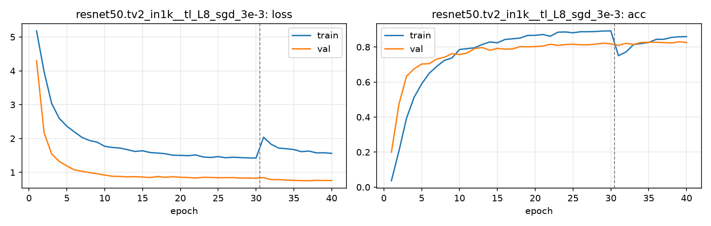

# Run card: `resnet50.tv2_in1k__tl_L8_sgd_3e-3`

_Generated by `python -m birdcls.report` from the files in `outputs/runs/resnet50.tv2_in1k__tl_L8_sgd_3e-3/`. Do not edit by hand._

## Summary

| Item | Value |
|---|---|
| Model | `resnet50.tv2_in1k` (23.92 M parameters) |
| Configuration | `tl_L8_sgd_3e-3`: L8 ResNet-50: L6 with SGD momentum 0.9, wd 1e-4, backbone LR 0.003 / head 0.03 |
| Finished | 2026-10-19 18:39 |
| Training time | 15.3 min, completed all epochs |
| Best epoch (by val accuracy) | 39 at 448 px, val Top-1 0.8302 |
| Input normalisation | mean (0.485, 0.456, 0.406), std (0.229, 0.224, 0.225) |
| Command | `python -m birdcls.train --model resnet50.tv2_in1k --config tl_L8_sgd_3e-3` |

## Results (from `outputs/results.csv`)

| Variant | Train acc (clean) | Val Top-1 | Gap (train - val) | **Test Top-1** | **Test avg/class** |
|---|---|---|---|---|---|
| no TTA | 0.9990 | 0.8302 | 0.1687 | 0.8140 | 0.8069 |
| with TTA (flip averaging) | 0.9990 | 0.8323 | 0.1667 | 0.8189 | 0.8120 |

Train acc is measured on the training images with eval preprocessing (no augmentation).

## Configuration

Source: snapshot saved with the run (`config.yaml`).

| Setting | Value |
|---|---|
| `full_train` | False |
| `cutmix_prob` | 0.0 |
| `label_smoothing` | 0.1 |
| `weight_decay` | 0.0001 |
| `dropout` | 0.3 |
| `drop_path` | 0.1 |
| `patience` | 10 |
| `optimizer` | sgd |
| `momentum` | 0.9 |
| `lr_schedule` | cosine |
| `augment` | strong |
| `freeze_backbone` | False |
| `layer_decay` | 1.0 |

| Phase | Image size | Batch | Epochs | LR backbone | LR head | Warm-up epochs |
|---|---|---|---|---|---|---|
| 1 | 224 | 32 | 30 | 0.003 | 0.03 | 1 |
| 2 | 448 | 16 | 10 | 0.0006 | 0.006 | 0 |

## Training curves

## Per-epoch log

| Epoch | Phase | Size | Train loss | Train acc | Val loss | Val acc | LR (backbone, end of epoch) |
|---|---|---|---|---|---|---|---|
| 1 | 1 | 224 | 5.179 | 0.037 | 4.294 | 0.1998 | 3.00e-03 |
| 2 | 1 | 224 | 3.969 | 0.207 | 2.167 | 0.4741 | 2.99e-03 |
| 3 | 1 | 224 | 3.032 | 0.394 | 1.544 | 0.6335 | 2.96e-03 |
| 4 | 1 | 224 | 2.596 | 0.513 | 1.324 | 0.6749 | 2.92e-03 |
| 5 | 1 | 224 | 2.364 | 0.590 | 1.189 | 0.7029 | 2.86e-03 |
| 6 | 1 | 224 | 2.196 | 0.650 | 1.073 | 0.7050 | 2.79e-03 |
| 7 | 1 | 224 | 2.034 | 0.690 | 1.031 | 0.7319 | 2.69e-03 |
| 8 | 1 | 224 | 1.941 | 0.723 | 0.992 | 0.7412 | 2.59e-03 |
| 9 | 1 | 224 | 1.892 | 0.738 | 0.958 | 0.7619 | 2.47e-03 |
| 10 | 1 | 224 | 1.771 | 0.786 | 0.921 | 0.7567 | 2.34e-03 |
| 11 | 1 | 224 | 1.736 | 0.791 | 0.885 | 0.7660 | 2.20e-03 |
| 12 | 1 | 224 | 1.719 | 0.796 | 0.879 | 0.7909 | 2.06e-03 |
| 13 | 1 | 224 | 1.670 | 0.814 | 0.867 | 0.7971 | 1.90e-03 |
| 14 | 1 | 224 | 1.617 | 0.829 | 0.872 | 0.7816 | 1.74e-03 |
| 15 | 1 | 224 | 1.637 | 0.824 | 0.862 | 0.7919 | 1.58e-03 |
| 16 | 1 | 224 | 1.587 | 0.843 | 0.846 | 0.7878 | 1.42e-03 |
| 17 | 1 | 224 | 1.571 | 0.847 | 0.878 | 0.7888 | 1.26e-03 |
| 18 | 1 | 224 | 1.551 | 0.851 | 0.854 | 0.8023 | 1.10e-03 |
| 19 | 1 | 224 | 1.507 | 0.866 | 0.872 | 0.8012 | 9.45e-04 |
| 20 | 1 | 224 | 1.502 | 0.867 | 0.855 | 0.8023 | 7.97e-04 |
| 21 | 1 | 224 | 1.492 | 0.871 | 0.849 | 0.8054 | 6.58e-04 |
| 22 | 1 | 224 | 1.515 | 0.861 | 0.833 | 0.8157 | 5.29e-04 |
| 23 | 1 | 224 | 1.455 | 0.885 | 0.853 | 0.8095 | 4.11e-04 |
| 24 | 1 | 224 | 1.439 | 0.886 | 0.851 | 0.8137 | 3.06e-04 |
| 25 | 1 | 224 | 1.465 | 0.881 | 0.841 | 0.8157 | 2.15e-04 |
| 26 | 1 | 224 | 1.431 | 0.887 | 0.843 | 0.8126 | 1.39e-04 |
| 27 | 1 | 224 | 1.447 | 0.887 | 0.844 | 0.8126 | 7.85e-05 |
| 28 | 1 | 224 | 1.436 | 0.888 | 0.831 | 0.8168 | 3.51e-05 |
| 29 | 1 | 224 | 1.427 | 0.891 | 0.833 | 0.8219 | 8.79e-06 |
| 30 | 1 | 224 | 1.421 | 0.892 | 0.826 | 0.8178 | 0.00e+00 |
| 31 | 2 | 448 | 2.036 | 0.751 | 0.845 | 0.8095 | 5.85e-04 |
| 32 | 2 | 448 | 1.830 | 0.772 | 0.785 | 0.8209 | 5.43e-04 |
| 33 | 2 | 448 | 1.716 | 0.814 | 0.786 | 0.8147 | 4.76e-04 |
| 34 | 2 | 448 | 1.699 | 0.820 | 0.772 | 0.8261 | 3.93e-04 |
| 35 | 2 | 448 | 1.673 | 0.826 | 0.763 | 0.8271 | 3.00e-04 |
| 36 | 2 | 448 | 1.612 | 0.844 | 0.757 | 0.8271 | 2.07e-04 |
| 37 | 2 | 448 | 1.629 | 0.844 | 0.752 | 0.8251 | 1.24e-04 |
| 38 | 2 | 448 | 1.575 | 0.855 | 0.764 | 0.8230 | 5.73e-05 |
| 39 **(best)** | 2 | 448 | 1.580 | 0.858 | 0.759 | 0.8302 | 1.47e-05 |
| 40 | 2 | 448 | 1.560 | 0.859 | 0.758 | 0.8261 | 0.00e+00 |

With CutMix, train loss/acc are computed on mixed images (soft accuracy), so they run lower than the clean train accuracy in the results table.

## Files

`outputs/runs/resnet50.tv2_in1k__tl_L8_sgd_3e-3/`: `best.pt` (best checkpoint), `history.json`, `train.log`, `curves.png`, `config.yaml`
