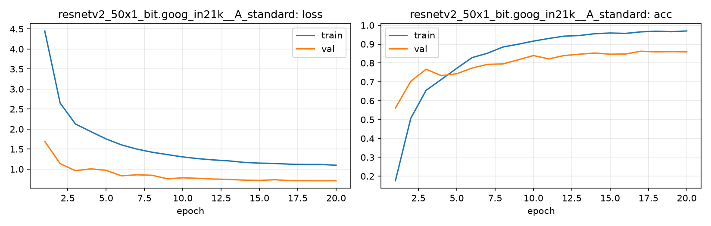

# Run card: `resnetv2_50x1_bit.goog_in21k__A_standard`

_Generated by `python -m birdcls.report` from the files in `outputs/runs/resnetv2_50x1_bit.goog_in21k__A_standard/`. Do not edit by hand._

## Summary

| Item | Value |
|---|---|
| Model | `resnetv2_50x1_bit.goog_in21k` (23.91 M parameters) |
| Configuration | `A_standard`: Standard fine-tune, 224 px throughout, no CutMix |
| Finished | 2026-10-07 12:46 |
| Training time | 7.4 min, completed all epochs |
| Best epoch (by val accuracy) | 17 at 224 px, val Top-1 0.8623 |
| Input normalisation | mean (0.5, 0.5, 0.5), std (0.5, 0.5, 0.5) |
| Command | `python -m birdcls.train --model resnetv2_50x1_bit.goog_in21k --config A_standard` |

## Results (from `outputs/results.csv`)

| Variant | Train acc (clean) | Val Top-1 | Gap (train - val) | **Test Top-1** | **Test avg/class** |
|---|---|---|---|---|---|
| no TTA | 0.9987 | 0.8623 | 0.1364 | 0.8571 | 0.8541 |
| with TTA (flip averaging) | 0.9987 | 0.8592 | 0.1395 | 0.8555 | 0.8529 |

Train acc is measured on the training images with eval preprocessing (no augmentation).

## Configuration

Source: snapshot saved with the run (`config.yaml`).

| Setting | Value |
|---|---|
| `cutmix_prob` | 0.0 |
| `label_smoothing` | 0.1 |
| `weight_decay` | 0.05 |
| `dropout` | 0.3 |
| `drop_path` | 0.1 |
| `patience` | 6 |

| Phase | Image size | Batch | Epochs | LR backbone | LR head | Warm-up epochs |
|---|---|---|---|---|---|---|
| 1 | 224 | 32 | 20 | 0.0001 | 0.001 | 1 |

## Training curves

## Per-epoch log

| Epoch | Phase | Size | Train loss | Train acc | Val loss | Val acc | LR (backbone, end of epoch) |
|---|---|---|---|---|---|---|---|
| 1 | 1 | 224 | 4.451 | 0.176 | 1.694 | 0.5611 | 1.00e-04 |
| 2 | 1 | 224 | 2.654 | 0.507 | 1.139 | 0.7029 | 9.93e-05 |
| 3 | 1 | 224 | 2.128 | 0.655 | 0.961 | 0.7671 | 9.73e-05 |
| 4 | 1 | 224 | 1.939 | 0.713 | 1.008 | 0.7329 | 9.40e-05 |
| 5 | 1 | 224 | 1.755 | 0.772 | 0.971 | 0.7433 | 8.95e-05 |
| 6 | 1 | 224 | 1.606 | 0.829 | 0.834 | 0.7733 | 8.39e-05 |
| 7 | 1 | 224 | 1.502 | 0.852 | 0.859 | 0.7930 | 7.73e-05 |
| 8 | 1 | 224 | 1.423 | 0.885 | 0.847 | 0.7950 | 7.01e-05 |
| 9 | 1 | 224 | 1.364 | 0.900 | 0.759 | 0.8168 | 6.23e-05 |
| 10 | 1 | 224 | 1.306 | 0.916 | 0.784 | 0.8395 | 5.41e-05 |
| 11 | 1 | 224 | 1.262 | 0.930 | 0.771 | 0.8219 | 4.59e-05 |
| 12 | 1 | 224 | 1.231 | 0.942 | 0.753 | 0.8395 | 3.77e-05 |
| 13 | 1 | 224 | 1.207 | 0.946 | 0.744 | 0.8468 | 2.99e-05 |
| 14 | 1 | 224 | 1.169 | 0.955 | 0.726 | 0.8530 | 2.27e-05 |
| 15 | 1 | 224 | 1.150 | 0.959 | 0.719 | 0.8468 | 1.61e-05 |
| 16 | 1 | 224 | 1.142 | 0.957 | 0.736 | 0.8478 | 1.05e-05 |
| 17 **(best)** | 1 | 224 | 1.124 | 0.965 | 0.713 | 0.8623 | 6.03e-06 |
| 18 | 1 | 224 | 1.119 | 0.969 | 0.711 | 0.8592 | 2.71e-06 |
| 19 | 1 | 224 | 1.118 | 0.966 | 0.711 | 0.8602 | 6.82e-07 |
| 20 | 1 | 224 | 1.098 | 0.970 | 0.711 | 0.8592 | 0.00e+00 |

With CutMix, train loss/acc are computed on mixed images (soft accuracy), so they run lower than the clean train accuracy in the results table.

## Files

`outputs/runs/resnetv2_50x1_bit.goog_in21k__A_standard/`: `best.pt` (best checkpoint), `history.json`, `train.log`, `curves.png`, `config.yaml`
