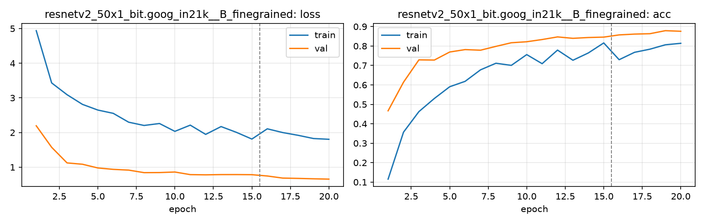

# Run card: `resnetv2_50x1_bit.goog_in21k__B_finegrained`

_Generated by `python -m birdcls.report` from the files in `outputs/runs/resnetv2_50x1_bit.goog_in21k__B_finegrained/`. Do not edit by hand._

## Summary

| Item | Value |
|---|---|
| Model | `resnetv2_50x1_bit.goog_in21k` (23.91 M parameters) |
| Configuration | `B_finegrained`: Progressive resizing 224 -> 448 px + CutMix |
| Finished | 2026-10-07 13:02 |
| Training time | 15.6 min, completed all epochs |
| Best epoch (by val accuracy) | 19 at 448 px, val Top-1 0.8789 |
| Input normalisation | mean (0.5, 0.5, 0.5), std (0.5, 0.5, 0.5) |
| Command | `python -m birdcls.train --model resnetv2_50x1_bit.goog_in21k --config B_finegrained` |

## Results (from `outputs/results.csv`)

| Variant | Train acc (clean) | Val Top-1 | Gap (train - val) | **Test Top-1** | **Test avg/class** |
|---|---|---|---|---|---|
| no TTA | 0.9966 | 0.8789 | 0.1178 | 0.8671 | 0.8649 |
| with TTA (flip averaging) | 0.9966 | 0.8820 | 0.1146 | 0.8630 | 0.8611 |

Train acc is measured on the training images with eval preprocessing (no augmentation).

## Configuration

Source: snapshot saved with the run (`config.yaml`).

| Setting | Value |
|---|---|
| `cutmix_prob` | 0.5 |
| `label_smoothing` | 0.1 |
| `weight_decay` | 0.05 |
| `dropout` | 0.3 |
| `drop_path` | 0.1 |
| `patience` | 6 |

| Phase | Image size | Batch | Epochs | LR backbone | LR head | Warm-up epochs |
|---|---|---|---|---|---|---|
| 1 | 224 | 32 | 15 | 0.0001 | 0.001 | 1 |
| 2 | 448 | 16 | 5 | 2e-05 | 0.0002 | 0 |

## Training curves

## Per-epoch log

| Epoch | Phase | Size | Train loss | Train acc | Val loss | Val acc | LR (backbone, end of epoch) |
|---|---|---|---|---|---|---|---|
| 1 | 1 | 224 | 4.939 | 0.115 | 2.195 | 0.4669 | 1.00e-04 |
| 2 | 1 | 224 | 3.432 | 0.357 | 1.574 | 0.6139 | 9.87e-05 |
| 3 | 1 | 224 | 3.092 | 0.463 | 1.123 | 0.7288 | 9.50e-05 |
| 4 | 1 | 224 | 2.813 | 0.530 | 1.085 | 0.7277 | 8.91e-05 |
| 5 | 1 | 224 | 2.649 | 0.591 | 0.977 | 0.7692 | 8.12e-05 |
| 6 | 1 | 224 | 2.553 | 0.618 | 0.937 | 0.7816 | 7.17e-05 |
| 7 | 1 | 224 | 2.298 | 0.677 | 0.915 | 0.7785 | 6.11e-05 |
| 8 | 1 | 224 | 2.204 | 0.711 | 0.842 | 0.7981 | 5.00e-05 |
| 9 | 1 | 224 | 2.260 | 0.700 | 0.844 | 0.8168 | 3.89e-05 |
| 10 | 1 | 224 | 2.034 | 0.756 | 0.860 | 0.8219 | 2.83e-05 |
| 11 | 1 | 224 | 2.213 | 0.709 | 0.785 | 0.8333 | 1.88e-05 |
| 12 | 1 | 224 | 1.946 | 0.779 | 0.779 | 0.8468 | 1.09e-05 |
| 13 | 1 | 224 | 2.172 | 0.727 | 0.786 | 0.8395 | 4.95e-06 |
| 14 | 1 | 224 | 2.005 | 0.764 | 0.786 | 0.8437 | 1.25e-06 |
| 15 | 1 | 224 | 1.811 | 0.816 | 0.783 | 0.8458 | 0.00e+00 |
| 16 | 2 | 448 | 2.107 | 0.730 | 0.746 | 0.8571 | 1.81e-05 |
| 17 | 2 | 448 | 1.999 | 0.768 | 0.685 | 0.8613 | 1.31e-05 |
| 18 | 2 | 448 | 1.920 | 0.784 | 0.676 | 0.8634 | 6.91e-06 |
| 19 **(best)** | 2 | 448 | 1.827 | 0.806 | 0.665 | 0.8789 | 1.91e-06 |
| 20 | 2 | 448 | 1.805 | 0.814 | 0.655 | 0.8758 | 0.00e+00 |

With CutMix, train loss/acc are computed on mixed images (soft accuracy), so they run lower than the clean train accuracy in the results table.

## Files

`outputs/runs/resnetv2_50x1_bit.goog_in21k__B_finegrained/`: `best.pt` (best checkpoint), `history.json`, `train.log`, `curves.png`, `config.yaml`
