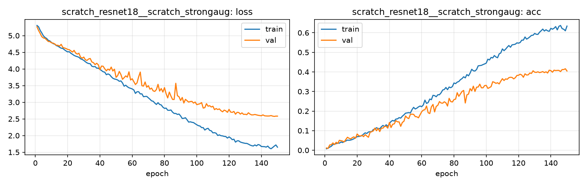

# Run card: `scratch_resnet18__scratch_strongaug`

_Generated by `python -m birdcls.report` from the files in `outputs/runs/scratch_resnet18__scratch_strongaug/`. Do not edit by hand._

## Summary

| Item | Value |
|---|---|
| Model | `scratch_resnet18` (11.28 M parameters) |
| Configuration | `scratch_strongaug`: S5 + strong augmentation (crop 25-100%, flip, TrivialAugmentWide, random erasing) |
| Finished | 2026-10-15 19:14 |
| Training time | 19.8 min, completed all epochs |
| Best epoch (by val accuracy) | 149 at 224 px, val Top-1 0.4161 |
| Input normalisation | mean (0.485, 0.456, 0.406), std (0.229, 0.224, 0.225) |
| Command | `python -m birdcls.train --model scratch_resnet18 --config scratch_strongaug` |

## Results (from `outputs/results.csv`)

| Variant | Train acc (clean) | Val Top-1 | Gap (train - val) | **Test Top-1** | **Test avg/class** |
|---|---|---|---|---|---|
| no TTA | 0.9317 | 0.4161 | 0.5155 | 0.4136 | 0.4064 |
| with TTA (flip averaging) | 0.9317 | 0.4089 | 0.5228 | 0.4161 | 0.4082 |

Train acc is measured on the training images with eval preprocessing (no augmentation).

## Configuration

Source: snapshot saved with the run (`config.yaml`).

| Setting | Value |
|---|---|
| `cutmix_prob` | 0.0 |
| `label_smoothing` | 0.0 |
| `weight_decay` | 0.0005 |
| `dropout` | 0.0 |
| `drop_path` | 0.0 |
| `patience` | 20 |
| `optimizer` | sgd |
| `momentum` | 0.9 |
| `lr_schedule` | cosine |
| `augment` | strong |

| Phase | Image size | Batch | Epochs | LR backbone | LR head | Warm-up epochs |
|---|---|---|---|---|---|---|
| 1 | 224 | 32 | 150 | 0.01 | 0.01 | 2 |

## Training curves

## Per-epoch log

| Epoch | Phase | Size | Train loss | Train acc | Val loss | Val acc | LR (backbone, end of epoch) |
|---|---|---|---|---|---|---|---|
| 1 | 1 | 224 | 5.304 | 0.008 | 5.265 | 0.0114 | 5.04e-03 |
| 2 | 1 | 224 | 5.265 | 0.011 | 5.155 | 0.0093 | 1.00e-02 |
| 3 | 1 | 224 | 5.158 | 0.016 | 5.065 | 0.0269 | 1.00e-02 |
| 4 | 1 | 224 | 5.080 | 0.020 | 4.968 | 0.0280 | 1.00e-02 |
| 5 | 1 | 224 | 4.992 | 0.029 | 4.930 | 0.0373 | 9.99e-03 |
| 6 | 1 | 224 | 4.945 | 0.032 | 4.919 | 0.0290 | 9.98e-03 |
| 7 | 1 | 224 | 4.915 | 0.033 | 4.871 | 0.0404 | 9.97e-03 |
| 8 | 1 | 224 | 4.860 | 0.037 | 4.824 | 0.0342 | 9.96e-03 |
| 9 | 1 | 224 | 4.839 | 0.036 | 4.819 | 0.0507 | 9.94e-03 |
| 10 | 1 | 224 | 4.794 | 0.042 | 4.784 | 0.0487 | 9.93e-03 |
| 11 | 1 | 224 | 4.760 | 0.039 | 4.774 | 0.0466 | 9.91e-03 |
| 12 | 1 | 224 | 4.743 | 0.044 | 4.752 | 0.0424 | 9.89e-03 |
| 13 | 1 | 224 | 4.700 | 0.047 | 4.709 | 0.0549 | 9.86e-03 |
| 14 | 1 | 224 | 4.683 | 0.052 | 4.710 | 0.0663 | 9.84e-03 |
| 15 | 1 | 224 | 4.651 | 0.051 | 4.684 | 0.0611 | 9.81e-03 |
| 16 | 1 | 224 | 4.623 | 0.052 | 4.738 | 0.0580 | 9.78e-03 |
| 17 | 1 | 224 | 4.615 | 0.055 | 4.647 | 0.0642 | 9.75e-03 |
| 18 | 1 | 224 | 4.575 | 0.059 | 4.628 | 0.0683 | 9.71e-03 |
| 19 | 1 | 224 | 4.541 | 0.064 | 4.613 | 0.0611 | 9.68e-03 |
| 20 | 1 | 224 | 4.512 | 0.069 | 4.586 | 0.0828 | 9.64e-03 |
| 21 | 1 | 224 | 4.517 | 0.070 | 4.578 | 0.0745 | 9.60e-03 |
| 22 | 1 | 224 | 4.470 | 0.072 | 4.541 | 0.0725 | 9.56e-03 |
| 23 | 1 | 224 | 4.440 | 0.074 | 4.507 | 0.0766 | 9.51e-03 |
| 24 | 1 | 224 | 4.405 | 0.083 | 4.557 | 0.0694 | 9.46e-03 |
| 25 | 1 | 224 | 4.384 | 0.089 | 4.474 | 0.0797 | 9.42e-03 |
| 26 | 1 | 224 | 4.368 | 0.086 | 4.445 | 0.0725 | 9.37e-03 |
| 27 | 1 | 224 | 4.349 | 0.093 | 4.468 | 0.0663 | 9.31e-03 |
| 28 | 1 | 224 | 4.304 | 0.095 | 4.354 | 0.0911 | 9.26e-03 |
| 29 | 1 | 224 | 4.285 | 0.094 | 4.322 | 0.0952 | 9.20e-03 |
| 30 | 1 | 224 | 4.257 | 0.105 | 4.355 | 0.0983 | 9.14e-03 |
| 31 | 1 | 224 | 4.216 | 0.108 | 4.274 | 0.1128 | 9.08e-03 |
| 32 | 1 | 224 | 4.182 | 0.115 | 4.256 | 0.0994 | 9.02e-03 |
| 33 | 1 | 224 | 4.162 | 0.111 | 4.299 | 0.1118 | 8.96e-03 |
| 34 | 1 | 224 | 4.156 | 0.110 | 4.314 | 0.0952 | 8.89e-03 |
| 35 | 1 | 224 | 4.081 | 0.120 | 4.210 | 0.1128 | 8.82e-03 |
| 36 | 1 | 224 | 4.066 | 0.127 | 4.189 | 0.1128 | 8.75e-03 |
| 37 | 1 | 224 | 4.072 | 0.121 | 4.129 | 0.1222 | 8.68e-03 |
| 38 | 1 | 224 | 4.024 | 0.130 | 4.169 | 0.1222 | 8.61e-03 |
| 39 | 1 | 224 | 4.023 | 0.122 | 4.124 | 0.1128 | 8.54e-03 |
| 40 | 1 | 224 | 3.988 | 0.136 | 3.978 | 0.1418 | 8.46e-03 |
| 41 | 1 | 224 | 3.951 | 0.147 | 4.087 | 0.1159 | 8.38e-03 |
| 42 | 1 | 224 | 3.915 | 0.152 | 4.080 | 0.1325 | 8.30e-03 |
| 43 | 1 | 224 | 3.903 | 0.149 | 4.004 | 0.1346 | 8.22e-03 |
| 44 | 1 | 224 | 3.826 | 0.159 | 3.942 | 0.1511 | 8.14e-03 |
| 45 | 1 | 224 | 3.850 | 0.160 | 3.996 | 0.1449 | 8.06e-03 |
| 46 | 1 | 224 | 3.827 | 0.166 | 3.961 | 0.1449 | 7.97e-03 |
| 47 | 1 | 224 | 3.769 | 0.164 | 4.056 | 0.1222 | 7.89e-03 |
| 48 | 1 | 224 | 3.721 | 0.174 | 3.937 | 0.1418 | 7.80e-03 |
| 49 | 1 | 224 | 3.698 | 0.181 | 3.993 | 0.1480 | 7.71e-03 |
| 50 | 1 | 224 | 3.688 | 0.189 | 3.748 | 0.1749 | 7.62e-03 |
| 51 | 1 | 224 | 3.668 | 0.191 | 3.799 | 0.1656 | 7.53e-03 |
| 52 | 1 | 224 | 3.629 | 0.192 | 3.925 | 0.1615 | 7.44e-03 |
| 53 | 1 | 224 | 3.640 | 0.190 | 3.831 | 0.1832 | 7.35e-03 |
| 54 | 1 | 224 | 3.579 | 0.207 | 3.688 | 0.1843 | 7.25e-03 |
| 55 | 1 | 224 | 3.482 | 0.219 | 3.738 | 0.1832 | 7.16e-03 |
| 56 | 1 | 224 | 3.511 | 0.211 | 3.791 | 0.1718 | 7.06e-03 |
| 57 | 1 | 224 | 3.466 | 0.215 | 3.753 | 0.1708 | 6.96e-03 |
| 58 | 1 | 224 | 3.435 | 0.221 | 3.913 | 0.1656 | 6.86e-03 |
| 59 | 1 | 224 | 3.418 | 0.226 | 3.667 | 0.1812 | 6.77e-03 |
| 60 | 1 | 224 | 3.400 | 0.222 | 3.705 | 0.1967 | 6.67e-03 |
| 61 | 1 | 224 | 3.369 | 0.231 | 3.618 | 0.2050 | 6.57e-03 |
| 62 | 1 | 224 | 3.265 | 0.256 | 3.532 | 0.2070 | 6.46e-03 |
| 63 | 1 | 224 | 3.315 | 0.239 | 3.583 | 0.2257 | 6.36e-03 |
| 64 | 1 | 224 | 3.316 | 0.243 | 3.762 | 0.1915 | 6.26e-03 |
| 65 | 1 | 224 | 3.250 | 0.261 | 3.906 | 0.1874 | 6.16e-03 |
| 66 | 1 | 224 | 3.252 | 0.258 | 3.497 | 0.2215 | 6.05e-03 |
| 67 | 1 | 224 | 3.166 | 0.280 | 3.485 | 0.2340 | 5.95e-03 |
| 68 | 1 | 224 | 3.174 | 0.279 | 3.608 | 0.1957 | 5.85e-03 |
| 69 | 1 | 224 | 3.176 | 0.273 | 3.451 | 0.2236 | 5.74e-03 |
| 70 | 1 | 224 | 3.133 | 0.283 | 3.498 | 0.2298 | 5.64e-03 |
| 71 | 1 | 224 | 3.091 | 0.284 | 3.392 | 0.2484 | 5.53e-03 |
| 72 | 1 | 224 | 3.043 | 0.293 | 3.424 | 0.2412 | 5.42e-03 |
| 73 | 1 | 224 | 3.029 | 0.308 | 3.341 | 0.2402 | 5.32e-03 |
| 74 | 1 | 224 | 2.975 | 0.310 | 3.326 | 0.2474 | 5.21e-03 |
| 75 | 1 | 224 | 2.934 | 0.321 | 3.381 | 0.2422 | 5.11e-03 |
| 76 | 1 | 224 | 2.988 | 0.309 | 3.538 | 0.2257 | 5.00e-03 |
| 77 | 1 | 224 | 2.934 | 0.323 | 3.335 | 0.2650 | 4.89e-03 |
| 78 | 1 | 224 | 2.918 | 0.319 | 3.411 | 0.2484 | 4.79e-03 |
| 79 | 1 | 224 | 2.852 | 0.325 | 3.305 | 0.2464 | 4.68e-03 |
| 80 | 1 | 224 | 2.816 | 0.343 | 3.439 | 0.2588 | 4.58e-03 |
| 81 | 1 | 224 | 2.824 | 0.340 | 3.257 | 0.2609 | 4.47e-03 |
| 82 | 1 | 224 | 2.760 | 0.348 | 3.129 | 0.2940 | 4.36e-03 |
| 83 | 1 | 224 | 2.757 | 0.351 | 3.305 | 0.2754 | 4.26e-03 |
| 84 | 1 | 224 | 2.768 | 0.360 | 3.184 | 0.2878 | 4.15e-03 |
| 85 | 1 | 224 | 2.703 | 0.366 | 3.084 | 0.3002 | 4.05e-03 |
| 86 | 1 | 224 | 2.663 | 0.375 | 3.083 | 0.3054 | 3.95e-03 |
| 87 | 1 | 224 | 2.663 | 0.370 | 3.569 | 0.2412 | 3.84e-03 |
| 88 | 1 | 224 | 2.634 | 0.386 | 3.197 | 0.2826 | 3.74e-03 |
| 89 | 1 | 224 | 2.645 | 0.380 | 3.165 | 0.2867 | 3.64e-03 |
| 90 | 1 | 224 | 2.588 | 0.394 | 3.052 | 0.3147 | 3.54e-03 |
| 91 | 1 | 224 | 2.512 | 0.414 | 3.143 | 0.3033 | 3.43e-03 |
| 92 | 1 | 224 | 2.519 | 0.406 | 2.977 | 0.3271 | 3.33e-03 |
| 93 | 1 | 224 | 2.535 | 0.405 | 3.087 | 0.3002 | 3.23e-03 |
| 94 | 1 | 224 | 2.473 | 0.412 | 3.045 | 0.3219 | 3.14e-03 |
| 95 | 1 | 224 | 2.403 | 0.431 | 3.003 | 0.3230 | 3.04e-03 |
| 96 | 1 | 224 | 2.413 | 0.432 | 3.022 | 0.3375 | 2.94e-03 |
| 97 | 1 | 224 | 2.398 | 0.434 | 3.026 | 0.3188 | 2.84e-03 |
| 98 | 1 | 224 | 2.389 | 0.438 | 2.975 | 0.3188 | 2.75e-03 |
| 99 | 1 | 224 | 2.356 | 0.441 | 3.007 | 0.3302 | 2.65e-03 |
| 100 | 1 | 224 | 2.324 | 0.445 | 2.928 | 0.3313 | 2.56e-03 |
| 101 | 1 | 224 | 2.297 | 0.465 | 2.943 | 0.3157 | 2.47e-03 |
| 102 | 1 | 224 | 2.286 | 0.461 | 2.955 | 0.3199 | 2.38e-03 |
| 103 | 1 | 224 | 2.239 | 0.474 | 2.989 | 0.3251 | 2.29e-03 |
| 104 | 1 | 224 | 2.238 | 0.471 | 2.825 | 0.3499 | 2.20e-03 |
| 105 | 1 | 224 | 2.166 | 0.484 | 2.837 | 0.3468 | 2.11e-03 |
| 106 | 1 | 224 | 2.202 | 0.476 | 2.957 | 0.3416 | 2.03e-03 |
| 107 | 1 | 224 | 2.217 | 0.472 | 2.881 | 0.3447 | 1.94e-03 |
| 108 | 1 | 224 | 2.156 | 0.492 | 2.897 | 0.3385 | 1.86e-03 |
| 109 | 1 | 224 | 2.142 | 0.497 | 2.857 | 0.3530 | 1.78e-03 |
| 110 | 1 | 224 | 2.081 | 0.517 | 2.880 | 0.3654 | 1.70e-03 |
| 111 | 1 | 224 | 2.087 | 0.509 | 2.777 | 0.3561 | 1.62e-03 |
| 112 | 1 | 224 | 2.070 | 0.516 | 2.811 | 0.3644 | 1.54e-03 |
| 113 | 1 | 224 | 2.002 | 0.526 | 2.780 | 0.3623 | 1.46e-03 |
| 114 | 1 | 224 | 2.020 | 0.535 | 2.800 | 0.3706 | 1.39e-03 |
| 115 | 1 | 224 | 1.996 | 0.526 | 2.746 | 0.3727 | 1.32e-03 |
| 116 | 1 | 224 | 1.990 | 0.538 | 2.713 | 0.3716 | 1.25e-03 |
| 117 | 1 | 224 | 1.975 | 0.540 | 2.763 | 0.3644 | 1.18e-03 |
| 118 | 1 | 224 | 1.970 | 0.542 | 2.742 | 0.3706 | 1.11e-03 |
| 119 | 1 | 224 | 1.925 | 0.548 | 2.698 | 0.3820 | 1.04e-03 |
| 120 | 1 | 224 | 1.961 | 0.547 | 2.786 | 0.3830 | 9.80e-04 |
| 121 | 1 | 224 | 1.926 | 0.550 | 2.704 | 0.3882 | 9.18e-04 |
| 122 | 1 | 224 | 1.877 | 0.562 | 2.696 | 0.3841 | 8.57e-04 |
| 123 | 1 | 224 | 1.891 | 0.562 | 2.724 | 0.3727 | 7.99e-04 |
| 124 | 1 | 224 | 1.803 | 0.578 | 2.641 | 0.3903 | 7.42e-04 |
| 125 | 1 | 224 | 1.841 | 0.567 | 2.697 | 0.3841 | 6.88e-04 |
| 126 | 1 | 224 | 1.842 | 0.572 | 2.693 | 0.3851 | 6.35e-04 |
| 127 | 1 | 224 | 1.806 | 0.579 | 2.644 | 0.3944 | 5.84e-04 |
| 128 | 1 | 224 | 1.790 | 0.586 | 2.681 | 0.3923 | 5.35e-04 |
| 129 | 1 | 224 | 1.777 | 0.588 | 2.636 | 0.4058 | 4.89e-04 |
| 130 | 1 | 224 | 1.766 | 0.597 | 2.639 | 0.3986 | 4.44e-04 |
| 131 | 1 | 224 | 1.764 | 0.592 | 2.627 | 0.3975 | 4.01e-04 |
| 132 | 1 | 224 | 1.742 | 0.592 | 2.684 | 0.4006 | 3.61e-04 |
| 133 | 1 | 224 | 1.715 | 0.603 | 2.643 | 0.3965 | 3.22e-04 |
| 134 | 1 | 224 | 1.697 | 0.610 | 2.620 | 0.3986 | 2.86e-04 |
| 135 | 1 | 224 | 1.686 | 0.619 | 2.622 | 0.4017 | 2.51e-04 |
| 136 | 1 | 224 | 1.719 | 0.609 | 2.633 | 0.3965 | 2.19e-04 |
| 137 | 1 | 224 | 1.690 | 0.615 | 2.621 | 0.4006 | 1.89e-04 |
| 138 | 1 | 224 | 1.730 | 0.610 | 2.609 | 0.3944 | 1.61e-04 |
| 139 | 1 | 224 | 1.716 | 0.607 | 2.601 | 0.4089 | 1.36e-04 |
| 140 | 1 | 224 | 1.672 | 0.623 | 2.594 | 0.4068 | 1.12e-04 |
| 141 | 1 | 224 | 1.669 | 0.618 | 2.621 | 0.3986 | 9.10e-05 |
| 142 | 1 | 224 | 1.667 | 0.623 | 2.593 | 0.4089 | 7.19e-05 |
| 143 | 1 | 224 | 1.653 | 0.632 | 2.589 | 0.4068 | 5.51e-05 |
| 144 | 1 | 224 | 1.684 | 0.615 | 2.586 | 0.4079 | 4.05e-05 |
| 145 | 1 | 224 | 1.629 | 0.633 | 2.588 | 0.4079 | 2.81e-05 |
| 146 | 1 | 224 | 1.604 | 0.637 | 2.600 | 0.4017 | 1.80e-05 |
| 147 | 1 | 224 | 1.640 | 0.621 | 2.584 | 0.4120 | 1.01e-05 |
| 148 | 1 | 224 | 1.682 | 0.618 | 2.575 | 0.4120 | 4.51e-06 |
| 149 **(best)** | 1 | 224 | 1.718 | 0.610 | 2.583 | 0.4161 | 1.13e-06 |
| 150 | 1 | 224 | 1.651 | 0.634 | 2.583 | 0.4048 | 0.00e+00 |

With CutMix, train loss/acc are computed on mixed images (soft accuracy), so they run lower than the clean train accuracy in the results table.

## Files

`outputs/runs/scratch_resnet18__scratch_strongaug/`: `best.pt` (best checkpoint), `history.json`, `train.log`, `curves.png`, `config.yaml`
