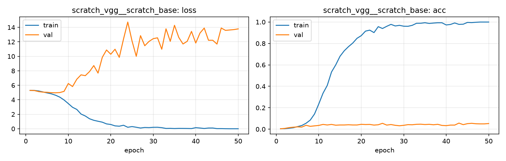

# Run card: `scratch_vgg__scratch_base`

_Generated by `python -m birdcls.report` from the files in `outputs/runs/scratch_vgg__scratch_base/`. Do not edit by hand._

## Summary

| Item | Value |
|---|---|
| Model | `scratch_vgg` (8.88 M parameters) |
| Configuration | `scratch_base`: From-scratch baseline - no augmentation, no regularisation, SGD at constant LR |
| Finished | 2026-10-08 16:48 |
| Training time | 8.1 min, completed all epochs |
| Best epoch (by val accuracy) | 43 at 224 px, val Top-1 0.0569 |
| Input normalisation | mean (0.485, 0.456, 0.406), std (0.229, 0.224, 0.225) |
| Command | `python -m birdcls.train --model scratch_vgg --config scratch_base` |

## Results (from `outputs/results.csv`)

| Variant | Train acc (clean) | Val Top-1 | Gap (train - val) | **Test Top-1** | **Test avg/class** |
|---|---|---|---|---|---|
| no TTA | 0.9858 | 0.0569 | 0.9288 | 0.0490 | 0.0478 |
| with TTA (flip averaging) | 0.9858 | 0.0590 | 0.9268 | 0.0498 | 0.0486 |

Train acc is measured on the training images with eval preprocessing (no augmentation).

## Configuration

Source: snapshot saved with the run (`config.yaml`).

| Setting | Value |
|---|---|
| `cutmix_prob` | 0.0 |
| `label_smoothing` | 0.0 |
| `weight_decay` | 0.0 |
| `dropout` | 0.0 |
| `drop_path` | 0.0 |
| `patience` | 1000 |
| `optimizer` | sgd |
| `momentum` | 0.9 |
| `lr_schedule` | constant |
| `augment` | none |

| Phase | Image size | Batch | Epochs | LR backbone | LR head | Warm-up epochs |
|---|---|---|---|---|---|---|
| 1 | 224 | 32 | 50 | 0.01 | 0.01 | 0 |

## Training curves

## Per-epoch log

| Epoch | Phase | Size | Train loss | Train acc | Val loss | Val acc | LR (backbone, end of epoch) |
|---|---|---|---|---|---|---|---|
| 1 | 1 | 224 | 5.301 | 0.005 | 5.295 | 0.0041 | 1.00e-02 |
| 2 | 1 | 224 | 5.292 | 0.005 | 5.277 | 0.0072 | 1.00e-02 |
| 3 | 1 | 224 | 5.223 | 0.009 | 5.133 | 0.0145 | 1.00e-02 |
| 4 | 1 | 224 | 5.090 | 0.014 | 5.059 | 0.0186 | 1.00e-02 |
| 5 | 1 | 224 | 4.952 | 0.024 | 5.035 | 0.0217 | 1.00e-02 |
| 6 | 1 | 224 | 4.825 | 0.034 | 4.981 | 0.0197 | 1.00e-02 |
| 7 | 1 | 224 | 4.633 | 0.055 | 4.964 | 0.0362 | 1.00e-02 |
| 8 | 1 | 224 | 4.367 | 0.085 | 5.000 | 0.0269 | 1.00e-02 |
| 9 | 1 | 224 | 3.975 | 0.142 | 5.163 | 0.0311 | 1.00e-02 |
| 10 | 1 | 224 | 3.479 | 0.235 | 6.246 | 0.0352 | 1.00e-02 |
| 11 | 1 | 224 | 2.966 | 0.335 | 5.828 | 0.0445 | 1.00e-02 |
| 12 | 1 | 224 | 2.670 | 0.408 | 6.836 | 0.0393 | 1.00e-02 |
| 13 | 1 | 224 | 2.032 | 0.534 | 7.445 | 0.0445 | 1.00e-02 |
| 14 | 1 | 224 | 1.764 | 0.600 | 7.331 | 0.0373 | 1.00e-02 |
| 15 | 1 | 224 | 1.380 | 0.680 | 7.897 | 0.0393 | 1.00e-02 |
| 16 | 1 | 224 | 1.168 | 0.732 | 8.724 | 0.0393 | 1.00e-02 |
| 17 | 1 | 224 | 1.037 | 0.770 | 7.688 | 0.0414 | 1.00e-02 |
| 18 | 1 | 224 | 0.910 | 0.803 | 9.859 | 0.0393 | 1.00e-02 |
| 19 | 1 | 224 | 0.671 | 0.848 | 10.878 | 0.0393 | 1.00e-02 |
| 20 | 1 | 224 | 0.591 | 0.873 | 10.291 | 0.0455 | 1.00e-02 |
| 21 | 1 | 224 | 0.398 | 0.915 | 10.981 | 0.0435 | 1.00e-02 |
| 22 | 1 | 224 | 0.354 | 0.924 | 9.861 | 0.0445 | 1.00e-02 |
| 23 | 1 | 224 | 0.484 | 0.901 | 12.393 | 0.0383 | 1.00e-02 |
| 24 | 1 | 224 | 0.205 | 0.957 | 14.735 | 0.0414 | 1.00e-02 |
| 25 | 1 | 224 | 0.302 | 0.939 | 12.133 | 0.0549 | 1.00e-02 |
| 26 | 1 | 224 | 0.207 | 0.960 | 10.003 | 0.0383 | 1.00e-02 |
| 27 | 1 | 224 | 0.101 | 0.978 | 12.856 | 0.0435 | 1.00e-02 |
| 28 | 1 | 224 | 0.177 | 0.963 | 11.464 | 0.0362 | 1.00e-02 |
| 29 | 1 | 224 | 0.157 | 0.969 | 12.059 | 0.0321 | 1.00e-02 |
| 30 | 1 | 224 | 0.200 | 0.961 | 12.441 | 0.0362 | 1.00e-02 |
| 31 | 1 | 224 | 0.206 | 0.960 | 12.558 | 0.0424 | 1.00e-02 |
| 32 | 1 | 224 | 0.149 | 0.969 | 10.983 | 0.0414 | 1.00e-02 |
| 33 | 1 | 224 | 0.045 | 0.988 | 13.802 | 0.0455 | 1.00e-02 |
| 34 | 1 | 224 | 0.057 | 0.988 | 12.071 | 0.0466 | 1.00e-02 |
| 35 | 1 | 224 | 0.031 | 0.993 | 14.286 | 0.0435 | 1.00e-02 |
| 36 | 1 | 224 | 0.052 | 0.986 | 12.619 | 0.0455 | 1.00e-02 |
| 37 | 1 | 224 | 0.048 | 0.990 | 11.707 | 0.0414 | 1.00e-02 |
| 38 | 1 | 224 | 0.041 | 0.993 | 12.082 | 0.0455 | 1.00e-02 |
| 39 | 1 | 224 | 0.027 | 0.993 | 13.442 | 0.0352 | 1.00e-02 |
| 40 | 1 | 224 | 0.150 | 0.972 | 11.840 | 0.0331 | 1.00e-02 |
| 41 | 1 | 224 | 0.100 | 0.977 | 13.219 | 0.0383 | 1.00e-02 |
| 42 | 1 | 224 | 0.040 | 0.991 | 13.903 | 0.0383 | 1.00e-02 |
| 43 **(best)** | 1 | 224 | 0.099 | 0.978 | 12.218 | 0.0569 | 1.00e-02 |
| 44 | 1 | 224 | 0.102 | 0.979 | 12.221 | 0.0424 | 1.00e-02 |
| 45 | 1 | 224 | 0.020 | 0.996 | 11.694 | 0.0518 | 1.00e-02 |
| 46 | 1 | 224 | 0.021 | 0.994 | 13.912 | 0.0549 | 1.00e-02 |
| 47 | 1 | 224 | 0.009 | 0.997 | 13.586 | 0.0507 | 1.00e-02 |
| 48 | 1 | 224 | 0.001 | 0.999 | 13.639 | 0.0497 | 1.00e-02 |
| 49 | 1 | 224 | 0.001 | 0.999 | 13.695 | 0.0497 | 1.00e-02 |
| 50 | 1 | 224 | 0.001 | 0.999 | 13.791 | 0.0528 | 1.00e-02 |

With CutMix, train loss/acc are computed on mixed images (soft accuracy), so they run lower than the clean train accuracy in the results table.

## Files

`outputs/runs/scratch_vgg__scratch_base/`: `best.pt` (best checkpoint), `history.json`, `train.log`, `curves.png`, `config.yaml`
