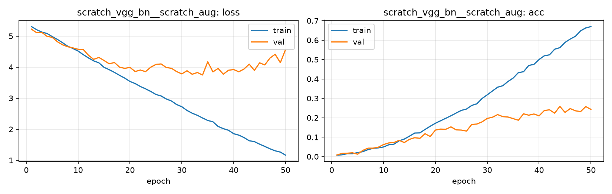

# Run card: `scratch_vgg_bn__scratch_aug`

_Generated by `python -m birdcls.report` from the files in `outputs/runs/scratch_vgg_bn__scratch_aug/`. Do not edit by hand._

## Summary

| Item | Value |
|---|---|
| Model | `scratch_vgg_bn` (8.88 M parameters) |
| Configuration | `scratch_aug`: S1 + basic data augmentation (crop, flip, rotation, colour jitter, random erasing) |
| Finished | 2026-10-13 23:48 |
| Training time | 9.1 min, completed all epochs |
| Best epoch (by val accuracy) | 44 at 224 px, val Top-1 0.2588 |
| Input normalisation | mean (0.485, 0.456, 0.406), std (0.229, 0.224, 0.225) |
| Command | `python -m birdcls.train --model scratch_vgg_bn --config scratch_aug` |

## Results (from `outputs/results.csv`)

| Variant | Train acc (clean) | Val Top-1 | Gap (train - val) | **Test Top-1** | **Test avg/class** |
|---|---|---|---|---|---|
| no TTA | 0.7712 | 0.2588 | 0.5124 | 0.2542 | 0.2462 |
| with TTA (flip averaging) | 0.7712 | 0.2567 | 0.5144 | 0.2616 | 0.2525 |

Train acc is measured on the training images with eval preprocessing (no augmentation).

## Configuration

Source: snapshot saved with the run (`config.yaml`).

| Setting | Value |
|---|---|
| `cutmix_prob` | 0.0 |
| `label_smoothing` | 0.0 |
| `weight_decay` | 0.0 |
| `dropout` | 0.0 |
| `drop_path` | 0.0 |
| `patience` | 1000 |
| `optimizer` | sgd |
| `momentum` | 0.9 |
| `lr_schedule` | constant |
| `augment` | basic |

| Phase | Image size | Batch | Epochs | LR backbone | LR head | Warm-up epochs |
|---|---|---|---|---|---|---|
| 1 | 224 | 32 | 50 | 0.01 | 0.01 | 0 |

## Training curves

## Per-epoch log

| Epoch | Phase | Size | Train loss | Train acc | Val loss | Val acc | LR (backbone, end of epoch) |
|---|---|---|---|---|---|---|---|
| 1 | 1 | 224 | 5.305 | 0.008 | 5.221 | 0.0083 | 1.00e-02 |
| 2 | 1 | 224 | 5.204 | 0.009 | 5.106 | 0.0166 | 1.00e-02 |
| 3 | 1 | 224 | 5.127 | 0.015 | 5.119 | 0.0176 | 1.00e-02 |
| 4 | 1 | 224 | 5.082 | 0.015 | 4.989 | 0.0197 | 1.00e-02 |
| 5 | 1 | 224 | 4.983 | 0.021 | 4.959 | 0.0124 | 1.00e-02 |
| 6 | 1 | 224 | 4.892 | 0.026 | 4.817 | 0.0321 | 1.00e-02 |
| 7 | 1 | 224 | 4.785 | 0.036 | 4.718 | 0.0435 | 1.00e-02 |
| 8 | 1 | 224 | 4.672 | 0.043 | 4.655 | 0.0435 | 1.00e-02 |
| 9 | 1 | 224 | 4.598 | 0.045 | 4.618 | 0.0487 | 1.00e-02 |
| 10 | 1 | 224 | 4.516 | 0.050 | 4.574 | 0.0621 | 1.00e-02 |
| 11 | 1 | 224 | 4.400 | 0.061 | 4.566 | 0.0704 | 1.00e-02 |
| 12 | 1 | 224 | 4.294 | 0.064 | 4.380 | 0.0725 | 1.00e-02 |
| 13 | 1 | 224 | 4.200 | 0.082 | 4.249 | 0.0839 | 1.00e-02 |
| 14 | 1 | 224 | 4.138 | 0.090 | 4.311 | 0.0725 | 1.00e-02 |
| 15 | 1 | 224 | 3.992 | 0.105 | 4.211 | 0.0890 | 1.00e-02 |
| 16 | 1 | 224 | 3.916 | 0.121 | 4.106 | 0.0973 | 1.00e-02 |
| 17 | 1 | 224 | 3.829 | 0.122 | 4.147 | 0.0942 | 1.00e-02 |
| 18 | 1 | 224 | 3.734 | 0.140 | 3.996 | 0.1180 | 1.00e-02 |
| 19 | 1 | 224 | 3.645 | 0.157 | 3.959 | 0.1035 | 1.00e-02 |
| 20 | 1 | 224 | 3.538 | 0.172 | 3.990 | 0.1366 | 1.00e-02 |
| 21 | 1 | 224 | 3.470 | 0.185 | 3.858 | 0.1418 | 1.00e-02 |
| 22 | 1 | 224 | 3.375 | 0.197 | 3.905 | 0.1408 | 1.00e-02 |
| 23 | 1 | 224 | 3.301 | 0.210 | 3.854 | 0.1532 | 1.00e-02 |
| 24 | 1 | 224 | 3.216 | 0.224 | 3.995 | 0.1377 | 1.00e-02 |
| 25 | 1 | 224 | 3.118 | 0.238 | 4.086 | 0.1366 | 1.00e-02 |
| 26 | 1 | 224 | 3.071 | 0.245 | 4.102 | 0.1315 | 1.00e-02 |
| 27 | 1 | 224 | 2.974 | 0.264 | 3.987 | 0.1656 | 1.00e-02 |
| 28 | 1 | 224 | 2.909 | 0.272 | 3.961 | 0.1677 | 1.00e-02 |
| 29 | 1 | 224 | 2.794 | 0.299 | 3.855 | 0.1791 | 1.00e-02 |
| 30 | 1 | 224 | 2.724 | 0.318 | 3.781 | 0.1967 | 1.00e-02 |
| 31 | 1 | 224 | 2.604 | 0.338 | 3.883 | 0.2029 | 1.00e-02 |
| 32 | 1 | 224 | 2.515 | 0.358 | 3.769 | 0.2164 | 1.00e-02 |
| 33 | 1 | 224 | 2.447 | 0.365 | 3.825 | 0.2060 | 1.00e-02 |
| 34 | 1 | 224 | 2.361 | 0.387 | 3.746 | 0.2039 | 1.00e-02 |
| 35 | 1 | 224 | 2.282 | 0.405 | 4.171 | 0.1957 | 1.00e-02 |
| 36 | 1 | 224 | 2.238 | 0.433 | 3.845 | 0.1874 | 1.00e-02 |
| 37 | 1 | 224 | 2.089 | 0.437 | 3.957 | 0.2205 | 1.00e-02 |
| 38 | 1 | 224 | 2.018 | 0.470 | 3.771 | 0.2133 | 1.00e-02 |
| 39 | 1 | 224 | 1.966 | 0.475 | 3.898 | 0.2195 | 1.00e-02 |
| 40 | 1 | 224 | 1.855 | 0.500 | 3.921 | 0.2101 | 1.00e-02 |
| 41 | 1 | 224 | 1.809 | 0.519 | 3.848 | 0.2371 | 1.00e-02 |
| 42 | 1 | 224 | 1.731 | 0.524 | 3.939 | 0.2412 | 1.00e-02 |
| 43 | 1 | 224 | 1.628 | 0.553 | 4.094 | 0.2236 | 1.00e-02 |
| 44 **(best)** | 1 | 224 | 1.600 | 0.561 | 3.892 | 0.2588 | 1.00e-02 |
| 45 | 1 | 224 | 1.518 | 0.588 | 4.137 | 0.2277 | 1.00e-02 |
| 46 | 1 | 224 | 1.446 | 0.605 | 4.070 | 0.2474 | 1.00e-02 |
| 47 | 1 | 224 | 1.369 | 0.620 | 4.290 | 0.2360 | 1.00e-02 |
| 48 | 1 | 224 | 1.304 | 0.648 | 4.412 | 0.2319 | 1.00e-02 |
| 49 | 1 | 224 | 1.263 | 0.663 | 4.141 | 0.2578 | 1.00e-02 |
| 50 | 1 | 224 | 1.164 | 0.670 | 4.560 | 0.2433 | 1.00e-02 |

With CutMix, train loss/acc are computed on mixed images (soft accuracy), so they run lower than the clean train accuracy in the results table.

## Files

`outputs/runs/scratch_vgg_bn__scratch_aug/`: `best.pt` (best checkpoint), `history.json`, `train.log`, `curves.png`, `config.yaml`
