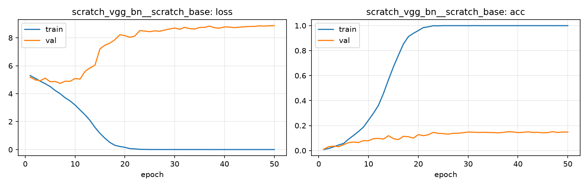

# Run card: `scratch_vgg_bn__scratch_base`

_Generated by `python -m birdcls.report` from the files in `outputs/runs/scratch_vgg_bn__scratch_base/`. Do not edit by hand._

## Summary

| Item | Value |
|---|---|
| Model | `scratch_vgg_bn` (8.88 M parameters) |
| Configuration | `scratch_base`: From-scratch baseline - no augmentation, no regularisation, SGD at constant LR |
| Finished | 2026-10-12 21:56 |
| Training time | 9.1 min, completed all epochs |
| Best epoch (by val accuracy) | 38 at 224 px, val Top-1 0.1511 |
| Input normalisation | mean (0.485, 0.456, 0.406), std (0.229, 0.224, 0.225) |
| Command | `python -m birdcls.train --model scratch_vgg_bn --config scratch_base` |

## Results (from `outputs/results.csv`)

| Variant | Train acc (clean) | Val Top-1 | Gap (train - val) | **Test Top-1** | **Test avg/class** |
|---|---|---|---|---|---|
| no TTA | 0.9997 | 0.1511 | 0.8486 | 0.1437 | 0.1381 |
| with TTA (flip averaging) | 0.9997 | 0.1439 | 0.8558 | 0.1628 | 0.1567 |

Train acc is measured on the training images with eval preprocessing (no augmentation).

## Configuration

Source: snapshot saved with the run (`config.yaml`).

| Setting | Value |
|---|---|
| `cutmix_prob` | 0.0 |
| `label_smoothing` | 0.0 |
| `weight_decay` | 0.0 |
| `dropout` | 0.0 |
| `drop_path` | 0.0 |
| `patience` | 1000 |
| `optimizer` | sgd |
| `momentum` | 0.9 |
| `lr_schedule` | constant |
| `augment` | none |

| Phase | Image size | Batch | Epochs | LR backbone | LR head | Warm-up epochs |
|---|---|---|---|---|---|---|
| 1 | 224 | 32 | 50 | 0.01 | 0.01 | 0 |

## Training curves

## Per-epoch log

| Epoch | Phase | Size | Train loss | Train acc | Val loss | Val acc | LR (backbone, end of epoch) |
|---|---|---|---|---|---|---|---|
| 1 | 1 | 224 | 5.297 | 0.008 | 5.182 | 0.0104 | 1.00e-02 |
| 2 | 1 | 224 | 5.104 | 0.016 | 4.987 | 0.0311 | 1.00e-02 |
| 3 | 1 | 224 | 4.894 | 0.030 | 4.927 | 0.0352 | 1.00e-02 |
| 4 | 1 | 224 | 4.715 | 0.045 | 5.109 | 0.0311 | 1.00e-02 |
| 5 | 1 | 224 | 4.514 | 0.057 | 4.855 | 0.0476 | 1.00e-02 |
| 6 | 1 | 224 | 4.230 | 0.091 | 4.876 | 0.0631 | 1.00e-02 |
| 7 | 1 | 224 | 3.999 | 0.121 | 4.738 | 0.0683 | 1.00e-02 |
| 8 | 1 | 224 | 3.710 | 0.153 | 4.892 | 0.0642 | 1.00e-02 |
| 9 | 1 | 224 | 3.484 | 0.189 | 4.886 | 0.0797 | 1.00e-02 |
| 10 | 1 | 224 | 3.186 | 0.244 | 5.085 | 0.0787 | 1.00e-02 |
| 11 | 1 | 224 | 2.837 | 0.300 | 5.044 | 0.0952 | 1.00e-02 |
| 12 | 1 | 224 | 2.491 | 0.362 | 5.591 | 0.0973 | 1.00e-02 |
| 13 | 1 | 224 | 2.083 | 0.458 | 5.851 | 0.0921 | 1.00e-02 |
| 14 | 1 | 224 | 1.585 | 0.566 | 6.041 | 0.1190 | 1.00e-02 |
| 15 | 1 | 224 | 1.160 | 0.670 | 7.208 | 0.0952 | 1.00e-02 |
| 16 | 1 | 224 | 0.809 | 0.763 | 7.473 | 0.0880 | 1.00e-02 |
| 17 | 1 | 224 | 0.506 | 0.853 | 7.620 | 0.1139 | 1.00e-02 |
| 18 | 1 | 224 | 0.303 | 0.912 | 7.864 | 0.1108 | 1.00e-02 |
| 19 | 1 | 224 | 0.219 | 0.938 | 8.222 | 0.0994 | 1.00e-02 |
| 20 | 1 | 224 | 0.159 | 0.960 | 8.155 | 0.1273 | 1.00e-02 |
| 21 | 1 | 224 | 0.068 | 0.984 | 8.035 | 0.1190 | 1.00e-02 |
| 22 | 1 | 224 | 0.049 | 0.990 | 8.127 | 0.1263 | 1.00e-02 |
| 23 | 1 | 224 | 0.016 | 0.999 | 8.518 | 0.1460 | 1.00e-02 |
| 24 | 1 | 224 | 0.011 | 0.998 | 8.480 | 0.1377 | 1.00e-02 |
| 25 | 1 | 224 | 0.004 | 1.000 | 8.440 | 0.1356 | 1.00e-02 |
| 26 | 1 | 224 | 0.003 | 1.000 | 8.496 | 0.1315 | 1.00e-02 |
| 27 | 1 | 224 | 0.004 | 1.000 | 8.470 | 0.1377 | 1.00e-02 |
| 28 | 1 | 224 | 0.003 | 1.000 | 8.555 | 0.1387 | 1.00e-02 |
| 29 | 1 | 224 | 0.003 | 1.000 | 8.632 | 0.1429 | 1.00e-02 |
| 30 | 1 | 224 | 0.005 | 0.999 | 8.699 | 0.1480 | 1.00e-02 |
| 31 | 1 | 224 | 0.002 | 1.000 | 8.612 | 0.1470 | 1.00e-02 |
| 32 | 1 | 224 | 0.002 | 1.000 | 8.746 | 0.1449 | 1.00e-02 |
| 33 | 1 | 224 | 0.003 | 0.999 | 8.660 | 0.1460 | 1.00e-02 |
| 34 | 1 | 224 | 0.002 | 0.999 | 8.627 | 0.1449 | 1.00e-02 |
| 35 | 1 | 224 | 0.002 | 1.000 | 8.743 | 0.1439 | 1.00e-02 |
| 36 | 1 | 224 | 0.002 | 0.999 | 8.745 | 0.1418 | 1.00e-02 |
| 37 | 1 | 224 | 0.001 | 1.000 | 8.836 | 0.1449 | 1.00e-02 |
| 38 **(best)** | 1 | 224 | 0.001 | 0.999 | 8.720 | 0.1511 | 1.00e-02 |
| 39 | 1 | 224 | 0.001 | 1.000 | 8.691 | 0.1491 | 1.00e-02 |
| 40 | 1 | 224 | 0.002 | 0.999 | 8.777 | 0.1439 | 1.00e-02 |
| 41 | 1 | 224 | 0.001 | 1.000 | 8.766 | 0.1460 | 1.00e-02 |
| 42 | 1 | 224 | 0.001 | 1.000 | 8.725 | 0.1501 | 1.00e-02 |
| 43 | 1 | 224 | 0.001 | 1.000 | 8.761 | 0.1449 | 1.00e-02 |
| 44 | 1 | 224 | 0.001 | 0.999 | 8.795 | 0.1460 | 1.00e-02 |
| 45 | 1 | 224 | 0.001 | 1.000 | 8.813 | 0.1418 | 1.00e-02 |
| 46 | 1 | 224 | 0.001 | 1.000 | 8.814 | 0.1439 | 1.00e-02 |
| 47 | 1 | 224 | 0.001 | 0.999 | 8.854 | 0.1511 | 1.00e-02 |
| 48 | 1 | 224 | 0.001 | 1.000 | 8.838 | 0.1449 | 1.00e-02 |
| 49 | 1 | 224 | 0.001 | 1.000 | 8.859 | 0.1480 | 1.00e-02 |
| 50 | 1 | 224 | 0.001 | 1.000 | 8.872 | 0.1480 | 1.00e-02 |

With CutMix, train loss/acc are computed on mixed images (soft accuracy), so they run lower than the clean train accuracy in the results table.

## Files

`outputs/runs/scratch_vgg_bn__scratch_base/`: `best.pt` (best checkpoint), `history.json`, `train.log`, `curves.png`, `config.yaml`
