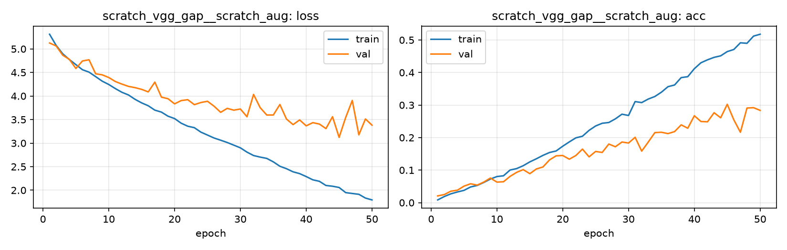

# Run card: `scratch_vgg_gap__scratch_aug`

_Generated by `python -m birdcls.report` from the files in `outputs/runs/scratch_vgg_gap__scratch_aug/`. Do not edit by hand._

## Summary

| Item | Value |
|---|---|
| Model | `scratch_vgg_gap` (2.41 M parameters) |
| Configuration | `scratch_aug`: S1 + basic data augmentation (crop, flip, rotation, colour jitter, random erasing) |
| Finished | 2026-10-15 16:20 |
| Training time | 8.7 min, completed all epochs |
| Best epoch (by val accuracy) | 45 at 224 px, val Top-1 0.3023 |
| Input normalisation | mean (0.485, 0.456, 0.406), std (0.229, 0.224, 0.225) |
| Command | `python -m birdcls.train --model scratch_vgg_gap --config scratch_aug` |

## Results (from `outputs/results.csv`)

| Variant | Train acc (clean) | Val Top-1 | Gap (train - val) | **Test Top-1** | **Test avg/class** |
|---|---|---|---|---|---|
| no TTA | 0.5918 | 0.3023 | 0.2895 | 0.3081 | 0.3004 |
| with TTA (flip averaging) | 0.5918 | 0.3085 | 0.2833 | 0.3048 | 0.2961 |

Train acc is measured on the training images with eval preprocessing (no augmentation).

## Configuration

Source: snapshot saved with the run (`config.yaml`).

| Setting | Value |
|---|---|
| `cutmix_prob` | 0.0 |
| `label_smoothing` | 0.0 |
| `weight_decay` | 0.0 |
| `dropout` | 0.0 |
| `drop_path` | 0.0 |
| `patience` | 1000 |
| `optimizer` | sgd |
| `momentum` | 0.9 |
| `lr_schedule` | constant |
| `augment` | basic |

| Phase | Image size | Batch | Epochs | LR backbone | LR head | Warm-up epochs |
|---|---|---|---|---|---|---|
| 1 | 224 | 32 | 50 | 0.01 | 0.01 | 0 |

## Training curves

## Per-epoch log

| Epoch | Phase | Size | Train loss | Train acc | Val loss | Val acc | LR (backbone, end of epoch) |
|---|---|---|---|---|---|---|---|
| 1 | 1 | 224 | 5.312 | 0.008 | 5.126 | 0.0207 | 1.00e-02 |
| 2 | 1 | 224 | 5.075 | 0.019 | 5.063 | 0.0248 | 1.00e-02 |
| 3 | 1 | 224 | 4.897 | 0.027 | 4.867 | 0.0352 | 1.00e-02 |
| 4 | 1 | 224 | 4.775 | 0.033 | 4.779 | 0.0383 | 1.00e-02 |
| 5 | 1 | 224 | 4.667 | 0.038 | 4.585 | 0.0507 | 1.00e-02 |
| 6 | 1 | 224 | 4.558 | 0.048 | 4.744 | 0.0580 | 1.00e-02 |
| 7 | 1 | 224 | 4.507 | 0.053 | 4.769 | 0.0538 | 1.00e-02 |
| 8 | 1 | 224 | 4.412 | 0.062 | 4.472 | 0.0631 | 1.00e-02 |
| 9 | 1 | 224 | 4.316 | 0.072 | 4.450 | 0.0756 | 1.00e-02 |
| 10 | 1 | 224 | 4.245 | 0.080 | 4.393 | 0.0631 | 1.00e-02 |
| 11 | 1 | 224 | 4.158 | 0.083 | 4.308 | 0.0642 | 1.00e-02 |
| 12 | 1 | 224 | 4.079 | 0.100 | 4.253 | 0.0807 | 1.00e-02 |
| 13 | 1 | 224 | 4.022 | 0.105 | 4.204 | 0.0932 | 1.00e-02 |
| 14 | 1 | 224 | 3.929 | 0.114 | 4.178 | 0.1014 | 1.00e-02 |
| 15 | 1 | 224 | 3.854 | 0.125 | 4.141 | 0.0890 | 1.00e-02 |
| 16 | 1 | 224 | 3.793 | 0.135 | 4.087 | 0.1035 | 1.00e-02 |
| 17 | 1 | 224 | 3.700 | 0.145 | 4.296 | 0.1097 | 1.00e-02 |
| 18 | 1 | 224 | 3.658 | 0.154 | 3.976 | 0.1315 | 1.00e-02 |
| 19 | 1 | 224 | 3.572 | 0.159 | 3.943 | 0.1439 | 1.00e-02 |
| 20 | 1 | 224 | 3.521 | 0.173 | 3.833 | 0.1449 | 1.00e-02 |
| 21 | 1 | 224 | 3.423 | 0.187 | 3.903 | 0.1335 | 1.00e-02 |
| 22 | 1 | 224 | 3.359 | 0.199 | 3.922 | 0.1449 | 1.00e-02 |
| 23 | 1 | 224 | 3.328 | 0.204 | 3.817 | 0.1646 | 1.00e-02 |
| 24 | 1 | 224 | 3.233 | 0.222 | 3.862 | 0.1408 | 1.00e-02 |
| 25 | 1 | 224 | 3.171 | 0.236 | 3.888 | 0.1573 | 1.00e-02 |
| 26 | 1 | 224 | 3.109 | 0.244 | 3.783 | 0.1542 | 1.00e-02 |
| 27 | 1 | 224 | 3.062 | 0.246 | 3.654 | 0.1801 | 1.00e-02 |
| 28 | 1 | 224 | 3.013 | 0.258 | 3.737 | 0.1718 | 1.00e-02 |
| 29 | 1 | 224 | 2.957 | 0.272 | 3.700 | 0.1863 | 1.00e-02 |
| 30 | 1 | 224 | 2.900 | 0.268 | 3.724 | 0.1832 | 1.00e-02 |
| 31 | 1 | 224 | 2.809 | 0.311 | 3.560 | 0.2008 | 1.00e-02 |
| 32 | 1 | 224 | 2.737 | 0.308 | 4.033 | 0.1584 | 1.00e-02 |
| 33 | 1 | 224 | 2.703 | 0.318 | 3.754 | 0.1863 | 1.00e-02 |
| 34 | 1 | 224 | 2.676 | 0.326 | 3.597 | 0.2153 | 1.00e-02 |
| 35 | 1 | 224 | 2.603 | 0.340 | 3.596 | 0.2164 | 1.00e-02 |
| 36 | 1 | 224 | 2.509 | 0.357 | 3.820 | 0.2122 | 1.00e-02 |
| 37 | 1 | 224 | 2.457 | 0.362 | 3.512 | 0.2184 | 1.00e-02 |
| 38 | 1 | 224 | 2.391 | 0.384 | 3.393 | 0.2391 | 1.00e-02 |
| 39 | 1 | 224 | 2.353 | 0.387 | 3.492 | 0.2288 | 1.00e-02 |
| 40 | 1 | 224 | 2.290 | 0.412 | 3.367 | 0.2671 | 1.00e-02 |
| 41 | 1 | 224 | 2.221 | 0.430 | 3.435 | 0.2495 | 1.00e-02 |
| 42 | 1 | 224 | 2.189 | 0.439 | 3.405 | 0.2484 | 1.00e-02 |
| 43 | 1 | 224 | 2.101 | 0.447 | 3.309 | 0.2764 | 1.00e-02 |
| 44 | 1 | 224 | 2.085 | 0.451 | 3.561 | 0.2609 | 1.00e-02 |
| 45 **(best)** | 1 | 224 | 2.058 | 0.464 | 3.122 | 0.3023 | 1.00e-02 |
| 46 | 1 | 224 | 1.949 | 0.471 | 3.545 | 0.2547 | 1.00e-02 |
| 47 | 1 | 224 | 1.931 | 0.491 | 3.906 | 0.2164 | 1.00e-02 |
| 48 | 1 | 224 | 1.913 | 0.490 | 3.175 | 0.2909 | 1.00e-02 |
| 49 | 1 | 224 | 1.834 | 0.512 | 3.513 | 0.2919 | 1.00e-02 |
| 50 | 1 | 224 | 1.794 | 0.518 | 3.381 | 0.2836 | 1.00e-02 |

With CutMix, train loss/acc are computed on mixed images (soft accuracy), so they run lower than the clean train accuracy in the results table.

## Files

`outputs/runs/scratch_vgg_gap__scratch_aug/`: `best.pt` (best checkpoint), `history.json`, `train.log`, `curves.png`, `config.yaml`
