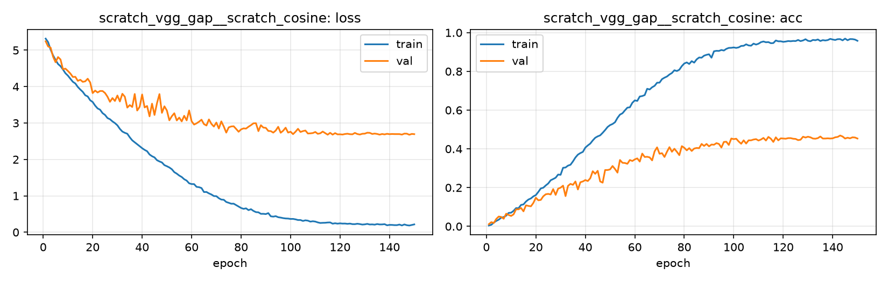

# Run card: `scratch_vgg_gap__scratch_cosine`

_Generated by `python -m birdcls.report` from the files in `outputs/runs/scratch_vgg_gap__scratch_cosine/`. Do not edit by hand._

## Summary

| Item | Value |
|---|---|
| Model | `scratch_vgg_gap` (2.41 M parameters) |
| Configuration | `scratch_cosine`: S3 + 2-epoch warm-up and cosine LR decay over up to 150 epochs, early stopping (patience 20) |
| Finished | 2026-10-15 16:51 |
| Training time | 26.2 min, completed all epochs |
| Best epoch (by val accuracy) | 143 at 224 px, val Top-1 0.4689 |
| Input normalisation | mean (0.485, 0.456, 0.406), std (0.229, 0.224, 0.225) |
| Command | `python -m birdcls.train --model scratch_vgg_gap --config scratch_cosine` |

## Results (from `outputs/results.csv`)

| Variant | Train acc (clean) | Val Top-1 | Gap (train - val) | **Test Top-1** | **Test avg/class** |
|---|---|---|---|---|---|
| no TTA | 0.9982 | 0.4689 | 0.5292 | 0.4626 | 0.4531 |
| with TTA (flip averaging) | 0.9982 | 0.4658 | 0.5323 | 0.4734 | 0.4620 |

Train acc is measured on the training images with eval preprocessing (no augmentation).

## Configuration

Source: snapshot saved with the run (`config.yaml`).

| Setting | Value |
|---|---|
| `cutmix_prob` | 0.0 |
| `label_smoothing` | 0.0 |
| `weight_decay` | 0.0 |
| `dropout` | 0.0 |
| `drop_path` | 0.0 |
| `patience` | 20 |
| `optimizer` | sgd |
| `momentum` | 0.9 |
| `lr_schedule` | cosine |
| `augment` | basic |

| Phase | Image size | Batch | Epochs | LR backbone | LR head | Warm-up epochs |
|---|---|---|---|---|---|---|
| 1 | 224 | 32 | 150 | 0.01 | 0.01 | 2 |

## Training curves

## Per-epoch log

| Epoch | Phase | Size | Train loss | Train acc | Val loss | Val acc | LR (backbone, end of epoch) |
|---|---|---|---|---|---|---|---|
| 1 | 1 | 224 | 5.319 | 0.004 | 5.246 | 0.0114 | 5.04e-03 |
| 2 | 1 | 224 | 5.221 | 0.008 | 5.103 | 0.0217 | 1.00e-02 |
| 3 | 1 | 224 | 5.016 | 0.020 | 5.072 | 0.0176 | 1.00e-02 |
| 4 | 1 | 224 | 4.858 | 0.028 | 4.822 | 0.0383 | 1.00e-02 |
| 5 | 1 | 224 | 4.733 | 0.035 | 4.670 | 0.0507 | 9.99e-03 |
| 6 | 1 | 224 | 4.621 | 0.045 | 4.812 | 0.0487 | 9.98e-03 |
| 7 | 1 | 224 | 4.563 | 0.048 | 4.747 | 0.0393 | 9.97e-03 |
| 8 | 1 | 224 | 4.470 | 0.055 | 4.479 | 0.0652 | 9.96e-03 |
| 9 | 1 | 224 | 4.367 | 0.070 | 4.494 | 0.0590 | 9.94e-03 |
| 10 | 1 | 224 | 4.302 | 0.071 | 4.430 | 0.0538 | 9.93e-03 |
| 11 | 1 | 224 | 4.215 | 0.080 | 4.359 | 0.0621 | 9.91e-03 |
| 12 | 1 | 224 | 4.132 | 0.094 | 4.266 | 0.0880 | 9.89e-03 |
| 13 | 1 | 224 | 4.086 | 0.093 | 4.270 | 0.0880 | 9.86e-03 |
| 14 | 1 | 224 | 3.991 | 0.111 | 4.159 | 0.0952 | 9.84e-03 |
| 15 | 1 | 224 | 3.920 | 0.113 | 4.188 | 0.0776 | 9.81e-03 |
| 16 | 1 | 224 | 3.857 | 0.128 | 4.132 | 0.1087 | 9.78e-03 |
| 17 | 1 | 224 | 3.763 | 0.139 | 4.146 | 0.1056 | 9.75e-03 |
| 18 | 1 | 224 | 3.730 | 0.144 | 4.217 | 0.1035 | 9.71e-03 |
| 19 | 1 | 224 | 3.625 | 0.155 | 4.115 | 0.1211 | 9.68e-03 |
| 20 | 1 | 224 | 3.578 | 0.161 | 3.822 | 0.1480 | 9.64e-03 |
| 21 | 1 | 224 | 3.478 | 0.178 | 3.891 | 0.1346 | 9.60e-03 |
| 22 | 1 | 224 | 3.401 | 0.196 | 3.839 | 0.1366 | 9.56e-03 |
| 23 | 1 | 224 | 3.366 | 0.199 | 3.880 | 0.1553 | 9.51e-03 |
| 24 | 1 | 224 | 3.272 | 0.211 | 3.880 | 0.1656 | 9.46e-03 |
| 25 | 1 | 224 | 3.222 | 0.221 | 3.824 | 0.1677 | 9.42e-03 |
| 26 | 1 | 224 | 3.137 | 0.238 | 3.723 | 0.1646 | 9.37e-03 |
| 27 | 1 | 224 | 3.104 | 0.244 | 3.583 | 0.1925 | 9.31e-03 |
| 28 | 1 | 224 | 3.044 | 0.251 | 3.685 | 0.1625 | 9.26e-03 |
| 29 | 1 | 224 | 2.998 | 0.267 | 3.606 | 0.1946 | 9.20e-03 |
| 30 | 1 | 224 | 2.937 | 0.266 | 3.756 | 0.1998 | 9.14e-03 |
| 31 | 1 | 224 | 2.839 | 0.302 | 3.592 | 0.2101 | 9.08e-03 |
| 32 | 1 | 224 | 2.766 | 0.304 | 3.803 | 0.1563 | 9.02e-03 |
| 33 | 1 | 224 | 2.731 | 0.314 | 3.723 | 0.2091 | 8.96e-03 |
| 34 | 1 | 224 | 2.706 | 0.318 | 3.424 | 0.2195 | 8.89e-03 |
| 35 | 1 | 224 | 2.608 | 0.335 | 3.494 | 0.2143 | 8.82e-03 |
| 36 | 1 | 224 | 2.525 | 0.355 | 3.440 | 0.2319 | 8.75e-03 |
| 37 | 1 | 224 | 2.470 | 0.370 | 3.798 | 0.1905 | 8.68e-03 |
| 38 | 1 | 224 | 2.418 | 0.378 | 3.344 | 0.2277 | 8.61e-03 |
| 39 | 1 | 224 | 2.364 | 0.384 | 3.446 | 0.2319 | 8.54e-03 |
| 40 | 1 | 224 | 2.309 | 0.407 | 3.784 | 0.2391 | 8.46e-03 |
| 41 | 1 | 224 | 2.262 | 0.418 | 3.428 | 0.2340 | 8.38e-03 |
| 42 | 1 | 224 | 2.226 | 0.427 | 3.467 | 0.2484 | 8.30e-03 |
| 43 | 1 | 224 | 2.135 | 0.443 | 3.183 | 0.2847 | 8.22e-03 |
| 44 | 1 | 224 | 2.088 | 0.457 | 3.532 | 0.2712 | 8.14e-03 |
| 45 | 1 | 224 | 2.055 | 0.465 | 3.221 | 0.2867 | 8.06e-03 |
| 46 | 1 | 224 | 1.979 | 0.470 | 3.544 | 0.2319 | 7.97e-03 |
| 47 | 1 | 224 | 1.944 | 0.483 | 3.795 | 0.2257 | 7.89e-03 |
| 48 | 1 | 224 | 1.917 | 0.497 | 3.280 | 0.2909 | 7.80e-03 |
| 49 | 1 | 224 | 1.843 | 0.513 | 3.459 | 0.2909 | 7.71e-03 |
| 50 | 1 | 224 | 1.813 | 0.523 | 3.345 | 0.2940 | 7.62e-03 |
| 51 | 1 | 224 | 1.779 | 0.528 | 3.075 | 0.3116 | 7.53e-03 |
| 52 | 1 | 224 | 1.731 | 0.537 | 3.187 | 0.2961 | 7.44e-03 |
| 53 | 1 | 224 | 1.650 | 0.560 | 3.269 | 0.2774 | 7.35e-03 |
| 54 | 1 | 224 | 1.609 | 0.577 | 3.071 | 0.3427 | 7.25e-03 |
| 55 | 1 | 224 | 1.557 | 0.584 | 3.149 | 0.3282 | 7.16e-03 |
| 56 | 1 | 224 | 1.517 | 0.599 | 3.045 | 0.3271 | 7.06e-03 |
| 57 | 1 | 224 | 1.456 | 0.613 | 3.199 | 0.3230 | 6.96e-03 |
| 58 | 1 | 224 | 1.419 | 0.615 | 3.074 | 0.3427 | 6.86e-03 |
| 59 | 1 | 224 | 1.344 | 0.638 | 3.346 | 0.3375 | 6.77e-03 |
| 60 | 1 | 224 | 1.323 | 0.650 | 3.048 | 0.3458 | 6.67e-03 |
| 61 | 1 | 224 | 1.322 | 0.647 | 2.957 | 0.3509 | 6.57e-03 |
| 62 | 1 | 224 | 1.246 | 0.670 | 2.991 | 0.3344 | 6.46e-03 |
| 63 | 1 | 224 | 1.237 | 0.673 | 3.036 | 0.3758 | 6.36e-03 |
| 64 | 1 | 224 | 1.214 | 0.678 | 3.092 | 0.3582 | 6.26e-03 |
| 65 | 1 | 224 | 1.104 | 0.710 | 2.970 | 0.3592 | 6.16e-03 |
| 66 | 1 | 224 | 1.106 | 0.707 | 2.932 | 0.3561 | 6.05e-03 |
| 67 | 1 | 224 | 1.067 | 0.718 | 3.099 | 0.3406 | 5.95e-03 |
| 68 | 1 | 224 | 1.037 | 0.725 | 2.976 | 0.3872 | 5.85e-03 |
| 69 | 1 | 224 | 0.994 | 0.741 | 2.903 | 0.4079 | 5.74e-03 |
| 70 | 1 | 224 | 0.991 | 0.742 | 3.014 | 0.3747 | 5.64e-03 |
| 71 | 1 | 224 | 0.935 | 0.760 | 2.849 | 0.3778 | 5.53e-03 |
| 72 | 1 | 224 | 0.898 | 0.767 | 3.045 | 0.3582 | 5.42e-03 |
| 73 | 1 | 224 | 0.891 | 0.773 | 2.905 | 0.3851 | 5.32e-03 |
| 74 | 1 | 224 | 0.831 | 0.784 | 2.737 | 0.4089 | 5.21e-03 |
| 75 | 1 | 224 | 0.808 | 0.792 | 2.881 | 0.3851 | 5.11e-03 |
| 76 | 1 | 224 | 0.784 | 0.806 | 2.906 | 0.4006 | 5.00e-03 |
| 77 | 1 | 224 | 0.785 | 0.802 | 2.911 | 0.3851 | 4.89e-03 |
| 78 | 1 | 224 | 0.745 | 0.809 | 2.838 | 0.3675 | 4.79e-03 |
| 79 | 1 | 224 | 0.705 | 0.827 | 2.761 | 0.4141 | 4.68e-03 |
| 80 | 1 | 224 | 0.666 | 0.841 | 2.826 | 0.4058 | 4.58e-03 |
| 81 | 1 | 224 | 0.642 | 0.846 | 2.853 | 0.3923 | 4.47e-03 |
| 82 | 1 | 224 | 0.656 | 0.838 | 2.847 | 0.4037 | 4.36e-03 |
| 83 | 1 | 224 | 0.607 | 0.853 | 2.898 | 0.3892 | 4.26e-03 |
| 84 | 1 | 224 | 0.633 | 0.845 | 2.941 | 0.4017 | 4.15e-03 |
| 85 | 1 | 224 | 0.586 | 0.862 | 2.992 | 0.4048 | 4.05e-03 |
| 86 | 1 | 224 | 0.553 | 0.872 | 2.996 | 0.4037 | 3.95e-03 |
| 87 | 1 | 224 | 0.547 | 0.871 | 2.778 | 0.4255 | 3.84e-03 |
| 88 | 1 | 224 | 0.506 | 0.881 | 2.940 | 0.4151 | 3.74e-03 |
| 89 | 1 | 224 | 0.506 | 0.885 | 2.874 | 0.4255 | 3.64e-03 |
| 90 | 1 | 224 | 0.499 | 0.888 | 2.867 | 0.4130 | 3.54e-03 |
| 91 | 1 | 224 | 0.525 | 0.871 | 2.783 | 0.4224 | 3.43e-03 |
| 92 | 1 | 224 | 0.438 | 0.904 | 2.778 | 0.4213 | 3.33e-03 |
| 93 | 1 | 224 | 0.429 | 0.906 | 2.736 | 0.4296 | 3.23e-03 |
| 94 | 1 | 224 | 0.442 | 0.905 | 2.793 | 0.4255 | 3.14e-03 |
| 95 | 1 | 224 | 0.412 | 0.910 | 2.896 | 0.4068 | 3.04e-03 |
| 96 | 1 | 224 | 0.402 | 0.908 | 2.733 | 0.4358 | 2.94e-03 |
| 97 | 1 | 224 | 0.388 | 0.916 | 2.789 | 0.4369 | 2.84e-03 |
| 98 | 1 | 224 | 0.379 | 0.921 | 2.872 | 0.4203 | 2.75e-03 |
| 99 | 1 | 224 | 0.376 | 0.922 | 2.737 | 0.4534 | 2.65e-03 |
| 100 | 1 | 224 | 0.365 | 0.923 | 2.761 | 0.4503 | 2.56e-03 |
| 101 | 1 | 224 | 0.366 | 0.921 | 2.694 | 0.4524 | 2.47e-03 |
| 102 | 1 | 224 | 0.354 | 0.924 | 2.761 | 0.4379 | 2.38e-03 |
| 103 | 1 | 224 | 0.335 | 0.931 | 2.841 | 0.4265 | 2.29e-03 |
| 104 | 1 | 224 | 0.336 | 0.932 | 2.754 | 0.4441 | 2.20e-03 |
| 105 | 1 | 224 | 0.310 | 0.940 | 2.778 | 0.4275 | 2.11e-03 |
| 106 | 1 | 224 | 0.327 | 0.934 | 2.794 | 0.4441 | 2.03e-03 |
| 107 | 1 | 224 | 0.318 | 0.933 | 2.712 | 0.4441 | 1.94e-03 |
| 108 | 1 | 224 | 0.291 | 0.943 | 2.716 | 0.4482 | 1.86e-03 |
| 109 | 1 | 224 | 0.302 | 0.938 | 2.725 | 0.4503 | 1.78e-03 |
| 110 | 1 | 224 | 0.293 | 0.943 | 2.755 | 0.4431 | 1.70e-03 |
| 111 | 1 | 224 | 0.270 | 0.951 | 2.704 | 0.4482 | 1.62e-03 |
| 112 | 1 | 224 | 0.254 | 0.954 | 2.718 | 0.4565 | 1.54e-03 |
| 113 | 1 | 224 | 0.258 | 0.950 | 2.765 | 0.4431 | 1.46e-03 |
| 114 | 1 | 224 | 0.260 | 0.951 | 2.723 | 0.4617 | 1.39e-03 |
| 115 | 1 | 224 | 0.267 | 0.945 | 2.680 | 0.4524 | 1.32e-03 |
| 116 | 1 | 224 | 0.270 | 0.946 | 2.731 | 0.4358 | 1.25e-03 |
| 117 | 1 | 224 | 0.235 | 0.959 | 2.681 | 0.4596 | 1.18e-03 |
| 118 | 1 | 224 | 0.247 | 0.955 | 2.723 | 0.4441 | 1.11e-03 |
| 119 | 1 | 224 | 0.236 | 0.955 | 2.689 | 0.4545 | 1.04e-03 |
| 120 | 1 | 224 | 0.244 | 0.952 | 2.690 | 0.4534 | 9.80e-04 |
| 121 | 1 | 224 | 0.237 | 0.954 | 2.684 | 0.4524 | 9.18e-04 |
| 122 | 1 | 224 | 0.239 | 0.957 | 2.698 | 0.4555 | 8.57e-04 |
| 123 | 1 | 224 | 0.230 | 0.955 | 2.706 | 0.4555 | 7.99e-04 |
| 124 | 1 | 224 | 0.237 | 0.957 | 2.693 | 0.4524 | 7.42e-04 |
| 125 | 1 | 224 | 0.223 | 0.957 | 2.690 | 0.4513 | 6.88e-04 |
| 126 | 1 | 224 | 0.222 | 0.962 | 2.728 | 0.4451 | 6.35e-04 |
| 127 | 1 | 224 | 0.233 | 0.956 | 2.698 | 0.4472 | 5.84e-04 |
| 128 | 1 | 224 | 0.224 | 0.960 | 2.684 | 0.4627 | 5.35e-04 |
| 129 | 1 | 224 | 0.211 | 0.966 | 2.705 | 0.4586 | 4.89e-04 |
| 130 | 1 | 224 | 0.216 | 0.958 | 2.708 | 0.4627 | 4.44e-04 |
| 131 | 1 | 224 | 0.229 | 0.955 | 2.734 | 0.4596 | 4.01e-04 |
| 132 | 1 | 224 | 0.213 | 0.962 | 2.730 | 0.4534 | 3.61e-04 |
| 133 | 1 | 224 | 0.216 | 0.961 | 2.700 | 0.4524 | 3.22e-04 |
| 134 | 1 | 224 | 0.208 | 0.965 | 2.710 | 0.4555 | 2.86e-04 |
| 135 | 1 | 224 | 0.225 | 0.957 | 2.700 | 0.4638 | 2.51e-04 |
| 136 | 1 | 224 | 0.214 | 0.961 | 2.681 | 0.4534 | 2.19e-04 |
| 137 | 1 | 224 | 0.215 | 0.959 | 2.699 | 0.4534 | 1.89e-04 |
| 138 | 1 | 224 | 0.222 | 0.961 | 2.688 | 0.4545 | 1.61e-04 |
| 139 | 1 | 224 | 0.191 | 0.968 | 2.704 | 0.4534 | 1.36e-04 |
| 140 | 1 | 224 | 0.202 | 0.964 | 2.694 | 0.4545 | 1.12e-04 |
| 141 | 1 | 224 | 0.201 | 0.962 | 2.699 | 0.4596 | 9.10e-05 |
| 142 | 1 | 224 | 0.195 | 0.966 | 2.696 | 0.4617 | 7.19e-05 |
| 143 **(best)** | 1 | 224 | 0.195 | 0.966 | 2.697 | 0.4689 | 5.51e-05 |
| 144 | 1 | 224 | 0.211 | 0.960 | 2.696 | 0.4638 | 4.05e-05 |
| 145 | 1 | 224 | 0.186 | 0.969 | 2.682 | 0.4534 | 2.81e-05 |
| 146 | 1 | 224 | 0.214 | 0.961 | 2.709 | 0.4576 | 1.80e-05 |
| 147 | 1 | 224 | 0.193 | 0.967 | 2.707 | 0.4545 | 1.01e-05 |
| 148 | 1 | 224 | 0.184 | 0.966 | 2.678 | 0.4596 | 4.51e-06 |
| 149 | 1 | 224 | 0.200 | 0.964 | 2.701 | 0.4586 | 1.13e-06 |
| 150 | 1 | 224 | 0.215 | 0.958 | 2.694 | 0.4534 | 0.00e+00 |

With CutMix, train loss/acc are computed on mixed images (soft accuracy), so they run lower than the clean train accuracy in the results table.

## Files

`outputs/runs/scratch_vgg_gap__scratch_cosine/`: `best.pt` (best checkpoint), `history.json`, `train.log`, `curves.png`, `config.yaml`
