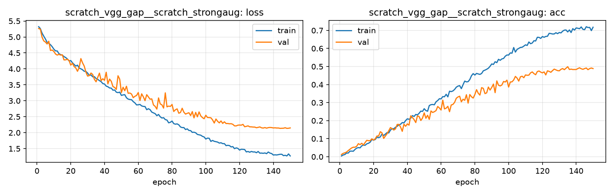

# Run card: `scratch_vgg_gap__scratch_strongaug`

_Generated by `python -m birdcls.report` from the files in `outputs/runs/scratch_vgg_gap__scratch_strongaug/`. Do not edit by hand._

## Summary

| Item | Value |
|---|---|
| Model | `scratch_vgg_gap` (2.41 M parameters) |
| Configuration | `scratch_strongaug`: S5 + strong augmentation (crop 25-100%, flip, TrivialAugmentWide, random erasing) |
| Finished | 2026-10-15 18:16 |
| Training time | 26.2 min, completed all epochs |
| Best epoch (by val accuracy) | 135 at 224 px, val Top-1 0.4990 |
| Input normalisation | mean (0.485, 0.456, 0.406), std (0.229, 0.224, 0.225) |
| Command | `python -m birdcls.train --model scratch_vgg_gap --config scratch_strongaug` |

## Results (from `outputs/results.csv`)

| Variant | Train acc (clean) | Val Top-1 | Gap (train - val) | **Test Top-1** | **Test avg/class** |
|---|---|---|---|---|---|
| no TTA | 0.9671 | 0.4990 | 0.4682 | 0.4826 | 0.4690 |
| with TTA (flip averaging) | 0.9671 | 0.4928 | 0.4744 | 0.4942 | 0.4809 |

Train acc is measured on the training images with eval preprocessing (no augmentation).

## Configuration

Source: snapshot saved with the run (`config.yaml`).

| Setting | Value |
|---|---|
| `cutmix_prob` | 0.0 |
| `label_smoothing` | 0.0 |
| `weight_decay` | 0.0005 |
| `dropout` | 0.0 |
| `drop_path` | 0.0 |
| `patience` | 20 |
| `optimizer` | sgd |
| `momentum` | 0.9 |
| `lr_schedule` | cosine |
| `augment` | strong |

| Phase | Image size | Batch | Epochs | LR backbone | LR head | Warm-up epochs |
|---|---|---|---|---|---|---|
| 1 | 224 | 32 | 150 | 0.01 | 0.01 | 2 |

## Training curves

## Per-epoch log

| Epoch | Phase | Size | Train loss | Train acc | Val loss | Val acc | LR (backbone, end of epoch) |
|---|---|---|---|---|---|---|---|
| 1 | 1 | 224 | 5.322 | 0.004 | 5.264 | 0.0124 | 5.04e-03 |
| 2 | 1 | 224 | 5.263 | 0.010 | 5.244 | 0.0186 | 1.00e-02 |
| 3 | 1 | 224 | 5.121 | 0.012 | 4.996 | 0.0217 | 1.00e-02 |
| 4 | 1 | 224 | 5.026 | 0.021 | 4.877 | 0.0259 | 1.00e-02 |
| 5 | 1 | 224 | 4.937 | 0.020 | 4.841 | 0.0342 | 9.99e-03 |
| 6 | 1 | 224 | 4.835 | 0.031 | 4.779 | 0.0414 | 9.98e-03 |
| 7 | 1 | 224 | 4.802 | 0.031 | 4.867 | 0.0487 | 9.97e-03 |
| 8 | 1 | 224 | 4.757 | 0.030 | 4.576 | 0.0528 | 9.96e-03 |
| 9 | 1 | 224 | 4.696 | 0.040 | 4.591 | 0.0528 | 9.94e-03 |
| 10 | 1 | 224 | 4.618 | 0.048 | 4.547 | 0.0580 | 9.93e-03 |
| 11 | 1 | 224 | 4.563 | 0.051 | 4.465 | 0.0725 | 9.91e-03 |
| 12 | 1 | 224 | 4.561 | 0.049 | 4.432 | 0.0673 | 9.89e-03 |
| 13 | 1 | 224 | 4.477 | 0.060 | 4.454 | 0.0745 | 9.86e-03 |
| 14 | 1 | 224 | 4.446 | 0.064 | 4.432 | 0.0652 | 9.84e-03 |
| 15 | 1 | 224 | 4.430 | 0.064 | 4.441 | 0.0787 | 9.81e-03 |
| 16 | 1 | 224 | 4.386 | 0.072 | 4.280 | 0.0911 | 9.78e-03 |
| 17 | 1 | 224 | 4.354 | 0.075 | 4.283 | 0.0890 | 9.75e-03 |
| 18 | 1 | 224 | 4.311 | 0.081 | 4.301 | 0.0890 | 9.71e-03 |
| 19 | 1 | 224 | 4.248 | 0.096 | 4.263 | 0.0994 | 9.68e-03 |
| 20 | 1 | 224 | 4.260 | 0.092 | 4.117 | 0.0921 | 9.64e-03 |
| 21 | 1 | 224 | 4.191 | 0.096 | 4.175 | 0.0994 | 9.60e-03 |
| 22 | 1 | 224 | 4.140 | 0.108 | 4.072 | 0.1149 | 9.56e-03 |
| 23 | 1 | 224 | 4.086 | 0.106 | 4.028 | 0.1149 | 9.51e-03 |
| 24 | 1 | 224 | 4.116 | 0.110 | 3.924 | 0.1387 | 9.46e-03 |
| 25 | 1 | 224 | 4.022 | 0.127 | 4.044 | 0.1325 | 9.42e-03 |
| 26 | 1 | 224 | 4.002 | 0.117 | 4.322 | 0.1014 | 9.37e-03 |
| 27 | 1 | 224 | 3.970 | 0.126 | 4.188 | 0.1149 | 9.31e-03 |
| 28 | 1 | 224 | 3.924 | 0.134 | 4.086 | 0.1273 | 9.26e-03 |
| 29 | 1 | 224 | 3.920 | 0.132 | 3.894 | 0.1439 | 9.20e-03 |
| 30 | 1 | 224 | 3.868 | 0.147 | 3.773 | 0.1615 | 9.14e-03 |
| 31 | 1 | 224 | 3.792 | 0.156 | 3.791 | 0.1553 | 9.08e-03 |
| 32 | 1 | 224 | 3.809 | 0.155 | 3.869 | 0.1480 | 9.02e-03 |
| 33 | 1 | 224 | 3.750 | 0.164 | 3.825 | 0.1542 | 8.96e-03 |
| 34 | 1 | 224 | 3.756 | 0.169 | 3.671 | 0.1791 | 8.89e-03 |
| 35 | 1 | 224 | 3.696 | 0.177 | 3.595 | 0.1791 | 8.82e-03 |
| 36 | 1 | 224 | 3.671 | 0.180 | 3.735 | 0.1646 | 8.75e-03 |
| 37 | 1 | 224 | 3.631 | 0.189 | 3.867 | 0.1408 | 8.68e-03 |
| 38 | 1 | 224 | 3.599 | 0.188 | 3.631 | 0.1801 | 8.61e-03 |
| 39 | 1 | 224 | 3.539 | 0.201 | 3.690 | 0.1687 | 8.54e-03 |
| 40 | 1 | 224 | 3.525 | 0.210 | 3.640 | 0.1822 | 8.46e-03 |
| 41 | 1 | 224 | 3.459 | 0.208 | 3.894 | 0.1749 | 8.38e-03 |
| 42 | 1 | 224 | 3.440 | 0.213 | 3.532 | 0.2267 | 8.30e-03 |
| 43 | 1 | 224 | 3.401 | 0.228 | 3.678 | 0.2174 | 8.22e-03 |
| 44 | 1 | 224 | 3.396 | 0.223 | 3.611 | 0.2060 | 8.14e-03 |
| 45 | 1 | 224 | 3.331 | 0.234 | 3.445 | 0.1894 | 8.06e-03 |
| 46 | 1 | 224 | 3.338 | 0.232 | 3.418 | 0.2267 | 7.97e-03 |
| 47 | 1 | 224 | 3.269 | 0.241 | 3.356 | 0.2226 | 7.89e-03 |
| 48 | 1 | 224 | 3.254 | 0.253 | 3.783 | 0.2008 | 7.80e-03 |
| 49 | 1 | 224 | 3.271 | 0.251 | 3.677 | 0.2143 | 7.71e-03 |
| 50 | 1 | 224 | 3.167 | 0.266 | 3.257 | 0.2433 | 7.62e-03 |
| 51 | 1 | 224 | 3.184 | 0.256 | 3.424 | 0.2133 | 7.53e-03 |
| 52 | 1 | 224 | 3.191 | 0.252 | 3.315 | 0.2298 | 7.44e-03 |
| 53 | 1 | 224 | 3.094 | 0.284 | 3.455 | 0.2070 | 7.35e-03 |
| 54 | 1 | 224 | 3.052 | 0.289 | 3.234 | 0.2536 | 7.25e-03 |
| 55 | 1 | 224 | 3.040 | 0.290 | 3.243 | 0.2453 | 7.16e-03 |
| 56 | 1 | 224 | 3.034 | 0.288 | 3.211 | 0.2495 | 7.06e-03 |
| 57 | 1 | 224 | 2.973 | 0.304 | 3.097 | 0.2557 | 6.96e-03 |
| 58 | 1 | 224 | 2.933 | 0.311 | 3.139 | 0.2785 | 6.86e-03 |
| 59 | 1 | 224 | 2.869 | 0.322 | 3.167 | 0.2702 | 6.77e-03 |
| 60 | 1 | 224 | 2.874 | 0.321 | 3.257 | 0.2588 | 6.67e-03 |
| 61 | 1 | 224 | 2.885 | 0.333 | 3.007 | 0.3137 | 6.57e-03 |
| 62 | 1 | 224 | 2.838 | 0.332 | 3.217 | 0.2650 | 6.46e-03 |
| 63 | 1 | 224 | 2.823 | 0.346 | 3.123 | 0.2692 | 6.36e-03 |
| 64 | 1 | 224 | 2.819 | 0.332 | 3.003 | 0.2795 | 6.26e-03 |
| 65 | 1 | 224 | 2.719 | 0.363 | 3.191 | 0.2495 | 6.16e-03 |
| 66 | 1 | 224 | 2.750 | 0.361 | 3.120 | 0.2867 | 6.05e-03 |
| 67 | 1 | 224 | 2.720 | 0.365 | 3.048 | 0.2899 | 5.95e-03 |
| 68 | 1 | 224 | 2.644 | 0.373 | 3.059 | 0.3012 | 5.85e-03 |
| 69 | 1 | 224 | 2.619 | 0.385 | 2.868 | 0.3240 | 5.74e-03 |
| 70 | 1 | 224 | 2.595 | 0.391 | 2.824 | 0.3313 | 5.64e-03 |
| 71 | 1 | 224 | 2.532 | 0.394 | 2.738 | 0.3354 | 5.53e-03 |
| 72 | 1 | 224 | 2.570 | 0.377 | 3.089 | 0.3043 | 5.42e-03 |
| 73 | 1 | 224 | 2.498 | 0.399 | 2.901 | 0.3188 | 5.32e-03 |
| 74 | 1 | 224 | 2.459 | 0.419 | 2.873 | 0.3126 | 5.21e-03 |
| 75 | 1 | 224 | 2.469 | 0.415 | 2.769 | 0.3437 | 5.11e-03 |
| 76 | 1 | 224 | 2.409 | 0.416 | 3.248 | 0.2971 | 5.00e-03 |
| 77 | 1 | 224 | 2.395 | 0.428 | 2.810 | 0.3447 | 4.89e-03 |
| 78 | 1 | 224 | 2.308 | 0.449 | 2.833 | 0.3323 | 4.79e-03 |
| 79 | 1 | 224 | 2.325 | 0.461 | 2.822 | 0.3251 | 4.68e-03 |
| 80 | 1 | 224 | 2.364 | 0.453 | 2.884 | 0.3447 | 4.58e-03 |
| 81 | 1 | 224 | 2.283 | 0.462 | 2.664 | 0.3716 | 4.47e-03 |
| 82 | 1 | 224 | 2.265 | 0.459 | 2.717 | 0.3520 | 4.36e-03 |
| 83 | 1 | 224 | 2.275 | 0.456 | 2.746 | 0.3416 | 4.26e-03 |
| 84 | 1 | 224 | 2.245 | 0.461 | 2.609 | 0.3830 | 4.15e-03 |
| 85 | 1 | 224 | 2.178 | 0.476 | 2.634 | 0.3789 | 4.05e-03 |
| 86 | 1 | 224 | 2.159 | 0.480 | 2.765 | 0.3499 | 3.95e-03 |
| 87 | 1 | 224 | 2.159 | 0.485 | 2.641 | 0.3540 | 3.84e-03 |
| 88 | 1 | 224 | 2.097 | 0.491 | 2.582 | 0.3861 | 3.74e-03 |
| 89 | 1 | 224 | 2.119 | 0.501 | 2.607 | 0.3696 | 3.64e-03 |
| 90 | 1 | 224 | 2.068 | 0.514 | 2.624 | 0.3841 | 3.54e-03 |
| 91 | 1 | 224 | 2.064 | 0.511 | 2.536 | 0.4027 | 3.43e-03 |
| 92 | 1 | 224 | 2.008 | 0.527 | 2.660 | 0.3551 | 3.33e-03 |
| 93 | 1 | 224 | 2.014 | 0.521 | 2.462 | 0.4203 | 3.23e-03 |
| 94 | 1 | 224 | 1.996 | 0.540 | 2.636 | 0.3965 | 3.14e-03 |
| 95 | 1 | 224 | 1.945 | 0.534 | 2.496 | 0.3923 | 3.04e-03 |
| 96 | 1 | 224 | 1.932 | 0.542 | 2.650 | 0.3975 | 2.94e-03 |
| 97 | 1 | 224 | 1.920 | 0.545 | 2.527 | 0.4172 | 2.84e-03 |
| 98 | 1 | 224 | 1.884 | 0.557 | 2.472 | 0.4141 | 2.75e-03 |
| 99 | 1 | 224 | 1.865 | 0.564 | 2.436 | 0.4244 | 2.65e-03 |
| 100 | 1 | 224 | 1.799 | 0.564 | 2.546 | 0.3861 | 2.56e-03 |
| 101 | 1 | 224 | 1.829 | 0.576 | 2.474 | 0.4141 | 2.47e-03 |
| 102 | 1 | 224 | 1.823 | 0.574 | 2.472 | 0.4151 | 2.38e-03 |
| 103 | 1 | 224 | 1.725 | 0.605 | 2.466 | 0.4255 | 2.29e-03 |
| 104 | 1 | 224 | 1.756 | 0.580 | 2.400 | 0.4451 | 2.20e-03 |
| 105 | 1 | 224 | 1.728 | 0.595 | 2.301 | 0.4358 | 2.11e-03 |
| 106 | 1 | 224 | 1.717 | 0.600 | 2.428 | 0.4193 | 2.03e-03 |
| 107 | 1 | 224 | 1.704 | 0.606 | 2.355 | 0.4431 | 1.94e-03 |
| 108 | 1 | 224 | 1.672 | 0.607 | 2.307 | 0.4462 | 1.86e-03 |
| 109 | 1 | 224 | 1.683 | 0.613 | 2.367 | 0.4379 | 1.78e-03 |
| 110 | 1 | 224 | 1.656 | 0.620 | 2.290 | 0.4534 | 1.70e-03 |
| 111 | 1 | 224 | 1.656 | 0.617 | 2.340 | 0.4513 | 1.62e-03 |
| 112 | 1 | 224 | 1.593 | 0.636 | 2.286 | 0.4524 | 1.54e-03 |
| 113 | 1 | 224 | 1.603 | 0.626 | 2.287 | 0.4648 | 1.46e-03 |
| 114 | 1 | 224 | 1.595 | 0.630 | 2.278 | 0.4700 | 1.39e-03 |
| 115 | 1 | 224 | 1.553 | 0.643 | 2.281 | 0.4607 | 1.32e-03 |
| 116 | 1 | 224 | 1.563 | 0.641 | 2.261 | 0.4545 | 1.25e-03 |
| 117 | 1 | 224 | 1.498 | 0.662 | 2.213 | 0.4720 | 1.18e-03 |
| 118 | 1 | 224 | 1.523 | 0.661 | 2.212 | 0.4752 | 1.11e-03 |
| 119 | 1 | 224 | 1.507 | 0.656 | 2.234 | 0.4689 | 1.04e-03 |
| 120 | 1 | 224 | 1.453 | 0.666 | 2.239 | 0.4648 | 9.80e-04 |
| 121 | 1 | 224 | 1.480 | 0.662 | 2.235 | 0.4700 | 9.18e-04 |
| 122 | 1 | 224 | 1.476 | 0.667 | 2.260 | 0.4534 | 8.57e-04 |
| 123 | 1 | 224 | 1.471 | 0.667 | 2.186 | 0.4762 | 7.99e-04 |
| 124 | 1 | 224 | 1.396 | 0.684 | 2.197 | 0.4731 | 7.42e-04 |
| 125 | 1 | 224 | 1.410 | 0.683 | 2.213 | 0.4679 | 6.88e-04 |
| 126 | 1 | 224 | 1.386 | 0.680 | 2.183 | 0.4772 | 6.35e-04 |
| 127 | 1 | 224 | 1.411 | 0.680 | 2.181 | 0.4855 | 5.84e-04 |
| 128 | 1 | 224 | 1.394 | 0.687 | 2.175 | 0.4814 | 5.35e-04 |
| 129 | 1 | 224 | 1.396 | 0.682 | 2.174 | 0.4772 | 4.89e-04 |
| 130 | 1 | 224 | 1.371 | 0.689 | 2.154 | 0.4762 | 4.44e-04 |
| 131 | 1 | 224 | 1.410 | 0.686 | 2.166 | 0.4845 | 4.01e-04 |
| 132 | 1 | 224 | 1.357 | 0.696 | 2.180 | 0.4886 | 3.61e-04 |
| 133 | 1 | 224 | 1.360 | 0.702 | 2.152 | 0.4824 | 3.22e-04 |
| 134 | 1 | 224 | 1.353 | 0.702 | 2.144 | 0.4907 | 2.86e-04 |
| 135 **(best)** | 1 | 224 | 1.364 | 0.692 | 2.160 | 0.4990 | 2.51e-04 |
| 136 | 1 | 224 | 1.341 | 0.703 | 2.141 | 0.4834 | 2.19e-04 |
| 137 | 1 | 224 | 1.393 | 0.688 | 2.157 | 0.4855 | 1.89e-04 |
| 138 | 1 | 224 | 1.359 | 0.710 | 2.163 | 0.4834 | 1.61e-04 |
| 139 | 1 | 224 | 1.345 | 0.702 | 2.159 | 0.4834 | 1.36e-04 |
| 140 | 1 | 224 | 1.299 | 0.714 | 2.148 | 0.4834 | 1.12e-04 |
| 141 | 1 | 224 | 1.305 | 0.712 | 2.152 | 0.4886 | 9.10e-05 |
| 142 | 1 | 224 | 1.300 | 0.709 | 2.145 | 0.4928 | 7.19e-05 |
| 143 | 1 | 224 | 1.311 | 0.719 | 2.146 | 0.4876 | 5.51e-05 |
| 144 | 1 | 224 | 1.322 | 0.706 | 2.135 | 0.4845 | 4.05e-05 |
| 145 | 1 | 224 | 1.322 | 0.704 | 2.137 | 0.4886 | 2.81e-05 |
| 146 | 1 | 224 | 1.279 | 0.721 | 2.138 | 0.4917 | 1.80e-05 |
| 147 | 1 | 224 | 1.290 | 0.716 | 2.154 | 0.4824 | 1.01e-05 |
| 148 | 1 | 224 | 1.270 | 0.717 | 2.135 | 0.4886 | 4.51e-06 |
| 149 | 1 | 224 | 1.333 | 0.699 | 2.138 | 0.4917 | 1.13e-06 |
| 150 | 1 | 224 | 1.270 | 0.718 | 2.148 | 0.4886 | 0.00e+00 |

With CutMix, train loss/acc are computed on mixed images (soft accuracy), so they run lower than the clean train accuracy in the results table.

## Files

`outputs/runs/scratch_vgg_gap__scratch_strongaug/`: `best.pt` (best checkpoint), `history.json`, `train.log`, `curves.png`, `config.yaml`
