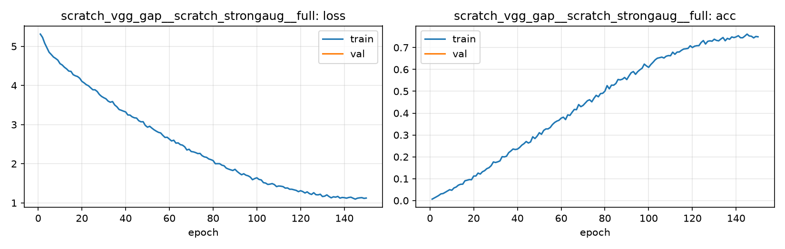

# Run card: `scratch_vgg_gap__scratch_strongaug__full`

_Generated by `python -m birdcls.report` from the files in `outputs/runs/scratch_vgg_gap__scratch_strongaug__full/`. Do not edit by hand._

## Summary

| Item | Value |
|---|---|
| Model | `scratch_vgg_gap` (2.41 M parameters) |
| Configuration | `scratch_strongaug`: S5 + strong augmentation (crop 25-100%, flip, TrivialAugmentWide, random erasing) |
| Finished | 2026-10-15 23:36 |
| Training time | 27.4 min, completed all epochs |
| Checkpoint | **final epoch 150** (full-train: trained on train + val, no validation, no early stopping) |
| Input normalisation | mean (0.485, 0.456, 0.406), std (0.229, 0.224, 0.225) |
| Command | `python -m birdcls.train --model scratch_vgg_gap --config scratch_strongaug` |

## Results (from `outputs/results.csv`)

| Variant | Train acc (clean) | Val Top-1 | Gap (train - val) | **Test Top-1** | **Test avg/class** |
|---|---|---|---|---|---|
| no TTA | 0.9863 | nan | nan | 0.5864 | 0.5760 |
| with TTA (flip averaging) | 0.9863 | nan | nan | 0.5914 | 0.5816 |

Train acc is measured on the training images with eval preprocessing (no augmentation).

## Configuration

Source: snapshot saved with the run (`config.yaml`).

| Setting | Value |
|---|---|
| `full_train` | True |
| `cutmix_prob` | 0.0 |
| `label_smoothing` | 0.0 |
| `weight_decay` | 0.0005 |
| `dropout` | 0.0 |
| `drop_path` | 0.0 |
| `patience` | 20 |
| `optimizer` | sgd |
| `momentum` | 0.9 |
| `lr_schedule` | cosine |
| `augment` | strong |

| Phase | Image size | Batch | Epochs | LR backbone | LR head | Warm-up epochs |
|---|---|---|---|---|---|---|
| 1 | 224 | 32 | 150 | 0.01 | 0.01 | 2 |

## Training curves

## Per-epoch log

| Epoch | Phase | Size | Train loss | Train acc | Val loss | Val acc | LR (backbone, end of epoch) |
|---|---|---|---|---|---|---|---|
| 1 | 1 | 224 | 5.313 | 0.007 | nan | nan | 5.03e-03 |
| 2 | 1 | 224 | 5.229 | 0.012 | nan | nan | 1.00e-02 |
| 3 | 1 | 224 | 5.078 | 0.018 | nan | nan | 1.00e-02 |
| 4 | 1 | 224 | 4.962 | 0.023 | nan | nan | 1.00e-02 |
| 5 | 1 | 224 | 4.849 | 0.031 | nan | nan | 9.99e-03 |
| 6 | 1 | 224 | 4.790 | 0.032 | nan | nan | 9.98e-03 |
| 7 | 1 | 224 | 4.727 | 0.038 | nan | nan | 9.97e-03 |
| 8 | 1 | 224 | 4.691 | 0.044 | nan | nan | 9.96e-03 |
| 9 | 1 | 224 | 4.647 | 0.050 | nan | nan | 9.94e-03 |
| 10 | 1 | 224 | 4.557 | 0.047 | nan | nan | 9.93e-03 |
| 11 | 1 | 224 | 4.523 | 0.058 | nan | nan | 9.91e-03 |
| 12 | 1 | 224 | 4.466 | 0.062 | nan | nan | 9.89e-03 |
| 13 | 1 | 224 | 4.423 | 0.071 | nan | nan | 9.86e-03 |
| 14 | 1 | 224 | 4.368 | 0.075 | nan | nan | 9.84e-03 |
| 15 | 1 | 224 | 4.360 | 0.075 | nan | nan | 9.81e-03 |
| 16 | 1 | 224 | 4.276 | 0.091 | nan | nan | 9.78e-03 |
| 17 | 1 | 224 | 4.248 | 0.093 | nan | nan | 9.75e-03 |
| 18 | 1 | 224 | 4.229 | 0.096 | nan | nan | 9.71e-03 |
| 19 | 1 | 224 | 4.185 | 0.095 | nan | nan | 9.68e-03 |
| 20 | 1 | 224 | 4.105 | 0.112 | nan | nan | 9.64e-03 |
| 21 | 1 | 224 | 4.067 | 0.113 | nan | nan | 9.60e-03 |
| 22 | 1 | 224 | 4.020 | 0.126 | nan | nan | 9.56e-03 |
| 23 | 1 | 224 | 3.993 | 0.121 | nan | nan | 9.51e-03 |
| 24 | 1 | 224 | 3.940 | 0.132 | nan | nan | 9.46e-03 |
| 25 | 1 | 224 | 3.891 | 0.137 | nan | nan | 9.42e-03 |
| 26 | 1 | 224 | 3.889 | 0.146 | nan | nan | 9.37e-03 |
| 27 | 1 | 224 | 3.846 | 0.150 | nan | nan | 9.31e-03 |
| 28 | 1 | 224 | 3.769 | 0.160 | nan | nan | 9.26e-03 |
| 29 | 1 | 224 | 3.720 | 0.177 | nan | nan | 9.20e-03 |
| 30 | 1 | 224 | 3.687 | 0.174 | nan | nan | 9.14e-03 |
| 31 | 1 | 224 | 3.659 | 0.177 | nan | nan | 9.08e-03 |
| 32 | 1 | 224 | 3.600 | 0.181 | nan | nan | 9.02e-03 |
| 33 | 1 | 224 | 3.572 | 0.201 | nan | nan | 8.96e-03 |
| 34 | 1 | 224 | 3.589 | 0.200 | nan | nan | 8.89e-03 |
| 35 | 1 | 224 | 3.502 | 0.203 | nan | nan | 8.82e-03 |
| 36 | 1 | 224 | 3.455 | 0.219 | nan | nan | 8.75e-03 |
| 37 | 1 | 224 | 3.386 | 0.227 | nan | nan | 8.68e-03 |
| 38 | 1 | 224 | 3.366 | 0.236 | nan | nan | 8.61e-03 |
| 39 | 1 | 224 | 3.344 | 0.234 | nan | nan | 8.54e-03 |
| 40 | 1 | 224 | 3.324 | 0.235 | nan | nan | 8.46e-03 |
| 41 | 1 | 224 | 3.247 | 0.243 | nan | nan | 8.38e-03 |
| 42 | 1 | 224 | 3.243 | 0.254 | nan | nan | 8.30e-03 |
| 43 | 1 | 224 | 3.198 | 0.260 | nan | nan | 8.22e-03 |
| 44 | 1 | 224 | 3.174 | 0.270 | nan | nan | 8.14e-03 |
| 45 | 1 | 224 | 3.167 | 0.263 | nan | nan | 8.06e-03 |
| 46 | 1 | 224 | 3.099 | 0.268 | nan | nan | 7.97e-03 |
| 47 | 1 | 224 | 3.071 | 0.292 | nan | nan | 7.89e-03 |
| 48 | 1 | 224 | 3.073 | 0.284 | nan | nan | 7.80e-03 |
| 49 | 1 | 224 | 2.978 | 0.295 | nan | nan | 7.71e-03 |
| 50 | 1 | 224 | 2.934 | 0.310 | nan | nan | 7.62e-03 |
| 51 | 1 | 224 | 2.957 | 0.303 | nan | nan | 7.53e-03 |
| 52 | 1 | 224 | 2.910 | 0.321 | nan | nan | 7.44e-03 |
| 53 | 1 | 224 | 2.867 | 0.328 | nan | nan | 7.35e-03 |
| 54 | 1 | 224 | 2.833 | 0.328 | nan | nan | 7.25e-03 |
| 55 | 1 | 224 | 2.802 | 0.334 | nan | nan | 7.16e-03 |
| 56 | 1 | 224 | 2.787 | 0.348 | nan | nan | 7.06e-03 |
| 57 | 1 | 224 | 2.725 | 0.357 | nan | nan | 6.96e-03 |
| 58 | 1 | 224 | 2.672 | 0.363 | nan | nan | 6.86e-03 |
| 59 | 1 | 224 | 2.676 | 0.367 | nan | nan | 6.77e-03 |
| 60 | 1 | 224 | 2.628 | 0.377 | nan | nan | 6.67e-03 |
| 61 | 1 | 224 | 2.582 | 0.381 | nan | nan | 6.57e-03 |
| 62 | 1 | 224 | 2.601 | 0.371 | nan | nan | 6.46e-03 |
| 63 | 1 | 224 | 2.526 | 0.392 | nan | nan | 6.36e-03 |
| 64 | 1 | 224 | 2.533 | 0.390 | nan | nan | 6.26e-03 |
| 65 | 1 | 224 | 2.489 | 0.404 | nan | nan | 6.16e-03 |
| 66 | 1 | 224 | 2.475 | 0.417 | nan | nan | 6.05e-03 |
| 67 | 1 | 224 | 2.433 | 0.416 | nan | nan | 5.95e-03 |
| 68 | 1 | 224 | 2.351 | 0.439 | nan | nan | 5.85e-03 |
| 69 | 1 | 224 | 2.370 | 0.430 | nan | nan | 5.74e-03 |
| 70 | 1 | 224 | 2.311 | 0.435 | nan | nan | 5.64e-03 |
| 71 | 1 | 224 | 2.303 | 0.446 | nan | nan | 5.53e-03 |
| 72 | 1 | 224 | 2.284 | 0.457 | nan | nan | 5.42e-03 |
| 73 | 1 | 224 | 2.260 | 0.461 | nan | nan | 5.32e-03 |
| 74 | 1 | 224 | 2.264 | 0.452 | nan | nan | 5.21e-03 |
| 75 | 1 | 224 | 2.204 | 0.468 | nan | nan | 5.11e-03 |
| 76 | 1 | 224 | 2.175 | 0.481 | nan | nan | 5.00e-03 |
| 77 | 1 | 224 | 2.163 | 0.475 | nan | nan | 4.89e-03 |
| 78 | 1 | 224 | 2.122 | 0.489 | nan | nan | 4.79e-03 |
| 79 | 1 | 224 | 2.104 | 0.491 | nan | nan | 4.68e-03 |
| 80 | 1 | 224 | 2.081 | 0.501 | nan | nan | 4.58e-03 |
| 81 | 1 | 224 | 2.001 | 0.526 | nan | nan | 4.47e-03 |
| 82 | 1 | 224 | 2.002 | 0.511 | nan | nan | 4.36e-03 |
| 83 | 1 | 224 | 2.001 | 0.528 | nan | nan | 4.26e-03 |
| 84 | 1 | 224 | 1.963 | 0.528 | nan | nan | 4.15e-03 |
| 85 | 1 | 224 | 1.948 | 0.535 | nan | nan | 4.05e-03 |
| 86 | 1 | 224 | 1.888 | 0.554 | nan | nan | 3.95e-03 |
| 87 | 1 | 224 | 1.864 | 0.552 | nan | nan | 3.84e-03 |
| 88 | 1 | 224 | 1.845 | 0.555 | nan | nan | 3.74e-03 |
| 89 | 1 | 224 | 1.827 | 0.563 | nan | nan | 3.64e-03 |
| 90 | 1 | 224 | 1.857 | 0.554 | nan | nan | 3.54e-03 |
| 91 | 1 | 224 | 1.801 | 0.570 | nan | nan | 3.43e-03 |
| 92 | 1 | 224 | 1.757 | 0.585 | nan | nan | 3.33e-03 |
| 93 | 1 | 224 | 1.718 | 0.590 | nan | nan | 3.23e-03 |
| 94 | 1 | 224 | 1.744 | 0.578 | nan | nan | 3.14e-03 |
| 95 | 1 | 224 | 1.707 | 0.590 | nan | nan | 3.04e-03 |
| 96 | 1 | 224 | 1.692 | 0.598 | nan | nan | 2.94e-03 |
| 97 | 1 | 224 | 1.658 | 0.605 | nan | nan | 2.84e-03 |
| 98 | 1 | 224 | 1.592 | 0.624 | nan | nan | 2.75e-03 |
| 99 | 1 | 224 | 1.621 | 0.616 | nan | nan | 2.65e-03 |
| 100 | 1 | 224 | 1.640 | 0.609 | nan | nan | 2.56e-03 |
| 101 | 1 | 224 | 1.598 | 0.622 | nan | nan | 2.47e-03 |
| 102 | 1 | 224 | 1.587 | 0.632 | nan | nan | 2.38e-03 |
| 103 | 1 | 224 | 1.517 | 0.644 | nan | nan | 2.29e-03 |
| 104 | 1 | 224 | 1.506 | 0.651 | nan | nan | 2.20e-03 |
| 105 | 1 | 224 | 1.471 | 0.654 | nan | nan | 2.11e-03 |
| 106 | 1 | 224 | 1.479 | 0.656 | nan | nan | 2.03e-03 |
| 107 | 1 | 224 | 1.492 | 0.652 | nan | nan | 1.94e-03 |
| 108 | 1 | 224 | 1.467 | 0.660 | nan | nan | 1.86e-03 |
| 109 | 1 | 224 | 1.416 | 0.663 | nan | nan | 1.78e-03 |
| 110 | 1 | 224 | 1.431 | 0.662 | nan | nan | 1.70e-03 |
| 111 | 1 | 224 | 1.426 | 0.679 | nan | nan | 1.62e-03 |
| 112 | 1 | 224 | 1.414 | 0.669 | nan | nan | 1.54e-03 |
| 113 | 1 | 224 | 1.377 | 0.679 | nan | nan | 1.46e-03 |
| 114 | 1 | 224 | 1.382 | 0.680 | nan | nan | 1.39e-03 |
| 115 | 1 | 224 | 1.348 | 0.687 | nan | nan | 1.32e-03 |
| 116 | 1 | 224 | 1.348 | 0.693 | nan | nan | 1.25e-03 |
| 117 | 1 | 224 | 1.333 | 0.694 | nan | nan | 1.18e-03 |
| 118 | 1 | 224 | 1.318 | 0.696 | nan | nan | 1.11e-03 |
| 119 | 1 | 224 | 1.287 | 0.708 | nan | nan | 1.04e-03 |
| 120 | 1 | 224 | 1.311 | 0.700 | nan | nan | 9.80e-04 |
| 121 | 1 | 224 | 1.289 | 0.706 | nan | nan | 9.18e-04 |
| 122 | 1 | 224 | 1.252 | 0.708 | nan | nan | 8.57e-04 |
| 123 | 1 | 224 | 1.281 | 0.709 | nan | nan | 7.99e-04 |
| 124 | 1 | 224 | 1.237 | 0.723 | nan | nan | 7.42e-04 |
| 125 | 1 | 224 | 1.215 | 0.732 | nan | nan | 6.88e-04 |
| 126 | 1 | 224 | 1.260 | 0.716 | nan | nan | 6.35e-04 |
| 127 | 1 | 224 | 1.209 | 0.728 | nan | nan | 5.84e-04 |
| 128 | 1 | 224 | 1.205 | 0.731 | nan | nan | 5.35e-04 |
| 129 | 1 | 224 | 1.220 | 0.729 | nan | nan | 4.89e-04 |
| 130 | 1 | 224 | 1.162 | 0.738 | nan | nan | 4.44e-04 |
| 131 | 1 | 224 | 1.171 | 0.733 | nan | nan | 4.01e-04 |
| 132 | 1 | 224 | 1.204 | 0.731 | nan | nan | 3.61e-04 |
| 133 | 1 | 224 | 1.162 | 0.739 | nan | nan | 3.22e-04 |
| 134 | 1 | 224 | 1.129 | 0.746 | nan | nan | 2.86e-04 |
| 135 | 1 | 224 | 1.156 | 0.731 | nan | nan | 2.51e-04 |
| 136 | 1 | 224 | 1.146 | 0.742 | nan | nan | 2.19e-04 |
| 137 | 1 | 224 | 1.165 | 0.738 | nan | nan | 1.89e-04 |
| 138 | 1 | 224 | 1.122 | 0.749 | nan | nan | 1.61e-04 |
| 139 | 1 | 224 | 1.137 | 0.745 | nan | nan | 1.36e-04 |
| 140 | 1 | 224 | 1.133 | 0.749 | nan | nan | 1.12e-04 |
| 141 | 1 | 224 | 1.120 | 0.754 | nan | nan | 9.10e-05 |
| 142 | 1 | 224 | 1.137 | 0.745 | nan | nan | 7.19e-05 |
| 143 | 1 | 224 | 1.145 | 0.745 | nan | nan | 5.51e-05 |
| 144 | 1 | 224 | 1.119 | 0.752 | nan | nan | 4.05e-05 |
| 145 | 1 | 224 | 1.095 | 0.761 | nan | nan | 2.81e-05 |
| 146 | 1 | 224 | 1.120 | 0.753 | nan | nan | 1.80e-05 |
| 147 | 1 | 224 | 1.129 | 0.752 | nan | nan | 1.01e-05 |
| 148 | 1 | 224 | 1.133 | 0.744 | nan | nan | 4.51e-06 |
| 149 | 1 | 224 | 1.115 | 0.751 | nan | nan | 1.13e-06 |
| 150 **(best)** | 1 | 224 | 1.122 | 0.749 | nan | nan | 0.00e+00 |

With CutMix, train loss/acc are computed on mixed images (soft accuracy), so they run lower than the clean train accuracy in the results table.

## Files

`outputs/runs/scratch_vgg_gap__scratch_strongaug__full/`: `best.pt` (best checkpoint), `history.json`, `train.log`, `curves.png`, `config.yaml`
