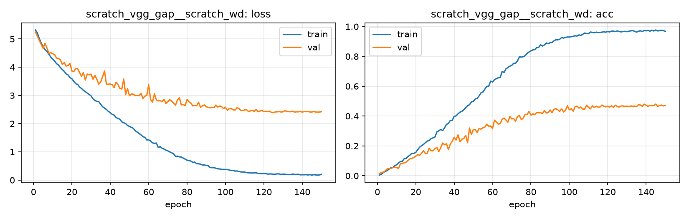

# Run card: `scratch_vgg_gap__scratch_wd`

_Generated by `python -m birdcls.report` from the files in `outputs/runs/scratch_vgg_gap__scratch_wd/`. Do not edit by hand._

## Summary

| Item | Value |
|---|---|
| Model | `scratch_vgg_gap` (2.41 M parameters) |
| Configuration | `scratch_wd`: S4 + weight decay 5e-4 (warm-up + cosine LR, up to 150 epochs, early stopping patience 20) |
| Finished | 2026-10-15 17:35 |
| Training time | 27.8 min, completed all epochs |
| Best epoch (by val accuracy) | 139 at 224 px, val Top-1 0.4803 |
| Input normalisation | mean (0.485, 0.456, 0.406), std (0.229, 0.224, 0.225) |
| Command | `python -m birdcls.train --model scratch_vgg_gap --config scratch_wd` |

## Results (from `outputs/results.csv`)

| Variant | Train acc (clean) | Val Top-1 | Gap (train - val) | **Test Top-1** | **Test avg/class** |
|---|---|---|---|---|---|
| no TTA | 0.9992 | 0.4803 | 0.5189 | 0.4809 | 0.4742 |
| with TTA (flip averaging) | 0.9992 | 0.4803 | 0.5189 | 0.4792 | 0.4716 |

Train acc is measured on the training images with eval preprocessing (no augmentation).

## Configuration

Source: snapshot saved with the run (`config.yaml`).

| Setting | Value |
|---|---|
| `cutmix_prob` | 0.0 |
| `label_smoothing` | 0.0 |
| `weight_decay` | 0.0005 |
| `dropout` | 0.0 |
| `drop_path` | 0.0 |
| `patience` | 20 |
| `optimizer` | sgd |
| `momentum` | 0.9 |
| `lr_schedule` | cosine |
| `augment` | basic |

| Phase | Image size | Batch | Epochs | LR backbone | LR head | Warm-up epochs |
|---|---|---|---|---|---|---|
| 1 | 224 | 32 | 150 | 0.01 | 0.01 | 2 |

## Training curves

## Per-epoch log

| Epoch | Phase | Size | Train loss | Train acc | Val loss | Val acc | LR (backbone, end of epoch) |
|---|---|---|---|---|---|---|---|
| 1 | 1 | 224 | 5.319 | 0.004 | 5.247 | 0.0124 | 5.04e-03 |
| 2 | 1 | 224 | 5.220 | 0.010 | 5.107 | 0.0217 | 1.00e-02 |
| 3 | 1 | 224 | 5.020 | 0.020 | 4.948 | 0.0238 | 1.00e-02 |
| 4 | 1 | 224 | 4.859 | 0.029 | 4.809 | 0.0321 | 1.00e-02 |
| 5 | 1 | 224 | 4.732 | 0.033 | 4.672 | 0.0445 | 9.99e-03 |
| 6 | 1 | 224 | 4.622 | 0.044 | 4.847 | 0.0497 | 9.98e-03 |
| 7 | 1 | 224 | 4.564 | 0.053 | 4.683 | 0.0487 | 9.97e-03 |
| 8 | 1 | 224 | 4.460 | 0.054 | 4.491 | 0.0549 | 9.96e-03 |
| 9 | 1 | 224 | 4.358 | 0.066 | 4.514 | 0.0569 | 9.94e-03 |
| 10 | 1 | 224 | 4.292 | 0.074 | 4.477 | 0.0549 | 9.93e-03 |
| 11 | 1 | 224 | 4.222 | 0.085 | 4.444 | 0.0497 | 9.91e-03 |
| 12 | 1 | 224 | 4.126 | 0.095 | 4.324 | 0.0797 | 9.89e-03 |
| 13 | 1 | 224 | 4.080 | 0.097 | 4.314 | 0.0828 | 9.86e-03 |
| 14 | 1 | 224 | 3.987 | 0.115 | 4.259 | 0.0870 | 9.84e-03 |
| 15 | 1 | 224 | 3.919 | 0.116 | 4.100 | 0.0921 | 9.81e-03 |
| 16 | 1 | 224 | 3.853 | 0.129 | 4.162 | 0.1035 | 9.78e-03 |
| 17 | 1 | 224 | 3.763 | 0.139 | 4.040 | 0.1139 | 9.75e-03 |
| 18 | 1 | 224 | 3.726 | 0.150 | 4.060 | 0.1170 | 9.71e-03 |
| 19 | 1 | 224 | 3.635 | 0.150 | 4.138 | 0.1222 | 9.68e-03 |
| 20 | 1 | 224 | 3.591 | 0.156 | 3.864 | 0.1315 | 9.64e-03 |
| 21 | 1 | 224 | 3.494 | 0.174 | 3.848 | 0.1408 | 9.60e-03 |
| 22 | 1 | 224 | 3.417 | 0.191 | 3.953 | 0.1377 | 9.56e-03 |
| 23 | 1 | 224 | 3.391 | 0.201 | 3.947 | 0.1501 | 9.51e-03 |
| 24 | 1 | 224 | 3.300 | 0.210 | 3.810 | 0.1677 | 9.46e-03 |
| 25 | 1 | 224 | 3.248 | 0.222 | 3.682 | 0.1491 | 9.42e-03 |
| 26 | 1 | 224 | 3.181 | 0.233 | 3.815 | 0.1511 | 9.37e-03 |
| 27 | 1 | 224 | 3.136 | 0.236 | 3.545 | 0.1853 | 9.31e-03 |
| 28 | 1 | 224 | 3.083 | 0.249 | 3.758 | 0.1677 | 9.26e-03 |
| 29 | 1 | 224 | 3.037 | 0.254 | 3.734 | 0.1667 | 9.20e-03 |
| 30 | 1 | 224 | 2.981 | 0.260 | 3.755 | 0.1812 | 9.14e-03 |
| 31 | 1 | 224 | 2.882 | 0.294 | 3.575 | 0.1905 | 9.08e-03 |
| 32 | 1 | 224 | 2.818 | 0.301 | 3.711 | 0.1625 | 9.02e-03 |
| 33 | 1 | 224 | 2.790 | 0.310 | 3.571 | 0.1874 | 8.96e-03 |
| 34 | 1 | 224 | 2.781 | 0.303 | 3.400 | 0.2195 | 8.89e-03 |
| 35 | 1 | 224 | 2.689 | 0.321 | 3.474 | 0.2081 | 8.82e-03 |
| 36 | 1 | 224 | 2.601 | 0.345 | 3.666 | 0.2143 | 8.75e-03 |
| 37 | 1 | 224 | 2.552 | 0.350 | 3.868 | 0.1749 | 8.68e-03 |
| 38 | 1 | 224 | 2.503 | 0.371 | 3.388 | 0.2133 | 8.61e-03 |
| 39 | 1 | 224 | 2.434 | 0.372 | 3.399 | 0.2298 | 8.54e-03 |
| 40 | 1 | 224 | 2.390 | 0.398 | 3.406 | 0.2588 | 8.46e-03 |
| 41 | 1 | 224 | 2.332 | 0.401 | 3.376 | 0.2391 | 8.38e-03 |
| 42 | 1 | 224 | 2.305 | 0.415 | 3.277 | 0.2743 | 8.30e-03 |
| 43 | 1 | 224 | 2.220 | 0.426 | 3.470 | 0.2288 | 8.22e-03 |
| 44 | 1 | 224 | 2.184 | 0.432 | 3.392 | 0.2453 | 8.14e-03 |
| 45 | 1 | 224 | 2.157 | 0.442 | 3.250 | 0.2484 | 8.06e-03 |
| 46 | 1 | 224 | 2.065 | 0.457 | 3.228 | 0.2712 | 7.97e-03 |
| 47 | 1 | 224 | 2.034 | 0.470 | 3.583 | 0.2215 | 7.89e-03 |
| 48 | 1 | 224 | 2.002 | 0.477 | 3.027 | 0.3199 | 7.80e-03 |
| 49 | 1 | 224 | 1.935 | 0.495 | 3.240 | 0.2764 | 7.71e-03 |
| 50 | 1 | 224 | 1.903 | 0.498 | 2.986 | 0.3095 | 7.62e-03 |
| 51 | 1 | 224 | 1.870 | 0.515 | 3.053 | 0.3095 | 7.53e-03 |
| 52 | 1 | 224 | 1.835 | 0.519 | 3.043 | 0.2899 | 7.44e-03 |
| 53 | 1 | 224 | 1.750 | 0.536 | 2.992 | 0.3168 | 7.35e-03 |
| 54 | 1 | 224 | 1.703 | 0.556 | 3.003 | 0.3126 | 7.25e-03 |
| 55 | 1 | 224 | 1.653 | 0.561 | 2.991 | 0.3219 | 7.16e-03 |
| 56 | 1 | 224 | 1.602 | 0.581 | 3.077 | 0.3261 | 7.06e-03 |
| 57 | 1 | 224 | 1.543 | 0.599 | 2.894 | 0.3447 | 6.96e-03 |
| 58 | 1 | 224 | 1.515 | 0.601 | 2.974 | 0.3323 | 6.86e-03 |
| 59 | 1 | 224 | 1.424 | 0.634 | 2.999 | 0.3333 | 6.77e-03 |
| 60 | 1 | 224 | 1.426 | 0.628 | 3.376 | 0.3157 | 6.67e-03 |
| 61 | 1 | 224 | 1.388 | 0.644 | 2.854 | 0.3727 | 6.57e-03 |
| 62 | 1 | 224 | 1.321 | 0.651 | 2.764 | 0.3602 | 6.46e-03 |
| 63 | 1 | 224 | 1.304 | 0.657 | 3.062 | 0.3458 | 6.36e-03 |
| 64 | 1 | 224 | 1.314 | 0.658 | 2.844 | 0.3499 | 6.26e-03 |
| 65 | 1 | 224 | 1.157 | 0.699 | 2.804 | 0.3789 | 6.16e-03 |
| 66 | 1 | 224 | 1.186 | 0.692 | 2.822 | 0.3872 | 6.05e-03 |
| 67 | 1 | 224 | 1.130 | 0.717 | 2.776 | 0.3737 | 5.95e-03 |
| 68 | 1 | 224 | 1.100 | 0.725 | 2.864 | 0.3592 | 5.85e-03 |
| 69 | 1 | 224 | 1.064 | 0.734 | 2.717 | 0.3975 | 5.74e-03 |
| 70 | 1 | 224 | 1.037 | 0.740 | 2.786 | 0.3810 | 5.64e-03 |
| 71 | 1 | 224 | 0.999 | 0.754 | 2.848 | 0.3841 | 5.53e-03 |
| 72 | 1 | 224 | 0.969 | 0.754 | 2.800 | 0.3654 | 5.42e-03 |
| 73 | 1 | 224 | 0.932 | 0.770 | 2.724 | 0.3986 | 5.32e-03 |
| 74 | 1 | 224 | 0.841 | 0.797 | 2.654 | 0.4027 | 5.21e-03 |
| 75 | 1 | 224 | 0.850 | 0.796 | 2.846 | 0.3758 | 5.11e-03 |
| 76 | 1 | 224 | 0.824 | 0.798 | 2.918 | 0.3872 | 5.00e-03 |
| 77 | 1 | 224 | 0.817 | 0.805 | 2.663 | 0.4110 | 4.89e-03 |
| 78 | 1 | 224 | 0.781 | 0.820 | 2.681 | 0.4110 | 4.79e-03 |
| 79 | 1 | 224 | 0.743 | 0.830 | 2.639 | 0.4306 | 4.68e-03 |
| 80 | 1 | 224 | 0.706 | 0.837 | 2.855 | 0.4068 | 4.58e-03 |
| 81 | 1 | 224 | 0.690 | 0.843 | 2.775 | 0.4151 | 4.47e-03 |
| 82 | 1 | 224 | 0.675 | 0.846 | 2.728 | 0.4099 | 4.36e-03 |
| 83 | 1 | 224 | 0.628 | 0.860 | 2.627 | 0.4244 | 4.26e-03 |
| 84 | 1 | 224 | 0.639 | 0.860 | 2.646 | 0.4213 | 4.15e-03 |
| 85 | 1 | 224 | 0.581 | 0.878 | 2.632 | 0.4234 | 4.05e-03 |
| 86 | 1 | 224 | 0.578 | 0.870 | 2.760 | 0.4161 | 3.95e-03 |
| 87 | 1 | 224 | 0.566 | 0.877 | 2.577 | 0.4379 | 3.84e-03 |
| 88 | 1 | 224 | 0.535 | 0.890 | 2.632 | 0.4203 | 3.74e-03 |
| 89 | 1 | 224 | 0.536 | 0.885 | 2.662 | 0.4234 | 3.64e-03 |
| 90 | 1 | 224 | 0.521 | 0.892 | 2.601 | 0.4410 | 3.54e-03 |
| 91 | 1 | 224 | 0.509 | 0.893 | 2.577 | 0.4234 | 3.43e-03 |
| 92 | 1 | 224 | 0.448 | 0.904 | 2.565 | 0.4451 | 3.33e-03 |
| 93 | 1 | 224 | 0.440 | 0.912 | 2.574 | 0.4493 | 3.23e-03 |
| 94 | 1 | 224 | 0.440 | 0.911 | 2.568 | 0.4420 | 3.14e-03 |
| 95 | 1 | 224 | 0.422 | 0.915 | 2.660 | 0.4317 | 3.04e-03 |
| 96 | 1 | 224 | 0.399 | 0.927 | 2.587 | 0.4482 | 2.94e-03 |
| 97 | 1 | 224 | 0.396 | 0.922 | 2.626 | 0.4275 | 2.84e-03 |
| 98 | 1 | 224 | 0.381 | 0.928 | 2.603 | 0.4389 | 2.75e-03 |
| 99 | 1 | 224 | 0.381 | 0.930 | 2.534 | 0.4689 | 2.65e-03 |
| 100 | 1 | 224 | 0.377 | 0.930 | 2.581 | 0.4420 | 2.56e-03 |
| 101 | 1 | 224 | 0.377 | 0.932 | 2.473 | 0.4493 | 2.47e-03 |
| 102 | 1 | 224 | 0.357 | 0.935 | 2.534 | 0.4327 | 2.38e-03 |
| 103 | 1 | 224 | 0.337 | 0.938 | 2.533 | 0.4627 | 2.29e-03 |
| 104 | 1 | 224 | 0.343 | 0.936 | 2.494 | 0.4669 | 2.20e-03 |
| 105 | 1 | 224 | 0.319 | 0.944 | 2.479 | 0.4534 | 2.11e-03 |
| 106 | 1 | 224 | 0.324 | 0.941 | 2.562 | 0.4607 | 2.03e-03 |
| 107 | 1 | 224 | 0.307 | 0.948 | 2.540 | 0.4472 | 1.94e-03 |
| 108 | 1 | 224 | 0.289 | 0.957 | 2.472 | 0.4472 | 1.86e-03 |
| 109 | 1 | 224 | 0.287 | 0.953 | 2.460 | 0.4731 | 1.78e-03 |
| 110 | 1 | 224 | 0.286 | 0.952 | 2.487 | 0.4586 | 1.70e-03 |
| 111 | 1 | 224 | 0.265 | 0.963 | 2.498 | 0.4482 | 1.62e-03 |
| 112 | 1 | 224 | 0.258 | 0.961 | 2.426 | 0.4689 | 1.54e-03 |
| 113 | 1 | 224 | 0.257 | 0.958 | 2.455 | 0.4576 | 1.46e-03 |
| 114 | 1 | 224 | 0.251 | 0.963 | 2.472 | 0.4669 | 1.39e-03 |
| 115 | 1 | 224 | 0.258 | 0.960 | 2.433 | 0.4596 | 1.32e-03 |
| 116 | 1 | 224 | 0.256 | 0.961 | 2.506 | 0.4607 | 1.25e-03 |
| 117 | 1 | 224 | 0.238 | 0.963 | 2.422 | 0.4741 | 1.18e-03 |
| 118 | 1 | 224 | 0.233 | 0.965 | 2.448 | 0.4658 | 1.11e-03 |
| 119 | 1 | 224 | 0.227 | 0.962 | 2.466 | 0.4617 | 1.04e-03 |
| 120 | 1 | 224 | 0.234 | 0.967 | 2.428 | 0.4658 | 9.80e-04 |
| 121 | 1 | 224 | 0.228 | 0.964 | 2.437 | 0.4596 | 9.18e-04 |
| 122 | 1 | 224 | 0.214 | 0.970 | 2.430 | 0.4689 | 8.57e-04 |
| 123 | 1 | 224 | 0.218 | 0.969 | 2.443 | 0.4586 | 7.99e-04 |
| 124 | 1 | 224 | 0.218 | 0.967 | 2.398 | 0.4731 | 7.42e-04 |
| 125 | 1 | 224 | 0.209 | 0.971 | 2.391 | 0.4638 | 6.88e-04 |
| 126 | 1 | 224 | 0.211 | 0.967 | 2.417 | 0.4607 | 6.35e-04 |
| 127 | 1 | 224 | 0.223 | 0.964 | 2.420 | 0.4679 | 5.84e-04 |
| 128 | 1 | 224 | 0.218 | 0.967 | 2.430 | 0.4679 | 5.35e-04 |
| 129 | 1 | 224 | 0.203 | 0.968 | 2.413 | 0.4648 | 4.89e-04 |
| 130 | 1 | 224 | 0.213 | 0.966 | 2.421 | 0.4669 | 4.44e-04 |
| 131 | 1 | 224 | 0.210 | 0.969 | 2.459 | 0.4638 | 4.01e-04 |
| 132 | 1 | 224 | 0.197 | 0.971 | 2.438 | 0.4679 | 3.61e-04 |
| 133 | 1 | 224 | 0.198 | 0.973 | 2.425 | 0.4658 | 3.22e-04 |
| 134 | 1 | 224 | 0.196 | 0.968 | 2.425 | 0.4669 | 2.86e-04 |
| 135 | 1 | 224 | 0.216 | 0.963 | 2.444 | 0.4638 | 2.51e-04 |
| 136 | 1 | 224 | 0.202 | 0.969 | 2.410 | 0.4762 | 2.19e-04 |
| 137 | 1 | 224 | 0.203 | 0.972 | 2.420 | 0.4741 | 1.89e-04 |
| 138 | 1 | 224 | 0.208 | 0.966 | 2.420 | 0.4658 | 1.61e-04 |
| 139 **(best)** | 1 | 224 | 0.187 | 0.975 | 2.434 | 0.4803 | 1.36e-04 |
| 140 | 1 | 224 | 0.190 | 0.971 | 2.408 | 0.4731 | 1.12e-04 |
| 141 | 1 | 224 | 0.189 | 0.975 | 2.432 | 0.4648 | 9.10e-05 |
| 142 | 1 | 224 | 0.194 | 0.969 | 2.426 | 0.4720 | 7.19e-05 |
| 143 | 1 | 224 | 0.181 | 0.976 | 2.430 | 0.4689 | 5.51e-05 |
| 144 | 1 | 224 | 0.194 | 0.970 | 2.415 | 0.4700 | 4.05e-05 |
| 145 | 1 | 224 | 0.176 | 0.977 | 2.413 | 0.4803 | 2.81e-05 |
| 146 | 1 | 224 | 0.192 | 0.971 | 2.429 | 0.4648 | 1.80e-05 |
| 147 | 1 | 224 | 0.184 | 0.972 | 2.414 | 0.4700 | 1.01e-05 |
| 148 | 1 | 224 | 0.178 | 0.976 | 2.408 | 0.4741 | 4.51e-06 |
| 149 | 1 | 224 | 0.185 | 0.973 | 2.412 | 0.4679 | 1.13e-06 |
| 150 | 1 | 224 | 0.200 | 0.968 | 2.423 | 0.4710 | 0.00e+00 |

With CutMix, train loss/acc are computed on mixed images (soft accuracy), so they run lower than the clean train accuracy in the results table.

## Files

`outputs/runs/scratch_vgg_gap__scratch_wd/`: `best.pt` (best checkpoint), `history.json`, `train.log`, `curves.png`, `config.yaml`
